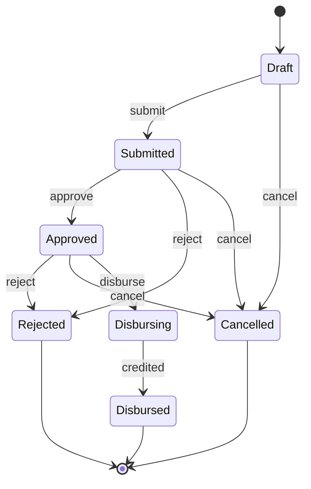

# Correction 3.5 — Exercice 3 : le dossier de prêt

> Rappel de l'énoncé : caractériser `loan`, défauts compris ; dessiner la
> table du prêt et la vérifier avec `Problems` ; refactorer avec un statut,
> une table et une écriture par comparaison-échange, en répondant à la
> panne entre le crédit et l'écriture ; puis refaire passer les tests.

Tout ce qui suit est dans le module de correction, vert sous
`go vet ./...` et `go test -race -count=1 ./...`. Les tests de
caractérisation (`ex3/legacy`) visent le paquet **d'origine**, sans le
modifier ; la nouvelle forme est dans `ex3/lending`.

## En bref

- Cinq défauts épinglés par un test nommé, plus une course trouvée par une
  sonde : un même clic « verser » fait deux fois **crédite deux fois**, et
  le détecteur de courses ne dit rien.
- La table a **sept** statuts, dont un que l'on n'aurait pas écrit sans la
  question de la panne : `Disbursing`, « le crédit est en cours, il a peut-être
  eu lieu ». C'est le `Unknown` du prêt.
- Le crédit porte une **clé** stable (`loan-L1`), et une tâche `Resume`
  reprend les prêts restés en `Disbursing`. La banque ne verse jamais deux
  fois, même après un plantage.
- La campagne a trouvé deux trous dans les tests ; deux tests de plus les
  ferment.

## 1. Caractériser d'abord

Cinq tests, verts sur le code d'origine. Chacun **décrit un défaut**, et son
nom le dit.

```go
// Flaw: Approve only checks Submitted.
func TestFlawARejectedApplicationCanBeApproved(t *testing.T) {
    a := loan.Application{Submitted: true}
    if err := a.Reject(); err != nil {
        t.Fatal(err)
    }
    if err := a.Approve(); err != nil {
        t.Fatalf("got %v: the flaw is to accept", err)
    }
    if !a.Approved || !a.Rejected {
        t.Fatalf("got %+v: the flaw is to be both approved and rejected", a)
    }
}
```

```go
// Flaw: Cancel leaves Approved true, and Disburse only reads Approved.
func TestFlawALoanCancelledAfterApprovalIsPaidOut(t *testing.T) {
    l := &ledger{}
    s := &loan.Service{Ledger: l}
    s.Save(loan.Application{ID: "L1", Amount: 500000, Submitted: true, Approved: true})
    if err := s.Do("L1", (*loan.Application).Cancel); err != nil {
        t.Fatal(err)
    }
    if err := s.Disburse(context.Background(), "L1"); err != nil {
        t.Fatal(err)
    }
    if l.count("L1") != 1 {
        t.Fatalf("credited %d times: the flaw is to pay a cancelled loan once", l.count("L1"))
    }
}
```

C'est le défaut le plus cher : le client a annulé, le dossier garde
`Approved: true`, et `Disburse` ne lit **que** ce champ. Le prêt est versé à
quelqu'un qui n'en veut plus, et qui devra des intérêts dessus.

```go
// Flaw: Disburse never reads Disbursed.
func TestFlawASecondDisbursePaysAgain(t *testing.T) {
    l := &ledger{}
    s := &loan.Service{Ledger: l}
    s.Save(loan.Application{ID: "L1", Amount: 500000, Submitted: true, Approved: true})
    for range 2 {
        if err := s.Disburse(context.Background(), "L1"); err != nil {
            t.Fatal(err)
        }
    }
    if l.count("L1") != 2 {
        t.Fatalf("credited %d times: the flaw is twice", l.count("L1"))
    }
}
```

```go
// Flaw: Pending reads two booleans out of five.
func TestFlawPendingListsCancelledAndRejectedLoans(t *testing.T) {
    s := &loan.Service{Ledger: &ledger{}}
    s.Save(loan.Application{ID: "L1", Submitted: true, Approved: true})
    s.Save(loan.Application{ID: "L2", Submitted: true, Approved: true, Cancelled: true})
    s.Save(loan.Application{ID: "L3", Submitted: true, Approved: true, Rejected: true})
    if got := s.Pending(); !slices.Equal(got, []string{"L1", "L2", "L3"}) {
        t.Fatalf("got %v", got)
    }
}
```

Le rapport de trésorerie surestime les sorties du jour : la trésorerie
prépare de l'argent pour des prêts annulés ou refusés. Le défaut de
`TestFlawACancelledApplicationCanBeApproved` (un dossier annulé que l'on
peut encore accepter) est du même genre que le premier, et n'est pas
recopié ici.

Le sixième défaut est une course, et ne peut pas être un test vert. Une
sonde, derrière une étiquette de compilation, simule deux agents qui
cliquent « verser » en même temps :

```go
// Run with: go test -tags probe -run Probe ./ex3/legacy/
// Two officers click "disburse" at the same time.
func TestProbeTwoDisbursesAtOnce(t *testing.T) {
    l := &slow{}
    s := &loan.Service{Ledger: l}
    s.Save(loan.Application{ID: "L1", Amount: 500000, Submitted: true, Approved: true})
    var wg sync.WaitGroup
    for range 2 {
        wg.Go(func() { _ = s.Disburse(context.Background(), "L1") })
    }
    wg.Wait()
    t.Logf("credited %d times", l.count("L1"))
}
```

```text
    race_probe_test.go:33: credited 2 times
--- PASS: TestProbeTwoDisbursesAtOnce (0.01s)
PASS
ok      example/corrections35/ex3/legacy        1.030s
```

Deux crédits, et `-race` est muet : comme `HandleNaive` dans la leçon, le
service verrouille chaque accès, mais lit, agit, puis écrit. C'est une course
**logique**.

## 2. La table du prêt

Le diagramme, généré par `ex3/cmd/diagram` depuis la table :



Quatre décisions, toutes discutables avec le métier :

- **`Draft`** existe parce que le dossier d'origine pouvait être créé sans
  être soumis (`Submitted: false`). Il s'annule librement.
- **`Approved --reject--> Rejected`** est gardé : le code d'origine le
  permettait (`Reject` ne vérifie que `Submitted`), et une seconde revue
  qui dit non avant le versement est un vrai cas. C'est un comportement
  conservé, pas un oubli.
- **Aucune sortie de `Disbursing`**, sauf `credited`. Une fois le crédit
  lancé, il est trop tard pour annuler : on ne sait pas s'il a eu lieu. C'est
  la réponse à la question 3 de l'énoncé (voir la section 3).
- **Trois fins** : `Disbursed`, `Rejected`, `Cancelled`.

Vérifiée par la fonction de l'exercice 2 :

```go
func TestTheTableHasNoProblem(t *testing.T) {
    var table []check.Transition
    for _, s := range Statuses() {
        for _, e := range Events() {
            if to, err := Next(s, e); err == nil {
                table = append(table, check.Transition{From: s.String(), On: e.String(), To: to.String()})
            }
        }
    }
    if p := check.Problems("Draft", []string{"Disbursed", "Rejected", "Cancelled"}, table); p != nil {
        t.Fatal(p)
    }
}
```

## 3. La nouvelle forme

```go
// transitions is the whole life cycle of an application.
var transitions = map[step]Status{
    {Draft, Submit}:        Submitted,
    {Draft, Cancel}:        Cancelled,
    {Submitted, Approve}:   Approved,
    {Submitted, Reject}:    Rejected,
    {Submitted, Cancel}:    Cancelled,
    {Approved, Reject}:     Rejected, // a second review may still say no
    {Approved, Cancel}:     Cancelled,
    {Approved, Disburse}:   Disbursing,
    {Disbursing, Credited}: Disbursed,
}
```

```go
// Apply moves the application with e. Two calls at the same time are
// decided one after the other.
func (s *Service) Apply(id string, e Event) (Application, error) {
    for {
        a, err := s.Store.Get(id)
        if err != nil {
            return a, err
        }
        to, err := Next(a.Status, e)
        if err != nil {
            return a, err
        }
        err = s.Store.Swap(id, a.Status, to)
        if errors.Is(err, ErrStale) {
            continue
        }
        a.Status = to
        return a, err
    }
}
```

```go
// Disburse pays an approved loan out. The status is written before the
// credit: if the process dies in between, Resume finds the loan in
// Disbursing and credits it again with the same key.
func (s *Service) Disburse(ctx context.Context, id string) error {
    a, err := s.Apply(id, Disburse)
    if err != nil {
        return err
    }
    return s.credit(ctx, a)
}
```

```go
// Resume finishes every loan left in Disbursing. The refund job of the
// lesson, for loans: run it at start and every few minutes.
func (s *Service) Resume(ctx context.Context) error {
    var errs []error
    for _, a := range s.Store.All() {
        if a.Status == Disbursing {
            errs = append(errs, s.credit(ctx, a))
        }
    }
    return errors.Join(errs...)
}
```

```go
func (s *Service) credit(ctx context.Context, a Application) error {
    if err := s.Ledger.Credit(ctx, "loan-"+a.ID, a.ID, a.Amount); err != nil {
        return err
    }
    _, err := s.Apply(a.ID, Credited)
    return err
}
```

**La panne entre le crédit et l'écriture du statut.** Trois moments où le
processus peut mourir, et ce que la nouvelle forme fait de chacun :

| Le processus meurt… | Statut trouvé au redémarrage | Ce que fait `Resume` |
|---|---|---|
| avant `Apply(Disburse)` | `Approved` | rien : le prêt attend un nouveau clic, et figure dans `Pending` |
| entre `Apply(Disburse)` et le crédit | `Disbursing` | crédite avec la clé `loan-L1` : premier crédit |
| entre le crédit et `Apply(Credited)` | `Disbursing` | crédite **avec la même clé** : le grand livre la reconnaît et ne crédite pas une deuxième fois, puis `Credited` |

Les deux dernières lignes sont **indiscernables** pour la banque : c'est
exactement pourquoi `Disbursing` existe, et pourquoi la clé est
indispensable. Sans clé, `Resume` devrait choisir entre risquer un double
versement et risquer de ne jamais verser. C'est le même raisonnement que la
section 8 de la leçon : aucun ordre entre « créditer » et « noter » ne
suffit, il faut que l'autre côté reconnaisse la répétition.

L'interface `Ledger` change donc : `Credit` reçoit une clé. C'est un
changement d'API, à négocier avec l'équipe du système central. Sans lui, il
n'existe pas de version sûre de `Disburse`.

**`Pending`** lit le statut : `Approved` ou `Disbursing`. Un prêt en cours
de versement est encore une sortie d'argent à prévoir pour la trésorerie.

## 4. Les tests, après

Chaque test de caractérisation a son pendant, **renommé** parce que le
comportement a changé exprès :

| Avant (défaut épinglé) | Après | Pourquoi le changement est voulu |
|---|---|---|
| `TestFlawARejectedApplicationCanBeApproved` | `TestARejectedApplicationCannotBeApproved` | un statut final ne bouge plus |
| `TestFlawACancelledApplicationCanBeApproved` | `TestACancelledApplicationCannotBeApproved` | idem |
| `TestFlawALoanCancelledAfterApprovalIsPaidOut` | `TestALoanCancelledAfterApprovalIsNotPaid` | on ne verse pas un prêt annulé |
| `TestFlawASecondDisbursePaysAgain` | `TestASecondDisburseIsRefusedAndPaysOnce` | un prêt ne se verse qu'une fois |
| `TestFlawPendingListsCancelledAndRejectedLoans` | `TestPendingListsOnlyLoansStillToPay` | la trésorerie ne prévoit que les vraies sorties |
| sonde de course | `TestTwoDisbursesAtOnceCreditOnce` | comparaison-échange, avec un test qui force le chevauchement |

Les quatre tests d'origine sont gardés. Un seul change : dans
`TestALoanThatIsNotApprovedIsNotPaid`, l'erreur `ErrNotApproved` devient
`ErrTransition`. Un appelant qui testait `errors.Is(err, loan.ErrNotApproved)`
doit changer : c'est à écrire dans les notes de version.

Le test du chevauchement reprend l'idée de la leçon : chaque `Get` **lit**,
puis attend que l'autre ait lu aussi.

```go
// bothRead lets the first two Gets return only once both have read.
type bothRead struct {
    *Memory
    n   atomic.Int32
    all chan struct{}
}

func (b *bothRead) Get(id string) (Application, error) {
    a, err := b.Memory.Get(id)
    if b.n.Add(1) == 2 {
        close(b.all)
    }
    select {
    case <-b.all:
    case <-time.After(time.Second):
    }
    return a, err
}
```

```go
func TestACrashAfterTheCreditIsResumedWithoutASecondCredit(t *testing.T) {
    s, m, l := newService(Approved)
    l.Crash = true
    ctx := context.Background()
    if err := s.Disburse(ctx, "L1"); !errors.Is(err, errCrash) || status(t, m) != Disbursing {
        t.Fatalf("got %v, %s", err, status(t, m))
    }
    if err := s.Resume(ctx); err != nil {
        t.Fatal(err)
    }
    if l.count("L1") != 1 || status(t, m) != Disbursed {
        t.Fatalf("%d credits, %s", l.count("L1"), status(t, m))
    }
}
```

Les deux paquets, sous `-race` :

```text
--- PASS: TestFlawARejectedApplicationCanBeApproved (0.00s)
--- PASS: TestFlawACancelledApplicationCanBeApproved (0.00s)
--- PASS: TestFlawALoanCancelledAfterApprovalIsPaidOut (0.00s)
--- PASS: TestFlawASecondDisbursePaysAgain (0.00s)
--- PASS: TestFlawPendingListsCancelledAndRejectedLoans (0.00s)
ok      example/corrections35/ex3/legacy        1.019s
--- PASS: TestEveryPairIsAllowedOrRefused (0.00s)
--- PASS: TestTheTableHasNoProblem (0.00s)
--- PASS: TestARejectedApplicationCannotBeApproved (0.00s)
--- PASS: TestACancelledApplicationCannotBeApproved (0.00s)
--- PASS: TestALoanCancelledAfterApprovalIsNotPaid (0.00s)
--- PASS: TestASecondDisburseIsRefusedAndPaysOnce (0.00s)
--- PASS: TestTwoDisbursesAtOnceCreditOnce (0.00s)
--- PASS: TestPendingListsOnlyLoansStillToPay (0.00s)
--- PASS: TestACrashAfterTheCreditIsResumedWithoutASecondCredit (0.00s)
--- PASS: TestAFailedCreditStaysDisbursingUntilResume (0.00s)
--- PASS: TestAnApprovedLoanIsPaidOut (0.00s)
--- PASS: TestALoanThatIsNotApprovedIsNotPaid (0.00s)
--- PASS: TestAPaidLoanCannotBeCancelledOrRejected (0.00s)
--- PASS: TestARefusedEventKeepsTheStatus (0.00s)
--- PASS: TestTwoLoansAreEachCreditedOnce (0.00s)
ok      example/corrections35/ex3/lending       1.022s
```

### La campagne

```text
annulation après accord refusée              tuee
accord après refus                           tuee
versement sans étape intermédiaire           tuee
un refus rend un autre statut                SURVIT
Swap sans comparaison                        tuee
conflit rendu au lieu de redécider           tuee
crédit sans écrire Disbursing                tuee
la même clé pour tous les prêts              SURVIT
Resume cherche au mauvais endroit            tuee
Resume tait les erreurs                      tuee
crédit jamais confirmé                       tuee
Pending oublie les versements en cours       tuee
10/12 tuees
```

Deux erreurs survivent au premier passage :

- **« un refus rend un autre statut »** : `Next` rend la valeur zéro au lieu
  du statut courant quand il refuse. `Apply` ne s'en sert pas, donc rien ne
  casse aujourd'hui. Mais le contrat de `Next` dit « le statut après `e` » :
  le premier appelant qui l'affiche dans un message d'erreur écrirait
  `Status(0)`. Le test de la leçon vérifiait ce cas ; celui-ci l'avait
  oublié.
- **« la même clé pour tous les prêts »** : avec la clé `""`, le premier
  prêt est crédité, et tous les suivants sont **ignorés** par le grand livre,
  qui croit les avoir déjà faits. Aucun test ne versait deux prêts
  différents.

```go
// Added after the campaign: a refusal must not move the application, even
// in the value Next returns.
func TestARefusedEventKeepsTheStatus(t *testing.T) {
    for _, s := range Statuses() {
        for _, e := range Events() {
            if got, err := Next(s, e); err != nil && got != s {
                t.Errorf("%s in %s refused, but Next returned %s", e, s, got)
            }
        }
    }
}
```

```go
// Added after the campaign: each loan has a key of its own.
func TestTwoLoansAreEachCreditedOnce(t *testing.T) {
    m, l := &Memory{}, &ledger{}
    m.Put(Application{ID: "L1", Amount: 500000, Status: Approved})
    m.Put(Application{ID: "L2", Amount: 300000, Status: Approved})
    s := &Service{Store: m, Ledger: l}
    for _, id := range []string{"L1", "L2"} {
        if err := s.Disburse(context.Background(), id); err != nil {
            t.Fatal(err)
        }
    }
    if l.count("L1") != 1 || l.count("L2") != 1 {
        t.Fatalf("credits: L1 %d, L2 %d", l.count("L1"), l.count("L2"))
    }
}
```

Rejouée avec eux :

```text
annulation après accord refusée              tuee
accord après refus                           tuee
versement sans étape intermédiaire           tuee
un refus rend un autre statut                tuee
Swap sans comparaison                        tuee
conflit rendu au lieu de redécider           tuee
crédit sans écrire Disbursing                tuee
la même clé pour tous les prêts              tuee
Resume cherche au mauvais endroit            tuee
Resume tait les erreurs                      tuee
crédit jamais confirmé                       tuee
Pending oublie les versements en cours       tuee
12/12 tuees
```

## Ce qu'il faut retenir

1. Un booléen par décision donne des dossiers « acceptés et annulés » : le
   code lit l'un et oublie l'autre. Un statut ne peut pas mentir ainsi.
2. Quand une action sur le monde extérieur peut avoir eu lieu **ou pas**, il
   faut un statut pour « en cours », une clé pour la répéter, et une tâche
   pour la reprendre.
3. Une clé d'idempotence se teste avec **deux** objets différents : la même
   clé partout passe tous les tests qui n'en ont qu'un.
4. Chaque test de caractérisation qui change est renommé, et chaque erreur
   publique qui change va dans les notes de version.
