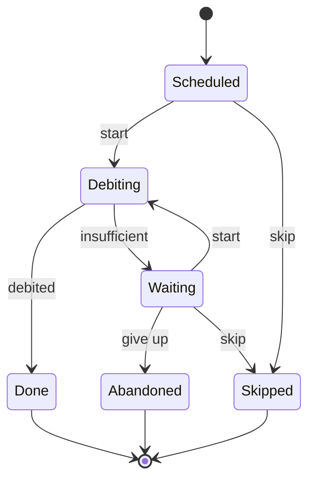

# Correction 3.5 — Exercice 4 : les virements permanents

> Rappel de l'énoncé : concevoir l'exécution des virements permanents
> (statuts, commande et clé), puis dire ce qui se passe avec deux instances
> de la tâche, avec une tâche en panne plusieurs jours, et avec un client
> qui suspend son ordre pendant l'exécution.

La conception ci-dessous est vérifiée par le paquet `ex4/standing` du
module de correction, vert sous `go vet ./...` et
`go test -race -count=1 ./...`. Ce code est une **vérification** de la
conception, pas une implémentation de production : le stockage et le grand
livre sont en mémoire.

## En bref

- **Une exécution**, c'est un ordre **pour un mois**. Sa clé est
  `SO-881/2026-11` : l'ordre et le mois, jamais la date du jour ni un UUID.
- **Six statuts**, dont `Debiting` (« le débit est en cours, il a peut-être
  eu lieu ») et `Waiting` (« pas assez d'argent, on réessaie demain »).
- **Deux protections** contre le double paiement : la création de
  l'exécution est idempotente (`INSERT ... ON CONFLICT DO NOTHING`), et le
  passage en `Debiting` se fait par comparaison-échange. Deux instances de
  la tâche sur 40 000 ordres : aucun doublon, **sans** aucune idempotence
  dans le grand livre.
- **Une clé par tentative** (`SO-881/2026-11#2`), parce qu'un grand livre
  peut se souvenir d'un refus sous sa clé.

## 1. Les statuts d'une exécution

Le diagramme, généré depuis la table par `ex4/cmd/diagram` :



```go
// transitions is the life cycle of one execution. Debiting cannot be
// skipped: once the debit is under way, only the ledger's answer counts.
var transitions = map[step]Status{
    {Scheduled, Start}:       Debiting,
    {Scheduled, Skip}:        Skipped,
    {Debiting, Debited}:      Done,
    {Debiting, Insufficient}: Waiting,
    {Waiting, Start}:         Debiting,
    {Waiting, GiveUp}:        Abandoned,
    {Waiting, Skip}:          Skipped,
}
```

Ce que la table dit, et ce qu'elle ne dit pas :

- **`Debiting` ne se suspend pas.** Une fois le débit lancé, seule la
  réponse du grand livre compte (question 5).
- **`Waiting` mène à `Debiting` ou à `Abandoned`.** Combien de fois ?
  La table ne le dit pas : c'est une **condition** (« si c'est la troisième
  tentative »), que le service vérifie avec le champ `Attempts`. UML
  l'appelle une *garde* sur la transition. Une table qui compterait les
  tentatives aurait trois statuts `Waiting1`, `Waiting2`, `Waiting3`, et
  devrait changer le jour où le métier passe à quatre.
- **Trois fins** : `Done`, `Abandoned` (le client reçoit un SMS),
  `Skipped`.

La table passe la fonction de l'exercice 2 :

```go
func TestTheTableHasNoProblem(t *testing.T) {
    var table []check.Transition
    for _, s := range Statuses() {
        for _, e := range Events() {
            if to, err := Next(s, e); err == nil {
                table = append(table, check.Transition{From: s.String(), On: e.String(), To: to.String()})
            }
        }
    }
    if p := check.Problems("Scheduled", []string{"Done", "Abandoned", "Skipped"}, table); p != nil {
        t.Fatal(p)
    }
}
```

## 2. La commande, et sa clé

```go
// Execution is one order for one month. Its key is the order and the
// month: it is the same whoever computes it, and whenever.
type Execution struct {
    Key      string // "SO-881/2026-11"
    Order    Order
    Due      time.Time
    Status   Status
    Attempts int
    LastTry  time.Time
}
```

```go
// Key names the execution of an order for the month of due.
func Key(orderID string, due time.Time) string {
    return orderID + "/" + due.Format("2006-01")
}
```

La clé est **calculée**, pas tirée au hasard : quiconque la calcule pour le
même ordre et le même mois obtient la même. C'est ce qui permet à deux
instances, ou à une tâche qui redémarre trois jours plus tard, de **tomber
sur la même ligne**. Un UUID tiré au moment de l'exécution en donnerait un
nouveau à chaque fois : deux instances créeraient deux exécutions, et
chacune paierait.

Pourquoi le **mois** et pas la date ? Le 25 peut tomber un dimanche et la
banque exécuter le lundi 26 ; une tâche en panne peut exécuter le 27.
L'ordre dit « une fois par mois », et c'est ce que la clé doit dire.

Et la clé envoyée au grand livre ? Elle ajoute **le numéro de la
tentative** :

```go
func (r *Runner) try(ctx context.Context, e Execution, day time.Time) error {
    if day.Sub(e.Due) > time.Duration(r.Window)*24*time.Hour {
        return r.move(e.Key, e.Status, Skip, nil) // too late: the customer may have paid by hand
    }
    attempt := e.Attempts + 1
    err := r.move(e.Key, e.Status, Start, func(x *Execution) { x.Attempts, x.LastTry = attempt, day })
    if errors.Is(err, ErrStale) || errors.Is(err, ErrTransition) {
        return nil // another runner has it
    }
    if err != nil {
        return err
    }
    // One key per attempt: a ledger may remember a refusal under its key.
    err = r.Ledger.Transfer(ctx, fmt.Sprintf("%s#%d", e.Key, attempt), e.Order.From, e.Order.To, e.Order.Amount)
    switch {
    case err == nil:
        return r.move(e.Key, Debiting, Debited, nil)
    case errors.Is(err, ErrInsufficient):
        if err := r.move(e.Key, Debiting, Insufficient, nil); err != nil {
            return err
        }
        if attempt >= r.MaxAttempts {
            return r.move(e.Key, Waiting, GiveUp, nil) // and an SMS to the customer
        }
        return nil
    default:
        return err // stays Debiting: the next run must not start it again blindly
    }
}
```

Certaines API de paiement gardent la **réponse** donnée à une clé, refus
compris. Stripe le dit pour sa première version : « *Stripe saves the status
code and body of the first request made with a given idempotency key* ». Si
la tentative du 26 reprenait la clé du 25, elle recevrait le refus du 25,
même avec un compte approvisionné entre-temps. La garantie « un mois, un
paiement » ne vient donc pas de la clé du grand livre : elle vient du statut,
`Done` étant final. La clé de tentative ne protège que d'une chose, la
répétition d'**une même** tentative après un plantage.

Le faux grand livre des tests a la même mémoire, et la campagne le vérifie :
« une seule clé pour toutes les tentatives » n'est vue que par
`TestMoneyThatArrivesTheNextDayIsPaid`.

## 3. Deux instances le même jour

```go
// Create adds e unless its key exists. In SQL: INSERT ... ON CONFLICT
// (key) DO NOTHING.
func (s *Store) Create(e Execution) {
    s.mu.Lock()
    defer s.mu.Unlock()
    if _, ok := s.execs[e.Key]; !ok {
        s.execs[e.Key] = e
    }
}
```

```go
// RunDay creates the executions due on or before day, then tries those
// that wait for a debit.
func (r *Runner) RunDay(ctx context.Context, day time.Time, orders []Order) error {
    for _, o := range orders {
        due := lastDue(o.Day, day)
        r.Store.Create(Execution{Key: Key(o.ID, due), Order: o, Due: due, Status: Scheduled})
    }
    var errs []error
    for _, e := range r.Store.All() {
        if (e.Status == Scheduled || e.Status == Waiting) && e.LastTry.Before(day) {
            errs = append(errs, r.try(ctx, e, day))
        }
    }
    return errors.Join(errs...)
}
```

Le déroulé, pour un ordre, avec deux instances A et B :

1. A et B calculent la même clé, et appellent `Create`. La première crée la
   ligne en `Scheduled` ; la seconde ne fait rien.
2. A et B lisent toutes deux `Scheduled`, et essaient de passer en
   `Debiting` par `Swap`. Une seule y arrive. L'autre reçoit `ErrStale` et
   passe à l'ordre suivant.
3. Seule celle qui a gagné débite.

La mesure, sur 40 000 ordres, avec un grand livre **sans** idempotence pour
que les statuts soient seuls à protéger (`ex4/cmd/standing`, sous `-race`) :

```text
two runners on 25 November:        paid once 40000, paid more than once 0
```

Le test `TestTwoRunnersOnTheSameDayPayEachOrderOnce` fait la même chose sur
200 ordres. La campagne vérifie qu'il dépend bien des deux protections :
« création qui écrase » et « Swap sans comparaison » sont toutes deux vues.

## 4. Une tâche en panne

La règle choisie : un mois manqué est encore payé **pendant cinq jours**
après sa date. Au-delà, il passe en `Skipped`, et le client reçoit un SMS.
Pourquoi ne pas payer quand même ? Parce qu'au bout de deux semaines, le
client a probablement payé sa mère **à la main**. Payer en retard, c'est
risquer un double paiement que la banque n'a aucun moyen de détecter.

```text
down 25-26, runs on 27 and 28:     paid once 40000, paid more than once 0
down until 10 December:            paid once 0, paid more than once 0 - skipped 40000
```

- **Redémarrage le 27** : `lastDue` donne le 25 novembre, dans la fenêtre.
  Chaque ordre est payé une fois ; le passage du 28 trouve tout en `Done`.
- **Redémarrage le 10 décembre** : le dernier 25 est encore le 25 novembre,
  hors fenêtre. 40 000 mois sautés, et autant de SMS. Le mois de décembre
  sera payé normalement le 25.

Ce choix est **métier** : cinq jours, c'est une valeur à faire valider. Ce
qui n'est pas négociable, c'est qu'elle soit écrite quelque part, et testée
(`TestARunTwoDaysLatePaysOnce`, `TestARunAfterTheWindowSkipsTheMonth`).

## 5. Une suspension pendant l'exécution

```go
// Suspend skips the executions of the order that have not started. An
// execution in Debiting is not touched: the answer to the customer is that
// this month is already under way.
func (r *Runner) Suspend(orderID string) (underWay bool, err error) {
    for _, e := range r.Store.All() {
        if e.Order.ID != orderID || e.Status == Done || e.Status == Abandoned || e.Status == Skipped {
            continue
        }
        if err := r.move(e.Key, e.Status, Skip, nil); errors.Is(err, ErrTransition) {
            underWay = true
        } else if err != nil {
            return underWay, err
        }
    }
    return underWay, nil
}
```

Deux cas, et la table décide :

- l'exécution est en `Scheduled` ou en `Waiting` : elle passe en `Skipped`,
  rien n'est débité ;
- elle est en `Debiting` : `skip` est refusé. Le débit va au bout, et la
  réponse au client le dit honnêtement : « *Votre virement permanent est
  suspendu. Le virement de novembre était déjà en cours et sera exécuté.* »

Ce que la conception **garantit** : il n'existe pas d'état intermédiaire. Le
mois est payé, ou il ne l'est pas, et le client en est informé dans les deux
cas. Ce qu'elle ne garantit pas : que la suspension soit prise en compte pour
le mois en cours, si elle arrive 300 ms trop tard. Le test le vérifie avec un
grand livre retenu exprès pendant le débit :

```go
func TestASuspensionDuringTheDebitLeavesTheMonthToFinish(t *testing.T) {
    l := newLedger(1, 1_000_000)
    l.Hold = make(chan struct{})
    r := runner(l)
    done := make(chan error)
    go func() { done <- r.RunDay(context.Background(), date(time.November, 25), orders(1)) }()
    for e, _ := find(r, "SO-0/2026-11"); e.Status != Debiting; e, _ = find(r, "SO-0/2026-11") {
        time.Sleep(time.Millisecond)
    }
    underWay, err := r.Suspend("SO-0")
    if err != nil || !underWay {
        t.Fatalf("got %v, %v; want under way", underWay, err)
    }
    close(l.Hold)
    if err := <-done; err != nil {
        t.Fatal(err)
    }
    if status(t, r, "SO-0/2026-11").Status != Done || l.count("M0") != 1 {
        t.Fatal("the month under way must finish")
    }
}
```

La suspension de l'**ordre** lui-même (ne plus créer d'exécution les mois
suivants) est un champ de l'ordre, lu par celui qui appelle `RunDay` : ce
n'est pas un statut de l'exécution.

## 6. La campagne

```text
création qui écrase                          tuee
Swap sans comparaison                        tuee
clé tirée du jour d'exécution                tuee
fenêtre ignorée                              tuee
une seule clé pour toutes les tentatives     tuee
une tentative de trop                        tuee
deux tentatives le même jour                 tuee
conflit remonté comme une erreur             tuee
suspension pendant le débit                  tuee
jamais d'abandon                             tuee
10/10 tuees
```

Dix erreurs, toutes vues. Une précision d'honnêteté : au premier passage,
« une seule clé pour toutes les tentatives » ne compilait pas (le paquet
`fmt` devenait inutilisé) ; elle a été réécrite avec `fmt.Sprint(e.Key)`,
puis rejouée.

## Ce que cette vérification ne couvre pas

- **Un débit resté en `Debiting`** après une erreur du grand livre (ni
  succès, ni refus). `RunDay` ne le reprend pas : il faut une tâche de
  reprise, comme `Resume` à l'exercice 3, qui rejoue **la même tentative**
  avec **la même clé**.
- **Le jour 29, 30 ou 31.** Les ordres sont limités au 1–28. Un ordre « le
  31 » demande une règle métier (le dernier jour du mois ?), et `lastDue`
  devra changer.
- **Le SMS** d'abandon et de mois sauté : c'est une réaction à un événement
  `ExecutionAbandoned`, au sens de la leçon 3.4.

## Ce qu'il faut retenir

1. La clé d'une opération récurrente, c'est **ce qui ne doit arriver qu'une
   fois** : ici, un ordre et un mois.
2. Deux protections valent mieux qu'une : une création idempotente, et une
   transition par comparaison-échange.
3. Un nombre de tentatives est une **garde** sur une transition, pas un
   statut par tentative.
4. Une règle de retard (« cinq jours ») est une décision métier : on
   l'écrit, on la teste, et l'on prévient le client quand elle s'applique.
