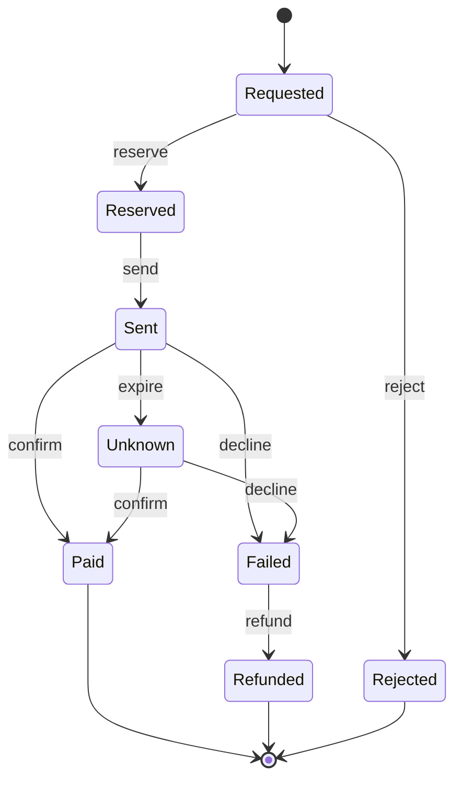

# Leçon 3.5 — Représenter des états et des étapes : machine à états, commande, pipeline

## L'essentiel en deux minutes

**Le problème, en une phrase.** Une opération qui prend du temps passe par
plusieurs étapes, et entre deux étapes tout peut arriver : une réponse qui
arrive deux fois, une réponse qui arrive trop tard, un processus qui meurt.
Si l'on note où en est l'opération avec quelques booléens et des fonctions
gardées en mémoire, le programme finit par atteindre des situations que
personne n'a prévues : un paiement **envoyé et remboursé**.

**Trois images.**

- **Le suivi d'un colis** : « commandé, expédié, en livraison, livré ». Le
  colis est dans **un** statut à la fois, et certaines étapes sont
  impossibles : un colis livré ne revient pas « en entrepôt ». C'est une
  **machine à états**.
- **Le bon de commande écrit**, contre la commande passée de vive voix. Le
  bon porte un numéro : on peut le ranger, le relire, le montrer au
  fournisseur, et s'il est présenté deux fois, le fournisseur voit qu'il l'a
  déjà livré. C'est une **commande** (*command*).
- **La station de lavage automatique** : prélavage, brosses, rinçage,
  séchage. Pendant qu'une voiture sèche, la suivante est rincée. Le débit de
  la station, c'est celui du poste le plus lent. C'est un **pipeline**.

**Le code, en vingt lignes.** Toute la vie d'un paiement tient dans une
table ; ce qui n'y est pas est refusé.

```go
// transitions is the whole life cycle. A pair that is not here is refused.
var transitions = map[step]Status{
    {Requested, Reserve}: Reserved,
    {Requested, Reject}:  Rejected,
    {Reserved, Send}:     Sent,
    {Sent, Confirm}:      Paid,
    {Sent, Decline}:      Failed,
    {Sent, Expire}:       Unknown,
    {Unknown, Confirm}:   Paid,
    {Unknown, Decline}:   Failed,
    {Failed, Refund}:     Refunded,
}
```

```go
// Next returns the status after e. It decides, and does nothing else.
func Next(s Status, e Event) (Status, error) {
    to, ok := transitions[step{s, e}]
    if !ok {
        return s, fmt.Errorf("%w: %s in %s", ErrTransition, e, s)
    }
    return to, nil
}
```

**Les règles à retenir.**

1. **Un statut, pas des booléens.** Un type qui ne prend que les valeurs
   prévues, et une table qui dit quels événements sont permis dans chaque
   statut. Tout le reste est refusé.
2. **La machine décide, le service agit.** `Next` ne fait rien d'autre que
   décider. Le service écrit le nouveau statut, **puis** fait ce qu'il
   demande (rendre l'argent).
3. **Deux événements peuvent arriver en même temps.** On écrit le statut par
   comparaison-échange (« passe à `Failed` **si** tu es encore `Sent` »),
   jamais par « lire, agir, écrire ».
4. **Ce qui doit survivre au processus est une commande** : une valeur, avec
   une clé, qu'on enregistre et qu'on peut rejouer sans payer deux fois. Une
   fonction gardée en mémoire meurt avec le processus.
5. **Un pipeline va à la vitesse de son étape la plus lente**, et chaque
   étape doit savoir s'arrêter quand une autre échoue. Sinon, ses goroutines
   restent bloquées pour toujours.

La suite mesure tout cela sur un vrai module.

---

La leçon 3.4 prévenait les autres qu'une chose **était arrivée**. Celle-ci
s'occupe de ce qui arrive **dans la durée** : une opération qui n'est pas
finie quand la fonction rend la main. Le problème qui revient est

> **Une opération passe par plusieurs étapes, attend des réponses qui
> peuvent arriver en double, en retard ou jamais, et doit survivre à un
> redémarrage. Comment savoir à tout moment où elle en est, ce qui est
> permis ensuite, et quoi refaire après une panne ?**

La banque envoie de l'argent depuis un compte vers un portefeuille Mobile
Money. Elle ne fait pas le paiement elle-même : elle bloque l'argent sur le
compte, envoie l'ordre à un **opérateur**, et attend sa réponse, qui arrive
plus tard par un appel de l'opérateur (un *callback*). Trois questions vont
structurer la leçon :

1. **Où en est ce paiement ?** C'est la machine à états (sections 1 à 6).
2. **Comment refaire un lot de paiements après un plantage, sans payer deux
   fois ?** C'est la commande (sections 7 à 9).
3. **Comment enchaîner les étapes d'un fichier de salaires, vite, et
   s'arrêter proprement ?** C'est le pipeline (sections 10 et 11).

Tout ce qui suit est mesuré sur un module vert sous `gofmt -l`,
`go vet ./...` et `go test -race -count=1 ./...`.

## 1. Le premier modèle : un booléen par événement

La première version note chaque chose qui est arrivée :

```go
// Payout says what happened so far.
type Payout struct {
    Reserved  bool
    Sent      bool
    Confirmed bool
    Failed    bool // the operator said no, or did not answer in time
    Refunded  bool
}
```

```go
func (p *Payout) Fail() error {
    if !p.Sent {
        return ErrNotSent
    }
    p.Failed = true
    return nil
}
```

Chaque méthode vérifie **sa** condition : on ne confirme qu'un paiement
envoyé, on ne rembourse qu'un paiement échoué. Les quatre tests passent.
Chacun vérifie une méthode, aucun ne regarde deux méthodes appelées dans un
ordre inattendu.

### Mesure : ce que les booléens permettent

Le programme `cmd/explore` part d'un paiement neuf, appelle chaque méthode
dans chaque ordre, et note toutes les combinaisons atteintes :

```text
booleans: 2^5 = 32 combinations, 8 reachable, 2 meaningless:
    Reserved+Sent+Confirmed+Failed
    Reserved+Sent+Confirmed+Failed+Refunded
    accepted twice in a row: Send Confirm Fail Refund
```

Cinq booléens font 32 combinaisons. Huit sont atteignables par des appels
**acceptés**, et deux n'ont aucun sens :

- `Confirmed+Failed+Refunded` : l'opérateur a **payé** le portefeuille, et
  la banque a **rendu** l'argent au client. La banque a perdu le montant.
- `Confirmed+Failed` : le même, en route.

Comment y arrive-t-on ? Par un scénario banal. L'opérateur est lent ; au
bout de 30 secondes sans réponse, une tâche appelle `Fail`, puis `Refund`.
Une minute plus tard, la réponse arrive enfin : « payé ». `Confirm` vérifie
que le paiement a été envoyé : c'est vrai, il accepte.

La dernière ligne en dit autant : `Send` est accepté sur un paiement **déjà
envoyé**. Chaque appel accepté, c'est un ordre de plus chez l'opérateur.

Deux causes, qu'on retrouvera partout :

1. **Les booléens racontent l'histoire, pas la situation.** « Il a été
   envoyé » reste vrai pour toujours ; la question utile, « où en est-il
   maintenant ? », n'a pas de réponse dans le type.
2. **`Fail` confond deux faits différents** : l'opérateur a dit non, et
   l'opérateur n'a rien dit. Le premier est un échec. Le second est une
   **ignorance** : on ne sait pas.

## 2. Un statut, et une table

La deuxième forme dit **où en est** le paiement, avec une seule valeur :

```go
// Status is where a payout stands. The zero value is not a status: a
// payout that was never created cannot move.
type Status int

const (
    Requested Status = iota + 1 // the customer asked
    Reserved                    // the money is held on the account
    Sent                        // the operator has the order
    Unknown                     // the operator did not answer in time
    Paid                        // the operator confirmed: final
    Failed                      // the operator said no: the money must go back
    Refunded                    // the money is back on the account: final
    Rejected                    // the account could not cover it: final
)
```

La valeur zéro n'est pas un statut (`iota + 1`) : un paiement jamais créé ne
peut pas bouger. C'est la règle de la leçon 3.2 sur les valeurs zéro.

`Unknown` est la réponse à la deuxième cause : un délai dépassé n'est pas un
refus. Le paiement attend qu'on **demande** à l'opérateur ce qu'il en est,
et seule sa réponse (`confirm` ou `decline`) le fait sortir de là. Le
remboursement n'est permis que depuis `Failed`, et on n'entre dans `Failed`
que par un refus explicite.

La table et `Next` sont celles de l'encadré du début. `Next` ne fait **rien
d'autre** que décider : pas d'appel réseau, pas d'écriture. C'est une
fonction pure, et c'est ce qui la rend testable en entier.

### Le diagramme, généré depuis la table

La fonction `Mermaid` parcourt la table et écrit un diagramme d'états ;
`cmd/diagram` l'affiche. Le voici tel quel, que GitHub dessine :



Un diagramme dessiné à la main finit toujours par mentir : quelqu'un ajoute
une transition dans le code et oublie le dessin. Celui-ci est **produit par
le code**, et un test vérifie qu'il contient chaque transition. Le niveau 4
reviendra sur ce diagramme : c'est le **diagramme d'états-transitions** de
UML, ici réduit à l'essentiel.

Lis-le comme un client le vivrait : de `Sent`, trois sorties ; d'`Unknown`,
deux, et **aucune** vers `Refunded` ; trois fins (`[*]`), et aucune flèche
qui en reparte.

La mesure, sur la table :

```text
statuses: 8 statuses, 56 pairs (status, event), 9 allowed, 47 refused
```

8 statuts et 7 événements font 56 couples. 9 sont permis, les 47 autres sont
refusés **par construction** : il n'y a rien à vérifier méthode par méthode.

## 3. Tester une machine : tous les couples, et trois propriétés

Une machine à états a un avantage rare : on peut tester **tous** ses cas.

```go
func TestEveryPairIsAllowedOrRefused(t *testing.T) {
    allowed := 0
    for _, s := range Statuses() {
        for _, e := range Events() {
            got, err := Next(s, e)
            to, ok := want[step{s, e}]
            switch {
            case ok && (err != nil || got != to):
                t.Errorf("%s on %s: got %s, %v; want %s", e, s, got, err, to)
            case !ok && !errors.Is(err, ErrTransition):
                t.Errorf("%s on %s: got %s, %v; want ErrTransition", e, s, got, err)
            case !ok && got != s:
                t.Errorf("%s on %s: a refused event moved the payout to %s", e, s, got)
            case ok:
                allowed++
            }
        }
    }
    if allowed != len(want) {
        t.Errorf("%d transitions allowed, want %d", allowed, len(want))
    }
}
```

Le test recopie la table (la variable `want`). C'est voulu : `want` est la
règle **écrite par le métier**, et `transitions` est le code. Changer une
transition demande de changer les deux, et la revue de code voit les deux
lignes. Pour une machine qui déplace de l'argent, cette répétition est le
prix d'un changement **conscient**.

Trois propriétés complètent, sans rien recopier :

- **les fins n'ont pas de sortie** : seuls `Paid`, `Refunded` et `Rejected`
  sont finals (`TestOnlyPaidRefundedAndRejectedAreFinal`) ;
- **tout statut est atteignable** depuis `Requested`
  (`TestEveryStatusIsReachable`) : un statut inatteignable est du code mort ;
- **tout statut peut finir** (`TestEveryStatusCanEnd`) : un statut sans
  chemin vers une fin, c'est un paiement **coincé pour toujours**.

## 4. La machine décide, le service agit

Le service reçoit les événements : les *callbacks* de l'opérateur, la tâche
qui fait expirer les paiements trop longs, celle qui rembourse.

```go
// Statuses keeps the status of each payout; store.Memory is one.
type Statuses interface {
    Get(id string) (payout.Status, error)
    Put(id string, st payout.Status)
    // Swap writes to only if the status is still from, or returns
    // store.ErrStale.
    Swap(id string, from, to payout.Status) error
}
```

```go
// Handle applies e to the payout, then does what its new status requires.
func (s *Service) Handle(ctx context.Context, id string, e payout.Event) error {
    for {
        from, err := s.Store.Get(id)
        if err != nil {
            return err
        }
        to, err := payout.Next(from, e)
        if err != nil {
            return err
        }
        err = s.Store.Swap(id, from, to)
        if errors.Is(err, store.ErrStale) {
            continue // someone moved it first: decide again
        }
        if err != nil {
            return err
        }
        return s.enter(ctx, id, to)
    }
}
```

```go
// enter runs the action of a status, once the status is written. If it
// fails, the payout stays in that status, where the refund job finds it.
func (s *Service) enter(ctx context.Context, id string, st payout.Status) error {
    if st != payout.Failed {
        return nil
    }
    if err := s.Funds.Release(ctx, id); err != nil {
        return err
    }
    return s.Handle(ctx, id, payout.Refund)
}
```

Deux choix comptent :

- **Le statut est écrit avant l'action.** Si `Release` échoue, ou si le
  processus meurt juste après l'écriture, le paiement reste en `Failed`. La
  tâche de remboursement n'a qu'à chercher les paiements en `Failed` depuis
  plus de cinq minutes : le statut **dit le travail qui reste**. Avec des
  booléens, il faudrait chercher « `Failed` et pas `Refunded` et pas
  `Confirmed` », et espérer n'avoir oublié aucune combinaison.
- **Le statut est écrit par comparaison-échange** (`Swap`). C'est le sujet
  de la section suivante.

## 5. Deux livraisons en même temps

Un opérateur qui n'est pas sûr que la banque a reçu son *callback* le
renvoie. C'est la règle de toute livraison « au moins une fois » ; Chris
Richardson en donne la conséquence : « *the consumer can be invoked
repeatedly for the same message* » — le même message peut arriver plusieurs
fois. Et rien ne garantit que les deux copies n'arrivent pas **en même
temps**, sur deux instances du service.

La première version du service :

```go
// HandleNaive is the first version: check, act, then write.
func (s *Service) HandleNaive(ctx context.Context, id string, e payout.Event) error {
    from, err := s.Store.Get(id)
    if err != nil {
        return err
    }
    to, err := payout.Next(from, e)
    if err != nil {
        return err
    }
    if to == payout.Failed {
        if err := s.Funds.Release(ctx, id); err != nil {
            return err
        }
        to = payout.Refunded
    }
    s.Store.Put(id, to)
    return nil
}
```

Elle **lit** le statut, **agit**, puis **écrit**. Le programme `cmd/double`
met 500 paiements en `Sent` et livre chaque refus deux fois, en même temps.
Rendre l'argent prend une milliseconde, comme un appel au système central :

```text
500 payouts in Sent, each decline delivered twice at once
check, act, write:       1000 declines, 1000 refunds, 500 payouts refunded twice, 0 declines refused
compare and swap:        1000 declines, 500 refunds, 0 payouts refunded twice, 500 declines refused
```

Avec « lire, agir, écrire », **chaque** paiement est remboursé deux fois :
les deux livraisons lisent `Sent`, toutes deux trouvent le refus permis,
toutes deux rendent l'argent. La table n'y peut rien : elle a été consultée
deux fois, sur la même photo.

Et le détecteur de courses ne voit rien :

```text
500 payouts in Sent, each decline delivered twice at once
check, act, write:       1000 declines, 1000 refunds, 500 payouts refunded twice, 0 declines refused
compare and swap:        1000 declines, 500 refunds, 0 payouts refunded twice, 500 declines refused
exit status 0
```

Il n'y a pas de course **de données** : le stockage est protégé par un
verrou, chaque accès est sérialisé. Le modèle mémoire de Go la définit
précisément : « *A data race is defined as a write to a memory location
happening concurrently with another read or write to that same location* ».
Ici, c'est une course **logique** : deux décisions prises sur la même
lecture. `-race` ne cherche pas ce genre de bogue.

La réponse est de rendre l'écriture **conditionnelle** :

```go
// Swap writes to only if the status is still from. In SQL:
//
//    UPDATE payouts SET status = $to WHERE id = $id AND status = $from
//
// and ErrStale when no row was updated.
func (s *Memory) Swap(id string, from, to payout.Status) error {
    s.mu.Lock()
    defer s.mu.Unlock()
    st, ok := s.m[id]
    if !ok {
        return ErrNotFound
    }
    if st != from {
        return ErrStale
    }
    s.m[id] = to
    return nil
}
```

C'est une seule requête en base. PostgreSQL rend le nombre de lignes
modifiées (« *an UPDATE command returns a command tag of the form UPDATE
count* ») : 0 veut dire que quelqu'un est passé avant. `Handle` relit alors
le statut et **décide à nouveau** : la deuxième livraison trouve `Refunded`,
la table refuse `decline`, et l'argent n'est rendu qu'une fois. La deuxième
ligne de la mesure le confirme : 500 remboursements, 500 refus.

### Le test qui provoque le pire cas

Le pire cas, c'est que les deux livraisons **lisent** le statut avant que
l'une ou l'autre ne l'écrive. Un test qui lance deux goroutines « en même
temps » ne le garantit pas : la plupart du temps, la deuxième arrive après
l'écriture de la première, et le test passe pour de mauvaises raisons. La
campagne de la section 12 l'a montré. Ce faux stockage rend le pire cas
certain :

```go
// The operator delivers its callbacks at least once: the same decline can
// arrive twice, at the same time. bothRead makes the worst case certain:
// each delivery reads the status before either writes it.
type bothRead struct {
    *store.Memory
    r *rendezvous
}

func (b bothRead) Get(id string) (payout.Status, error) {
    st, err := b.Memory.Get(id)
    b.r.wait() // read first, then wait: both have read before either writes
    return st, err
}
```

```go
func TestTwoDeliveriesThatReadTheSameStatusRefundOnce(t *testing.T) {
    f := &fake.Funds{}
    s := &Service{Store: bothRead{store.NewMemory(), newRendezvous(2)}, Funds: f}
    s.Store.Put("p1", payout.Sent)
    errs := make([]error, 2)
    var wg sync.WaitGroup
    for i := range errs {
        wg.Go(func() { errs[i] = s.Handle(context.Background(), "p1", payout.Decline) })
    }
    wg.Wait()
    if n := f.Released("p1"); n != 1 {
        t.Fatalf("money released %d times, want 1", n)
    }
    if err := errors.Join(errs...); !errors.Is(err, payout.ErrTransition) || errors.Is(err, store.ErrStale) {
        t.Fatalf("got %v: the loser must decide again and be refused, not report a conflict", err)
    }
}
```

`rendezvous` retient les deux premiers appelants jusqu'à ce qu'ils soient
tous les deux arrivés. L'ordre compte : **lire, puis attendre**. Attendre
puis lire ne garantit rien, et c'est exactement l'erreur que la campagne a
trouvée.

## 6. Le pattern État du *Gang of Four*, et pourquoi la table suffit souvent

Le livre *Design Patterns* propose une autre forme : un type **par
statut**, chacun avec ses méthodes, et l'objet délègue au statut courant.

```text
type state interface {
    Confirm(p *Payout) (state, error)
    Decline(p *Payout) (state, error)
    Expire(p *Payout) (state, error)
    // one method per event
}

type sent struct{}

func (sent) Confirm(p *Payout) (state, error) { return paid{}, nil }
func (sent) Expire(p *Payout) (state, error)  { return unknown{}, nil }
// ... and 55 other methods, most of them "not allowed"
```

Elle vaut la peine quand **le comportement** change beaucoup d'un statut à
l'autre : chaque statut a alors son propre code, et un `switch` géant
deviendrait illisible. Ici, chaque événement ne fait qu'une chose : choisir
le statut suivant. La table le dit en neuf lignes, se dessine et se teste
en entier. Huit types et 56 méthodes, dont 47 qui renvoient une erreur, le
diraient en deux cents lignes.

La règle : **commence par une table**. Passe à un type par statut le jour où
le code propre à chaque statut ne tient plus dans le service.

## 7. Commande : l'opération devient une valeur

Une entreprise envoie son fichier de salaires : 200 lignes, un paiement par
ligne. La première version range le travail dans une file de **fonctions**,
en mémoire :

```text
var queue []func(context.Context) error
for _, l := range lines {
    queue = append(queue, func(ctx context.Context) error { return op.Pay(ctx, "", l.To, l.Amount) })
}
for _, job := range queue {
    if err := job(ctx); err != nil {
        break
    }
}
```

C'est une commande, au sens large : un travail emballé pour plus tard. Mais
une fonction n'a que deux propriétés : on peut l'appeler, et c'est tout.
On ne peut ni l'enregistrer, ni l'afficher, ni la comparer à une autre.

La deuxième version fait de chaque paiement une **valeur** :

```go
// Pay is one payment, as a value. It can be stored, shown, compared and
// run again: this is what a closure cannot do.
type Pay struct {
    Key    string // file and line: the same line always has the same key
    To     string // wallet number
    Amount int64  // FCFA
}
```

```go
func (p Pay) String() string {
    return fmt.Sprintf("pay %d FCFA to %s (key %s)", p.Amount, p.To, p.Key)
}
```

La clé ne doit rien au hasard : c'est le fichier et la ligne. La même ligne
a **toujours** la même clé, même lue par un autre processus, le lendemain.
Le journal retient les clés faites, et celui qui exécute saute ce qui est
déjà fait :

```go
// Run stops at the first error. Running it again with the same commands
// goes on where it stopped.
func (r *Runner) Run(ctx context.Context, cmds []Pay) error {
    for _, c := range cmds {
        if r.Journal.Done(c.Key) {
            continue
        }
        if err := r.Operator.Pay(ctx, c.Key, c.To, c.Amount); err != nil {
            return fmt.Errorf("%v: %w", c, err)
        }
        r.Journal.MarkDone(c.Key)
    }
    return nil
}
```

## 8. Mesure : le lot qui plante à la ligne 120

`cmd/batch` lance le fichier de 200 lignes. Le processus meurt juste
**après** que l'opérateur a fait le 120ᵉ paiement, avant de l'avoir noté,
puis il redémarre et relance le fichier :

```text
200 lines, the process dies right after payment 120, then starts again
    what the queue holds: 0x4a9160 0x4a9160
closures:                          paid once 80, paid twice 120
commands, journal:                 paid once 199, paid twice 1
    first run stopped on: pay 150000 FCFA to +237690000120 (key B42-120): process killed
    what the journal can show: pay 150000 FCFA to +237690000001 (key B42-001)
commands, journal, key to operator: paid once 200, paid twice 0
```

Trois formes, trois résultats :

- **Fonctions en mémoire : 120 salariés payés deux fois.** Au redémarrage,
  la file est vide ; on la refait depuis le fichier, et tout repart du
  début. Et regarde ce que la file contenait : deux adresses, **la même**
  pour les deux fonctions, parce qu'elles ont le même code. Rien ne dit qui
  elles paient ni combien.
- **Commandes et journal : 1 salarié payé deux fois.** Les 119 premières
  lignes sont dans le journal et sont sautées. La 120ᵉ ne l'est pas : le
  processus est mort entre le paiement et l'écriture du journal. Aucun ordre
  de ces deux écritures ne résout le problème : si l'on note avant de payer
  et que le processus meurt entre les deux, le salarié n'est **jamais**
  payé.
- **Commandes, journal, et clé transmise à l'opérateur : 0.** L'opérateur
  reçoit la clé `B42-120` une deuxième fois et sait qu'il l'a déjà payée.
  C'est la clé d'**idempotence**. Stripe la décrit ainsi : « *you can safely
  repeat the request without risk of creating a second object or
  performing the update twice* ».

La ligne « *what the journal can show* » dit l'autre avantage : une commande
**se lit**. Le support voit « pay 150000 FCFA to +237690000001 (key
B42-001) », pas `0x4a9160`.

Ce que dit le *Gang of Four* de la commande tient dans ces mesures : faire
d'une requête un objet permet de la **mettre en file**, de la
**journaliser**, et de la **rejouer**. En Go, l'objet n'a pas besoin d'une
méthode `Execute` : une structure de données et un exécuteur suffisent, et
c'est ce qui permet de l'écrire en base.

## 9. Annuler, c'est compenser

Le livre ajoute une quatrième capacité : **annuler** (*undo*). Dans un
éditeur de texte, on défait la dernière frappe. Avec de l'argent, on ne
défait rien : un paiement parti est parti. L'inverse d'un paiement, c'est un
**nouveau** paiement dans l'autre sens, avec sa propre clé, son propre
journal, et qui peut lui-même échouer.

Chris Richardson parle de *compensating transactions* : des opérations « *that
explicitly undo changes made earlier* », qu'il faut **concevoir**, parce que
rien ne les fait à notre place. On y reviendra au niveau 8 avec les sagas.
Retiens dès maintenant : une commande qui déplace de l'argent ne s'annule
pas, elle se **compense**, et la compensation est une commande comme les
autres.

## 10. Pipeline : des étapes en séquence

Avant de devenir une commande, chaque ligne du fichier passe par des
étapes : la lire, la valider, vérifier que le portefeuille n'est pas sur une
liste de sanctions. Chaque étape a la même forme :

```go
// Step does one thing to a line, or says why it cannot.
type Step func(ctx context.Context, l *Line) error
```

```go
// Run passes the line through each step, in order, and stops at the first
// failure.
func Run(ctx context.Context, l *Line, steps ...Step) error {
    for _, step := range steps {
        if err := step(ctx, l); err != nil {
            return fmt.Errorf("line %d: %w", l.N, err)
        }
    }
    return nil
}
```

Les étapes sont de petites fonctions, chacune testée seule :

```go
// Validate refuses what the operator would refuse, before it is sent.
func Validate(ctx context.Context, l *Line) error {
    if !strings.HasPrefix(l.Pay.To, "+237") || len(l.Pay.To) != 13 {
        return fmt.Errorf("%w: %q", ErrWallet, l.Pay.To)
    }
    if l.Pay.Amount <= 0 || l.Pay.Amount > MaxAmount {
        return fmt.Errorf("%w: %d", ErrAmount, l.Pay.Amount)
    }
    return nil
}
```

L'appel tient sur une ligne, et c'est la liste des étapes :

```text
pipeline.Run(ctx, l, pipeline.Parse("B42"), pipeline.Validate, pipeline.Screen(sanctions), record)
```

Ajouter une étape, c'est ajouter un mot à cette ligne. Les retirer, les
réordonner, en tester une seule : tout se fait sans toucher aux autres.
C'est la même idée que la chaîne de *middlewares* de la leçon 3.3, sans le
« autour » : ici, chaque étape passe la main à la suivante, ou s'arrête.

## 11. Pipeline concurrent : une goroutine par étape

Le contrôle des sanctions prend 2 ms (un appel réseau), l'écriture de la
commande 1 ms. Pendant qu'une ligne est contrôlée, rien n'empêche d'écrire
la précédente. Le blog Go définit ainsi un pipeline : « *a series of stages
connected by channels, where each stage is a group of goroutines running
the same function* ».

```go
// Stages runs each step in a goroutine of its own, linked to the next by a
// channel: while one line is screened, the previous one is recorded. It
// returns the lines that went through every step, in file order. On the
// first failure, every goroutine stops before Stages returns.
func Stages(ctx context.Context, lines []*Line, steps ...Step) ([]*Line, error) {
    ctx, cancel := context.WithCancelCause(ctx)
    defer cancel(nil)
    var wg sync.WaitGroup

    src := make(chan *Line)
    wg.Go(func() {
        defer close(src)
        for _, l := range lines {
            select {
            case src <- l:
            case <-ctx.Done():
                return
            }
        }
    })

    var in <-chan *Line = src
    for _, step := range steps {
        in = stage(ctx, cancel, &wg, in, step)
    }

    var done []*Line
    for l := range in {
        done = append(done, l)
    }
    wg.Wait()
    return done, context.Cause(ctx)
}
```

```go
func stage(ctx context.Context, cancel context.CancelCauseFunc, wg *sync.WaitGroup, in <-chan *Line, step Step) <-chan *Line {
    out := make(chan *Line)
    wg.Go(func() {
        defer close(out)
        for l := range in {
            if err := step(ctx, l); err != nil {
                cancel(fmt.Errorf("line %d: %w", l.N, err))
                return
            }
            select {
            case out <- l:
            case <-ctx.Done():
                return
            }
        }
    })
    return out
}
```

Chaque étape lit son canal d'entrée, travaille, et envoie au suivant. Une
seule goroutine par étape : l'ordre du fichier est gardé (leçon 3.4).

### Mesure : le débit, et ce qui reste après un échec

`cmd/pipe` passe 200 lignes, d'abord une ligne après l'autre, puis avec une
goroutine par étape. Il lance ensuite 100 imports dont la ligne 10 est un
portefeuille sanctionné, avec deux versions des étapes : des envois simples
(`out <- l`), puis des envois qui écoutent le `ctx` :

```text
200 lines; screening takes 2 ms, recording 1 ms
    one line after the other: 690ms
    one goroutine per step:   490ms
100 imports, line 10 is on a sanctions list
    plain sends:           goroutines 1 -> 301, last error: line 10: wallet on a sanctions list
    sends that watch ctx:  goroutines 301 -> 301, last error: line 10: wallet on a sanctions list
```

**Le débit.** Une ligne après l'autre, chaque ligne coûte la **somme** des
étapes (environ 3 ms, plus le coût des minuteries) : 690 ms. Avec une
goroutine par étape, le fichier passe à la vitesse de l'étape **la plus
lente** (2 ms) : 490 ms. C'est la station de lavage : on ne lave pas plus
vite que les brosses. Pour aller plus vite, il faudrait plusieurs
goroutines **sur l'étape lente**, et l'on perdrait l'ordre, à moins de
répartir par clé comme à l'exercice 4 de la leçon 3.4.

**Ce qui reste.** Avec des envois simples, chaque import qui échoue laisse
**trois goroutines** bloquées pour toujours : la source et les deux étapes
avant le contrôle. Le contrôle s'est arrêté à la ligne 10, et plus personne
ne lit ce que les étapes d'avant veulent lui envoyer. Cent imports ratés, 300
goroutines. Le blog Go le dit sans détour : « *Goroutines are not garbage
collected; they must exit on their own.* »

La deuxième ligne part de 301 : les goroutines laissées par la première
sont **toujours là**, et elles y resteront jusqu'à la fin du processus. Avec
`Stages`, rien ne s'y ajoute. Trois mécanismes y suffisent :

- l'étape qui échoue appelle `cancel` avec **la cause** : `context.WithCancelCause`
  garde l'erreur, que `context.Cause` rend ensuite (« *Calling cancel with a
  non-nil error (the "cause") records that error in ctx* ») ;
- chaque envoi est un `select` entre le canal et `ctx.Done()` : une étape
  qui ne peut plus envoyer s'arrête au lieu d'attendre ;
- `Stages` attend toutes ses goroutines (`wg.Wait`) avant de rendre la
  main. Quand la fonction revient, il n'y a plus rien qui tourne : c'est
  vérifiable, et un test le vérifie.

Un pipeline séquentiel (`Run`) n'a aucun de ces problèmes. Passe au
pipeline concurrent quand une étape lente coûte vraiment quelque chose, et
pas avant : c'est la même règle que « commence synchrone » en 3.4.

## 12. La campagne

Une machine à états a peu de code et beaucoup de règles ; une erreur d'une
ligne y fait un remboursement en double. Les tests voient-ils chacune ? On
introduit une erreur à la fois, et on relance `go vet` et `go test -race`.

Au premier passage :

```text
confirmation tardive refusée                 tuee
expiration traitée comme un refus            tuee
un refus déplace le paiement                 tuee
final = sans flèche entrante                 tuee
le diagramme oublie une fin                  tuee
le zéro est un statut                        tuee
Swap sans comparaison                        tuee
conflit rendu au lieu de redécider           SURVIT
écriture sans comparaison                    SURVIT
argent rendu, statut resté Failed            tuee
remboursé même si l'argent n'est pas rendu   tuee
journal ignoré                               tuee
rien n'est noté fait                         tuee
clé non transmise à l'opérateur              tuee
le lot continue après un échec               tuee
Run continue après un échec                  tuee
la source n'écoute pas ctx                   tuee
une étape n'écoute pas ctx                   tuee
un échec n'arrête pas les autres             tuee
Stages tait l'erreur                         tuee
plafond exclu                                tuee
clé sans zéros                               tuee
criblage oublié                              tuee
longueur du numéro mal vérifiée              tuee
22/24 tuees
```

Deux erreurs survivent, et ce sont les deux plus graves : « écriture sans
comparaison » et « conflit rendu au lieu de redécider ». Le test des deux
livraisons simultanées existait, et passait sur le code muté. Sa première
version attendait les deux livraisons **avant** de lire le statut : elle
garantissait qu'elles entrent ensemble dans `Get`, pas qu'elles **lisent**
toutes les deux avant d'écrire. La première lisait, écrivait et rendait
l'argent ; la seconde lisait ensuite `Failed` et était refusée, mutation ou
pas.

Une fois la lecture placée avant l'attente (section 5) :

```text
confirmation tardive refusée                 tuee
expiration traitée comme un refus            tuee
un refus déplace le paiement                 tuee
final = sans flèche entrante                 tuee
le diagramme oublie une fin                  tuee
le zéro est un statut                        tuee
Swap sans comparaison                        tuee
conflit rendu au lieu de redécider           tuee
écriture sans comparaison                    tuee
argent rendu, statut resté Failed            tuee
remboursé même si l'argent n'est pas rendu   tuee
journal ignoré                               tuee
rien n'est noté fait                         tuee
clé non transmise à l'opérateur              tuee
le lot continue après un échec               tuee
Run continue après un échec                  tuee
la source n'écoute pas ctx                   tuee
une étape n'écoute pas ctx                   tuee
un échec n'arrête pas les autres             tuee
Stages tait l'erreur                         tuee
plafond exclu                                tuee
clé sans zéros                               tuee
criblage oublié                              tuee
longueur du numéro mal vérifiée              tuee
24/24 tuees
```

Vingt-quatre erreurs, toutes vues. Celles qui méritent un mot :

- « l'expiration traitée comme un refus » est vue par quatre tests : la
  table du test, le diagramme, l'atteignabilité (`Unknown` ne peut plus être
  atteint), et `TestALateConfirmAfterExpiryIsPaid`, qui joue le scénario de
  la section 1 ;
- « la source n'écoute pas ctx » et « une étape n'écoute pas ctx » font
  attendre `wg.Wait` pour toujours : le test échoue par le délai de
  `go test`. Un rouge lent, mais un rouge ;
- « clé non transmise à l'opérateur » n'est vue que par le test qui fait
  **planter** le lot entre le paiement et le journal.

## 13. La grille

| | Booléens | Statut et table |
|---|---|---|
| combinaisons possibles | 32 | 8 |
| situations absurdes atteignables | **2** (payé et remboursé) | 0 |
| un appel répété est accepté | oui (`Send`, `Confirm`, `Fail`, `Refund`) | non |
| « où en est-il ? » | à déduire de cinq champs | une valeur |
| trouver le travail coincé | une requête sur plusieurs champs | `WHERE status = 'Failed'` |
| test complet | impossible à énumérer à la main | 56 couples, un test |
| diagramme | à dessiner, et il dérive | généré depuis la table |

| | Fonctions en mémoire | Commandes avec clé |
|---|---|---|
| survit au processus | **non** | oui, dans le journal |
| se lit dans un journal | `0x4a9160` | « pay 150000 FCFA to … » |
| relancer après un plantage | 120 doublons sur 200 | 0, avec la clé chez l'opérateur |
| annuler | impossible | une commande de compensation |

| | `Run` (séquentiel) | `Stages` (une goroutine par étape) |
|---|---|---|
| durée de 200 lignes | 690 ms (somme des étapes) | 490 ms (l'étape la plus lente) |
| ordre du fichier | gardé | gardé |
| goroutines après un échec | aucune | aucune, **si** chaque envoi écoute `ctx` |
| code à écrire et à tester | une boucle | annulation, `select`, attente |

## 14. Les trois erreurs qui restent

### « Pas de réponse au bout de 30 secondes, c'est un échec »

C'est l'erreur de la section 1, et la plus coûteuse : un délai dépassé dit
qu'**on ne sait pas**. Rembourser sur un délai, c'est parier que l'opérateur
n'a rien fait. Le statut `Unknown` oblige à lui demander. Tout système qui
parle à un autre à travers un réseau a besoin de cet état, même s'il porte
un autre nom (« en attente de rapprochement », « à vérifier »).

### « Le détecteur de courses n'a rien trouvé, donc c'est sûr »

`-race` trouve les accès mémoire non protégés **qui se produisent pendant
l'exécution**. Il ne voit pas deux décisions prises sur la même lecture,
chacune parfaitement verrouillée (section 5). Ce qui protège d'une course
logique, c'est l'écriture conditionnelle, et un test qui **force** le
chevauchement.

### « Je noterai que c'est fait juste après, ça ne peut pas planter entre les deux »

Ça peut, et sur 200 lignes par mois pendant des années, ça arrivera. Aucun
ordre entre « payer » et « noter » ne protège d'un arrêt entre les deux
(section 8). Il faut que l'autre côté reconnaisse la répétition : une clé
d'idempotence chez l'opérateur, une écriture conditionnelle chez soi.

## 15. Le lien avec la production

Tu as déjà vu ces pannes :

- « Des clients ont été payés et remboursés » : un délai traité comme un
  refus, ou un *callback* livré deux fois sur un service qui lit, agit,
  puis écrit.
- « Des paiements sont coincés depuis trois jours » : un statut sans sortie,
  ou une action qui a échoué sans tâche pour la reprendre. Un tableau de
  bord par statut, avec **l'âge du plus ancien** paiement de chaque statut
  non final, les montre avant les clients.
- « Après le redémarrage, le lot a été payé deux fois » : des fonctions en
  mémoire, ou une clé qui change à chaque exécution (un UUID tiré au
  hasard au lieu du fichier et de la ligne).
- « Les goroutines montent après chaque import raté » : un pipeline dont les
  envois n'écoutent pas l'annulation.

Les métriques d'une machine à états tiennent en trois lignes : le nombre de
paiements par statut, l'âge du plus ancien dans chaque statut non final,
et le nombre de transitions refusées par événement. Une hausse des refus de
`decline` en `Refunded`, ce sont des livraisons en double, correctement
refusées : bonne nouvelle, mais à savoir.

## 16. Ce qu'il faut retenir

1. Quand une opération dure, donne-lui **un statut** et une **table** de
   transitions. Ce qui n'est pas dans la table est refusé.
2. Un délai dépassé n'est pas un échec : c'est un statut à part, d'où l'on
   sort en demandant.
3. La machine décide, le service agit : écris le nouveau statut **par
   comparaison-échange**, puis agis.
4. Ce qui doit survivre au processus est une **commande** : une valeur avec
   une clé stable, journalisée, que l'autre côté reconnaît.
5. Un pipeline séquentiel d'abord ; le pipeline concurrent quand une étape
   lente coûte, avec des envois qui écoutent l'annulation et une attente de
   toutes les goroutines.

## 17. Approfondissement

### Les machines à états de UML

Le diagramme d'états de UML va plus loin que la table : des états imbriqués
(« en cours » contient « envoyé » et « inconnu »), des actions à l'entrée et
à la sortie d'un état, des conditions sur les transitions (« `confirm` si le
montant correspond »). L'action à l'entrée, c'est la fonction `enter` du
service. Le niveau 4 s'en servira pour **analyser** un cycle de vie avec le
métier, avant d'écrire la table.

### Commande en interface

Quand les commandes sont de types très différents (payer, rembourser,
bloquer une carte) et passent par la même file, une interface
`Execute(ctx) error` devient utile. Mais la commande doit rester une
**donnée** qu'on peut écrire en base : on enregistre le type et les champs,
et l'on reconstruit l'objet à la lecture. Une interface dont la seule
implémentation est une fonction anonyme ne survit pas plus qu'elle.

### Rejouer toute l'histoire

Le journal des commandes ressemble à une idée plus ambitieuse : garder
**tous les événements** d'un paiement, et en déduire son statut en les
rejouant dans la table. C'est l'*event sourcing*. Il a son prix, et c'est un
sujet du niveau 8.

## 18. Le réflexe à installer

Devant une opération qui ne finit pas dans la fonction qui la commence, pose
quatre questions :

1. Quels sont ses statuts, et quelle est la table ? Dessine-la, ou mieux,
   fais-la dessiner par le code.
2. Que se passe-t-il si chaque événement arrive **deux fois**, ou **trop
   tard** ? La table le refuse-t-elle, et l'écriture est-elle
   conditionnelle ?
3. Si le processus meurt maintenant, qu'est-ce qui reste à faire, et comment
   le retrouve-t-on ? Une commande avec une clé stable, ou un statut qu'on
   peut chercher.
4. Si une étape échoue, toutes les autres s'arrêtent-elles, et le
   vérifie-t-on ?

## Sources

- Gamma, Helm, Johnson, Vlissides, *Design Patterns*, Addison-Wesley, 1994 —
  les chapitres *State* et *Command* (mise en file, journal, annulation).
- [The Go Memory Model](https://go.dev/ref/mem) — la définition d'une course
  de données.
- [Data Race Detector](https://go.dev/doc/articles/race_detector) — « *only
  finds races that happen at runtime* ».
- Sameer Ajmani, [Go Concurrency Patterns: Pipelines and cancellation](https://go.dev/blog/pipelines),
  2014 — la définition d'un pipeline, et « *Goroutines are not garbage
  collected* ».
- Documentation de [`context.WithCancelCause`](https://pkg.go.dev/context#WithCancelCause)
  et [`context.Cause`](https://pkg.go.dev/context#Cause).
- PostgreSQL, [UPDATE](https://www.postgresql.org/docs/current/sql-update.html)
  — la section *Outputs* : le nombre de lignes modifiées.
- Stripe, [Idempotent requests](https://docs.stripe.com/api/idempotent_requests).
- Chris Richardson, [Pattern: Idempotent Consumer](https://microservices.io/patterns/communication-style/idempotent-consumer.html)
  et [Pattern: Saga](https://microservices.io/patterns/data/saga.html).
- GitHub Docs, [Creating diagrams](https://docs.github.com/en/get-started/writing-on-github/working-with-advanced-formatting/creating-diagrams),
  et la syntaxe Mermaid des [diagrammes d'états](https://mermaid.js.org/syntax/stateDiagram.html).
- OMG, [Unified Modeling Language 2.5.1](https://www.omg.org/spec/UML/2.5.1),
  la spécification de UML, machines à états comprises.

---

➡️ Exercices : [3.5-exercices.md](../exercices/3.5-exercices.md)
