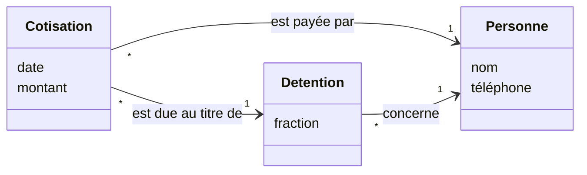

# Correction 4.3 — Exercice 3 : qui paie, et pour qui

> Rappel de l'énoncé : ajouter au modèle la distinction entre celui qui
> paie et celui qui doit ; changer `model` et `notebook` ; lire l'ancien et
> le nouveau cahier ; garder les tests qui doivent l'être.

La nouvelle version est dans `ex3/model2` et `ex3/notebook2` du module de
correction, verte sous `go vet ./...` et `go test -race -count=1 ./...`.

## En bref

- **Le modèle d'abord** : une cotisation est **due par** un titulaire et
  **payée par** une personne, qui n'est pas forcément titulaire. Deux
  associations au lieu d'une.
- **Le code ensuite** : deux champs, `PaidBy` et `For` ; les règles de la
  leçon portent sur `For`. Une ligne de lecture de plus, pour les anciens
  cahiers.
- **Mesuré** : l'ancien cahier donne toujours huit problèmes, le nouveau
  sept. Le problème de Mme Fon disparaît **seulement** quand la donnée dit
  pour qui elle a payé.

## 1. Le modèle

La partie du diagramme qui change :



Une cotisation est due **au titre d'une détention** (Fon, pour sa part
P06), et payée par **une personne** quelconque (Mme Fon). Le diagramme
parle maintenant de **personne** plutôt que de **membre** : celui qui paie
n'est pas forcément membre. Le glossaire gagne deux termes :

| Terme | Définition | Dans le code |
|---|---|---|
| personne | quelqu'un qui paie, reçoit, ou détient une part | une chaîne, pour l'instant |
| payeur | la personne qui fait un paiement, pour elle ou pour un titulaire | `Contribution.PaidBy` |
| (titulaire) **pour qui** | le titulaire au titre duquel une cotisation est due | `Contribution.For` |

## 2. Le code

```go
// Contribution is money paid for a share, for a month, by somebody (the
// payer), on behalf of a holder of the share. Most of the time, the payer
// is the holder.
type Contribution struct {
    Line         int
    Month, Share string
    PaidBy       string // anybody
    For          string // a holder of the share: the one who owes it
    Amount       int64
}
```

```go
    // A contribution is made for a holder of the share, for their part.
    // Who pays it does not matter.
    for _, ct := range cs {
        h, ok := holding(shares[ct.Share], ct.For)
        if !ok {
            out = append(out, Violation{ct.Line, "holder", fmt.Sprintf("paid for %s, who is not a holder of %s", ct.For, ct.Share)})
            continue
        }
        if want := c.Amount * int64(h.Num) / int64(h.Den); ct.Amount != want {
            out = append(out, Violation{ct.Line, "part", fmt.Sprintf("%d paid for %s on %s, who owes %d", ct.Amount, ct.For, ct.Share, want)})
        }
    }
```

Et la lecture, qui accepte les deux formats :

```go
        case "contribution":
            paidFor := r[3] // the notebooks before the "for" column: paid for oneself
            if len(r) > 5 && r[5] != "" {
                paidFor = r[5]
            }
            cs = append(cs, model.Contribution{Line: i + 2, Month: month, Share: r[2], PaidBy: r[3], For: paidFor, Amount: amount})
```

## 3. Les deux cahiers

```text
testdata: 8 problems
   line  21  part        50000 paid for Ebai on P05, who owes 25000
   line  65  holder      paid for Mme Fon, who is not a holder of P06
   line  58  one a month second payout in 2026-02
   line  58  turn        P08 paid in 2026-02, the turn of P07
   line  86  pot         550000 paid, the pot is 600000
   line 169  once        P08 takes the pot a second time
   cycle     one a month no payout in 2026-09
   cycle     once        P06 never took the pot
testdata2: 7 problems
   line  21  part        50000 paid for Ebai on P05, who owes 25000
   line  58  one a month second payout in 2026-02
   line  58  turn        P08 paid in 2026-02, the turn of P07
   line  86  pot         550000 paid, the pot is 600000
   line 169  once        P08 takes the pot a second time
   cycle     one a month no payout in 2026-09
   cycle     once        P06 never took the pot
```

L'ancien cahier garde le problème de Mme Fon, et c'est juste : il ne dit
pas pour qui elle a payé. La lecture suppose « pour elle-même », comme
pour toutes les lignes sans la colonne, et Mme Fon n'est pas titulaire.
Le modèle a changé, mais la **donnée** manquante ne s'invente pas : c'est
à la trésorière de compléter la ligne, et c'est exactement ce que fait le
nouveau cahier.

## 4. Les tests

Les tests de la leçon passent, à une exception voulue :
`TestAContributionComesFromAHolderForTheirPart` devient
`TestAContributionIsForAHolderAndTheirPart`. Il vérifie maintenant que la
règle porte sur **pour qui**, plus sur **qui paie**. Un test s'ajoute :

```go
// New: anybody may pay for a holder.
func TestSomebodyElseMayPayForAHolder(t *testing.T) {
    cs, ps := clean()
    cs[0].PaidBy = "Mme Ama"
    if vs := model.Check(cycle(), cs, ps); len(vs) != 0 {
        t.Fatalf("%v", vs)
    }
}
```

Et deux pour la lecture, ancien et nouveau format.

### La campagne

```text
règle appliquée au payeur                    tuee
colonne vide lue comme un nom                tuee
ancien cahier sans titulaire                 tuee
nombre de colonnes imposé                    SURVIT
3/4 tuees
```

**« nombre de colonnes imposé »** survit : sans `FieldsPerRecord = -1`,
le lecteur CSV de Go exige que toutes les lignes aient le nombre de champs
de la première. Chacun des deux cahiers est homogène, donc rien ne casse.
Mais la trésorière n'a pas recopié son cahier : elle ajoute la colonne **à
partir de mars**, dans le même fichier. Les lignes d'avant gardent cinq
champs, celles d'après en ont six. Un troisième cahier, mixte, le vérifie :

```go
// Added after the campaign: the treasurer adds the column from March on,
// in the same file. The old lines keep five fields.
func TestAMixedNotebookIsRead(t *testing.T) {
    _, cs, _, err := notebook.Load("testdata/mixed", 50_000)
    if err != nil {
        t.Fatal(err)
    }
    i := slices.IndexFunc(cs, func(c model.Contribution) bool { return c.Line == 65 })
    if len(cs) != 156 || i < 0 || cs[i].For != "Fon" || cs[i].PaidBy != "Mme Fon" {
        t.Fatalf("%d contributions, line 65 at %d", len(cs), i)
    }
}
```

Rejouée :

```text
règle appliquée au payeur                    tuee
colonne vide lue comme un nom                tuee
ancien cahier sans titulaire                 tuee
nombre de colonnes imposé                    tuee
4/4 tuees
```

## Ce qu'il faut retenir

1. On change le modèle **avant** le code : le diagramme et le glossaire
   disent ce que les champs voudront dire.
2. Un concept ajouté ne répare pas les données anciennes. Il faut une
   règle de lecture explicite pour elles (« sans la colonne, on paie pour
   soi »), et la donnée réelle là où elle manque.
3. Un format qui évolue évolue souvent **dans le même fichier**. Teste le
   fichier mixte, pas seulement l'ancien et le nouveau.
