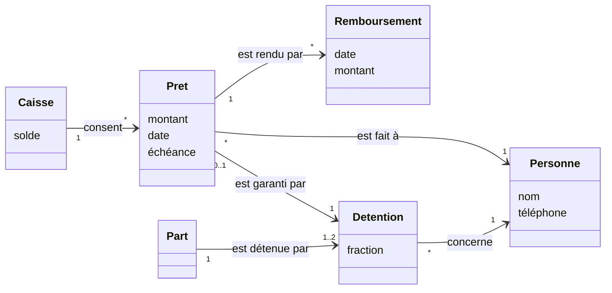

# Correction 4.3 — Exercice 4 : le modèle de la caisse de prêts

> Rappel de l'énoncé : le glossaire, le modèle conceptuel et cinq règles
> de la caisse de prêts ; puis la question ouverte : un prêt est-il fait à
> un membre, ou à une part ?

Cette correction est un modèle, sans code : les règles L1 à L6 de la
correction 4.1/4 ont déjà été vérifiées par des tests.

## En bref

- **Trois concepts nouveaux** : la caisse, le prêt, le remboursement. Les
  autres existent déjà (personne, détention, part).
- **La question ouverte se tranche par une conséquence** : si le prêt est
  fait à une **part**, la retenue sur la cagnotte (Q5 de la correction
  4.1/4) se fait naturellement, mais Divine engage Ebai sans son accord.
  Si le prêt est fait à une **personne**, chacune répond de ses dettes,
  mais la retenue sur la cagnotte d'une demi-part devient un calcul.
- La proposition : **le prêt est fait à une personne**, garanti par une
  détention. C'est un concept de plus, et la seule réponse juste pour les
  demi-parts.

## 1. Le glossaire

| Terme | Définition | Synonymes à éviter | Dans le code |
|---|---|---|---|
| caisse de secours | l'argent de la tontine qui n'est pas encore une cagnotte : avances (R4), prêts, intérêts | fonds, réserve | `Fund` |
| prêt | une somme de la caisse confiée à une personne, à rendre avec un intérêt | avance (c'est la R4), crédit | `Loan` |
| emprunteur | la personne à qui le prêt est fait | bénéficiaire (c'est celui qui bouffe) | `Loan.Borrower` |
| garantie | la détention sur laquelle le prêt sera retenu si l'emprunteur ne rembourse pas | caution, avaliste (c'est une personne) | `Loan.Against` |
| remboursement | un paiement de l'emprunteur vers la caisse, pour un prêt | versement (c'est la cagnotte), cotisation | `Repayment` |
| intérêt | ce que le prêt coûte en plus du montant, et qui revient à la caisse | frais, pénalité (c'est un retard) | calculé, pas stocké |
| échéance du prêt | la date au plus tard du remboursement | — | `Loan.Due` |

Deux mots demandaient une décision : « avance » (la caisse paie à la place
d'un retardataire, R4) n'est **pas** un prêt (le membre demande de
l'argent). Et « bénéficiaire » est déjà pris par la cagnotte.

## 2. Le modèle

Nouveaux : `Caisse`, `Pret`, `Remboursement`. Existants : `Personne`,
`Detention`, `Part`, raccordés comme dans la leçon et l'exercice 3.

## 3. Cinq règles

1. Un prêt est fait à **une** personne, et garanti par **une** de ses
   détentions (`"*" → "1"` et `"0..1" → "1"`).
2. Une détention garantit **au plus un** prêt à la fois (`"0..1"`) : c'est
   la règle « un seul prêt par membre » (Q4), écrite sur la garantie.
3. Un prêt est fait à une personne qui **détient** la détention qui le
   garantit : on ne garantit pas avec la part d'un autre.
4. La somme des remboursements d'un prêt soldé est son montant plus
   l'intérêt ; tant qu'elle est inférieure, le prêt est en cours.
5. La somme des prêts en cours ne dépasse jamais la moitié du solde de la
   caisse au moment de chaque prêt (Q1).

Les règles 3 à 5 sont des **contraintes** (comme celle de l'exercice 2) :
elles relient plusieurs associations, et s'écrivent en note.

## 4. Un prêt à un membre, ou à une part ?

| | Prêt fait à une **part** | Prêt fait à une **personne**, garanti par une détention |
|---|---|---|
| Divine emprunte, sur la part P05 qu'elle tient à moitié | elle engage **toute** la part, donc aussi Ebai, sans son accord | elle engage **sa moitié** ; Ebai n'est pas concernée |
| P05 bouffe avant le remboursement | on retient le prêt sur la cagnotte de P05 : simple, mais Ebai paie la dette de Divine | on retient sur les 300 000 de Divine seulement |
| Ama, deux parts | deux prêts possibles, un par part | un prêt par détention : deux aussi, chacun garanti par une part |
| un prêt sans part (une personne qui n'est que payeuse, Mme Fon) | impossible | impossible aussi : il faut une détention en garantie (règle 3) |

Le prêt à la part paraît plus simple, parce que la retenue sur la
cagnotte est directe. Mais il rend Ebai responsable d'une dette qu'elle
n'a pas contractée. Le prêt à la **personne**, garanti par **sa**
détention, coûte un concept (la garantie) et un calcul (la retenue sur sa
fraction de la cagnotte, que la correction 4.3/5 sait faire). C'est la
proposition, à faire valider par le bureau.

## Ce qu'il faut retenir

1. Un nouveau domaine se raccorde au modèle existant : la plupart de ses
   concepts existent déjà.
2. Une règle métier (« un seul prêt par membre ») trouve souvent sa place
   la plus juste sur une association précise (la garantie).
3. Une question de modélisation (« à qui est fait le prêt ? ») se tranche
   en jouant les cas réels, ici la demi-part et les deux parts, dans
   chaque option.
