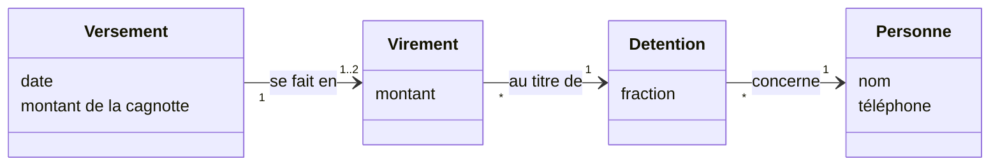

# Correction 4.3 — Exercice 5 : la cagnotte de décembre

> Rappel de l'énoncé : la cagnotte de P05, tenue à moitié par Divine et
> Ebai, est partie entière chez Divine. Expliquer, corriger le modèle puis
> le code, écrire le test qui manquait, proposer une règle de contrôle, et
> rédiger le compte rendu.

La correction est dans `ex5/payout2` du module de correction, verte sous
`go vet ./...` et `go test -race -count=1 ./...`.

## En bref

- **Le code a suivi le modèle.** Le diagramme de la leçon dit `Versement
  "0..1" → "1" Part : est reçu par`. Mais une part ne reçoit pas d'argent :
  une **personne** reçoit un virement. Le modèle ne disait pas qui, et le
  code a choisi « le premier titulaire ».
- **Le modèle corrigé** : un versement se fait en **un virement par
  détention**, du montant de sa fraction.
- **Le test qui manquait** : une demi-part reçoit deux virements de
  300 000. Et un **contrôle** avant l'envoi, qui aurait refusé le
  virement de décembre.

## 1. Un modèle incomplet, bien suivi

Le code de novembre :

```go
// Transfers returns what to send for the pot of share s. The model says a
// payout "is received by" a share; the share's first holder is the one
// the treasurer knows.
func Transfers(s model.Share, pot int64) []Transfer {
    return []Transfer{{To: s.Holders[0].Person, Amount: pot}}
}
```

Il ne trahit pas le modèle de la leçon. Il le suit, et comble son trou :
le diagramme s'arrête à la part (`Versement → Part`), alors que Mobile
Money demande un numéro de téléphone, donc une personne. Entre la part et
la personne, il y a les détentions, une ou deux, et le modèle ne disait
pas comment le versement s'y répartit. Le développeur a pris « le
titulaire que la trésorière connaît », c'est-à-dire le premier.

Pour la plupart des parts, c'est juste : elles n'ont qu'un titulaire. Le
défaut ne touche que les demi-parts, une fois par cycle. C'est pourquoi
aucun mois de novembre ne l'a montré.

## 2. Le modèle corrigé

Les questions au bureau, avec une réponse par défaut :

| Question | Réponse proposée |
|---|---|
| Une demi-part reçoit-elle un virement, ou deux ? | deux, un par titulaire, de sa fraction |
| Les titulaires peuvent-ils demander un seul virement, à l'un d'eux ? | oui, s'ils le demandent tous les deux, par écrit ; c'est alors une **désignation**, notée |
| Un franc qui reste à cause de l'arrondi va à qui ? | au premier titulaire nommé par le bureau |
| Si le virement à l'un échoue ? | l'autre part quand même ; celui qui a échoué suit les statuts de la leçon 3.5 |

La partie corrigée du diagramme :



Avec une contrainte : `{la somme des virements d'un versement = la
cagnotte ; chaque virement = la fraction de sa détention, au franc près}`.

## 3. Le code, et le test

```go
// Transfers gives each holder their part of the pot, rounded down to the
// franc. What rounding leaves (at most one franc per holder) goes to the
// first holder, the one the bureau names first: the rule decided with it.
func Transfers(s model.Share, pot int64) []Transfer {
    out := make([]Transfer, len(s.Holders))
    var given int64
    for i, h := range s.Holders {
        out[i] = Transfer{To: h.Person, Amount: pot * int64(h.Num) / int64(h.Den)}
        given += out[i].Amount
    }
    if len(out) > 0 {
        out[0].Amount += pot - given
    }
    return out
}
```

```go
// The test that was missing: a half share's pot goes half to each holder.
func TestAHalfSharesPotIsSplit(t *testing.T) {
    got := payout2.Transfers(half, 600_000)
    want := []payout2.Transfer{{"Divine", 300_000}, {"Ebai", 300_000}}
    if !slices.Equal(got, want) {
        t.Fatalf("%v", got)
    }
}
```

La cagnotte impaire : 600 001 FCFA donne 300 000 à chacune, plus le franc
restant à Divine, première nommée. La règle est arbitraire, mais elle est
**écrite**, testée, et validée par le bureau ; l'arrondi « au hasard du
calcul » ne l'est jamais.

```go
// An odd pot: the franc left by rounding goes to the first holder.
func TestTheFrancLeftGoesToTheFirstHolder(t *testing.T) {
    got := payout2.Transfers(half, 600_001)
    if !slices.Equal(got, []payout2.Transfer{{"Divine", 300_001}, {"Ebai", 300_000}}) {
        t.Fatalf("%v", got)
    }
    three := model.Share{ID: "P9", Holders: []model.Holding{{Person: "A", Num: 3, Den: 4}, {Person: "B", Num: 1, Den: 4}}}
    got = payout2.Transfers(three, 100_003)
    if got[0].Amount+got[1].Amount != 100_003 || got[1].Amount != 25_000 {
        t.Fatalf("%v", got)
    }
}
```

Rejoués avec la correction (`go run ./ex5/cmd/october2`) :

```text
Divine received 300000, Ebai received 300000
```

## 4. Le contrôle qui aurait refusé décembre

La contrainte du diagramme devient un contrôle **avant** l'envoi :

```go
// Check refuses to send transfers that do not split the pot: one transfer
// per holder, each within one franc of their part, the whole pot and no
// more.
func Check(s model.Share, pot int64, ts []Transfer) error {
    if len(ts) != len(s.Holders) {
        return fmt.Errorf("%w: %d transfers for %d holders", ErrSplit, len(ts), len(s.Holders))
    }
    var total int64
    for i, h := range s.Holders {
        part := pot * int64(h.Num) / int64(h.Den)
        if ts[i].To != h.Person || ts[i].Amount < part || ts[i].Amount > part+int64(len(s.Holders)) {
            return fmt.Errorf("%w: %d to %s, whose part is %d", ErrSplit, ts[i].Amount, ts[i].To, part)
        }
        total += ts[i].Amount
    }
    if total != pot {
        return fmt.Errorf("%w: %d sent, the pot is %d", ErrSplit, total, pot)
    }
    return nil
}
```

Le virement de décembre (600 000 à Divine) a un seul virement pour deux
titulaires : refusé. Le test le rejoue avec le code de novembre :

```go
func TestCheckAcceptsTheSplitAndRefusesTheOldTransfer(t *testing.T) {
    if err := payout2.Check(half, 600_000, payout2.Transfers(half, 600_000)); err != nil {
        t.Fatal(err)
    }
    var old []payout2.Transfer
    for _, tr := range payout.Transfers(half, 600_000) {
        old = append(old, payout2.Transfer{To: tr.To, Amount: tr.Amount})
    }
    if err := payout2.Check(half, 600_000, old); !errors.Is(err, payout2.ErrSplit) {
        t.Fatalf("the transfer of December passed the check: %v", err)
    }
}
```

Ce contrôle a une propriété précieuse : il ne dépend pas de la façon dont
les virements ont été calculés. Si quelqu'un réécrit `Transfers` demain,
ou ajoute la désignation d'un seul titulaire, le contrôle continue de
vérifier que l'argent part aux bonnes personnes, dans les bonnes
proportions. Une désignation devra d'ailleurs passer par lui : il faudra
lui donner la désignation notée, pas l'en dispenser.

### La campagne

```text
partage égal au lieu des fractions           tuee
reste au dernier titulaire                   tuee
reste perdu                                  tuee
contrôle accepte un seul virement            SURVIT
contrôle sans le destinataire                tuee
contrôle accepte moins que la cagnotte       SURVIT
4/6 tuees
```

Deux trous dans le contrôle : « contrôle accepte un seul virement » survit parce
que le seul test à un virement avait aussi un mauvais montant, refusé pour
cette raison-là ; « contrôle accepte moins que la cagnotte » survit parce qu'avec des
contrôles par virement, un total trop petit n'arrive que si le franc de
l'arrondi se perd. Deux tests de plus :

```go
// Added after the campaign: one transfer, the right half, and nothing for
// the other holder.
func TestCheckRefusesAMissingHolder(t *testing.T) {
    if err := payout2.Check(half, 600_000, []payout2.Transfer{{"Divine", 300_000}}); !errors.Is(err, payout2.ErrSplit) {
        t.Fatalf("%v", err)
    }
}
```

```go
// Added after the campaign: an odd pot whose last franc is given to
// nobody. Each transfer is its part; the total is one franc short.
func TestCheckRefusesALostFranc(t *testing.T) {
    if err := payout2.Check(half, 600_001, []payout2.Transfer{{"Divine", 300_000}, {"Ebai", 300_000}}); !errors.Is(err, payout2.ErrSplit) {
        t.Fatalf("%v", err)
    }
}
```

Rejouée :

```text
partage égal au lieu des fractions           tuee
reste au dernier titulaire                   tuee
reste perdu                                  tuee
contrôle accepte un seul virement            tuee
contrôle sans le destinataire                tuee
contrôle accepte moins que la cagnotte       tuee
6/6 tuees
```

## Le compte rendu, en cinq lignes

1. **Quoi** : le 5 décembre, la cagnotte de la part P05 (600 000 FCFA),
   tenue à moitié par Divine et Ebai, a été envoyée entière à Divine ;
   Ebai n'a rien reçu.
2. **Pourquoi** : le modèle disait qu'un versement est reçu par une part,
   sans dire par quelles personnes ; le code a envoyé au premier
   titulaire.
3. **Pourquoi personne ne l'a vu** : un seul cas par cycle, aucun test de
   versement sur une demi-part, et aucun contrôle avant l'envoi.
4. **Correction** : un virement par titulaire, de sa fraction, avec une
   règle d'arrondi validée ; un contrôle qui refuse tout envoi qui ne
   partage pas la cagnotte selon les détentions.
5. **Ce qui reste ouvert** : récupérer 300 000 FCFA auprès de Divine pour
   Ebai (une décision du bureau), et revoir les autres associations du
   modèle qui s'arrêtent à la part alors que l'argent va à des personnes.

## Ce qu'il faut retenir

1. Un code peut suivre fidèlement un modèle incomplet. Quand l'argent, ou
   un message, doit aller quelque part, le modèle doit aller jusqu'à la
   personne.
2. Les contraintes du diagramme (« la somme des virements = la cagnotte »)
   deviennent des contrôles avant les actions irréversibles.
3. Une règle d'arrondi est une règle métier : écrite, testée, validée.
4. Un contrôle indépendant du calcul protège aussi contre les
   réécritures futures du calcul.
