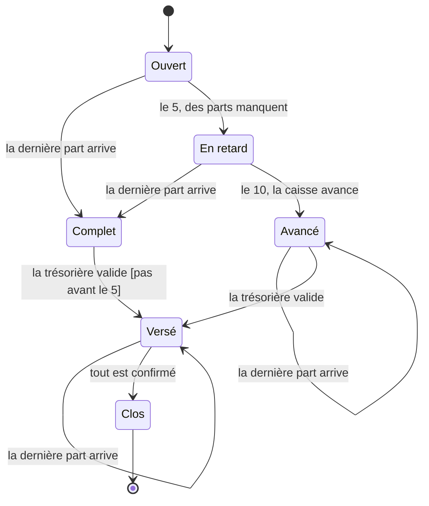

# Correction 4.4 — Exercice 3 : le diagramme d'états du mois

> Rappel de l'énoncé : générer le diagramme d'états du mois depuis sa
> table, le vérifier par un test de référence, lister les différences avec
> l'esquisse recopiée, et dire où vit la règle « pas avant le 5 ».

La solution est dans `ex3/month2` du module de correction, verte sous
`go vet ./...` et `go test -race -count=1 ./...`.

## En bref

- **Le diagramme vient de la table**, avec les **noms du glossaire** : le
  code dit `Advanced`, la trésorière lit « Avancé ».
- **Trois différences** avec l'esquisse : deux transitions que le code a
  et que l'esquisse ignore (une part qui arrive après l'avance), et une
  garde que la table ne peut pas porter.
- La garde « pas avant le 5 » vit dans le **service**, et le diagramme la
  montre quand même, entre crochets, à partir d'une petite table à côté
  de celle des transitions.

## 1. Le générateur

```go
// labels are the names of the glossary: the diagram is read by the
// treasurer.
var labels = map[Status]string{
    Open: "Ouvert", Complete: "Complet", Late: "En retard", Advanced: "Avancé", Paid: "Versé", Closed: "Clos",
}
```

```go
// guards are the conditions the table cannot hold: they are checked by
// the service, and written on the diagram so that it says them.
var guards = map[step]string{
    {Complete, Validate}: "pas avant le 5",
}
```

```go
// Mermaid draws the table, in the order of the statuses then of the
// events, so that the text is the same at every run.
func Mermaid() string {
    var b strings.Builder
    b.WriteString("stateDiagram-v2\n")
    for s := Open; s <= Closed; s++ {
        fmt.Fprintf(&b, "    state \"%s\" as %s\n", labels[s], s)
    }
    fmt.Fprintf(&b, "    [*] --> %s\n", Open)
    for s := Open; s <= Closed; s++ {
        for e := LastShare; e <= Confirmed; e++ {
            to, ok := transitions[step{s, e}]
            if !ok {
                continue
            }
            label := eventLabels[e]
            if g, ok := guards[step{s, e}]; ok {
                label += " [" + g + "]"
            }
            fmt.Fprintf(&b, "    %s --> %s : %s\n", s, to, label)
        }
    }
    fmt.Fprintf(&b, "    %s --> [*]\n", Closed)
    return b.String()
}
```

Deux choix, qui comptent :

- **L'ordre est fixe** : les statuts, puis les événements, dans l'ordre de
  leurs constantes. Parcourir la `map` des transitions donnerait un ordre
  différent à chaque exécution, et le test de référence échouerait une
  fois sur deux.
- **`state "Avancé" as Advanced`** : l'identifiant Mermaid est le nom du
  code, le texte affiché est celui du glossaire. Le diagramme se lit en
  français, et reste relié au code.

## 2. Le test de référence

```go
func TestTheStateDiagramIsTheTable(t *testing.T) {
    const path = "../../docs/mois.mmd"
    got := month2.Mermaid()
    if *update {
        if err := os.WriteFile(path, []byte(got), 0o644); err != nil {
            t.Fatal(err)
        }
    }
    want, err := os.ReadFile(path)
    if err != nil || got != string(want) {
        t.Fatalf("docs/mois.mmd is not the table (%v); run go test -update and review.\nthe table draws:\n%s", err, got)
    }
}
```

Le diagramme, une fois `go test -update` lancé :



## 3. Les différences, et qui a raison

Un `diff` des deux fichiers ne sert à rien : les noms ont changé
(« Ouvert » est devenu `Open`, déclaré avec son libellé), et toutes les
lignes diffèrent. Il faut comparer les **transitions** :

| Transition | Esquisse | Table | Qui a raison | Ce que l'on fait |
|---|---|---|---|---|
| Avancé → Avancé quand la dernière part arrive | absente | présente | **le code** : R4 dit que le retardataire rembourse la caisse ; sa part arrive après l'avance, et le mois reste avancé | rien : l'esquisse avait oublié ce cas |
| Versé → Versé quand la dernière part arrive | absente | présente | **le code** : même règle, une part qui arrive après le versement rembourse la caisse | rien |
| Complet → Versé « pas avant le 5 » | une garde sur la flèche | rien dans la table | **l'esquisse** : c'est AC6 de la leçon 4.1 | ajouter la garde au diagramme (section 4) ; vérifier qu'un test du service la couvre |
| `[*] → Ouvert`, `Clos → [*]` | présents | présents, générés | les deux | rien |

Deux des trois différences donnent raison au code : l'esquisse avait été
faite **avant** la règle R4, et personne ne l'avait reprise. La troisième
donne raison à l'esquisse, mais le code n'a pas tort non plus : la règle
existe, ailleurs.

## 4. Où vit « pas avant le 5 » ?

La table dit **quels** événements sont permis dans quel état, pas
**quand**. « Pas avant le 5 » dépend de la date : c'est une **garde**, au
sens d'UML, une condition sur une transition. Elle vit dans le service,
qui ne déclenche `Validate` sur un mois `Complete` qu'à partir du 5 (c'est
`Settle` dans le paquet `tontine` de la leçon 4.1).

Pour que le diagramme la montre quand même, le générateur lit une petite
table de gardes, à côté de celle des transitions, et les écrit entre
crochets, comme UML : `la trésorière valide [pas avant le 5]`. La table
des gardes est du texte, pas du code exécuté : elle doit donc pointer vers
le test qui vérifie la règle (ici AC6), sinon elle peut mentir à son tour.

## 5. La campagne

Au premier passage, « garde oubliée sur le dessin » ne compilait pas (la
variable `g` devenait inutilisée) ; elle a été réécrite. Rejouée :

```text
garde oubliée sur le dessin                  tuee
noms du glossaire oubliés                    tuee
état final oublié                            tuee
avance oubliée à l'arrivée de la part        tuee
4/4 tuees
```

## Ce qu'il faut retenir

1. Un diagramme d'états se génère depuis la table, dans un ordre fixe,
   avec les noms du glossaire.
2. Quand l'esquisse et le code diffèrent, compare les transitions, pas les
   lignes, et décide transition par transition.
3. Une garde dépend d'autre chose que l'état (une date, un montant) : elle
   vit dans le service, et peut être affichée sur le diagramme si elle est
   reliée à un test.
