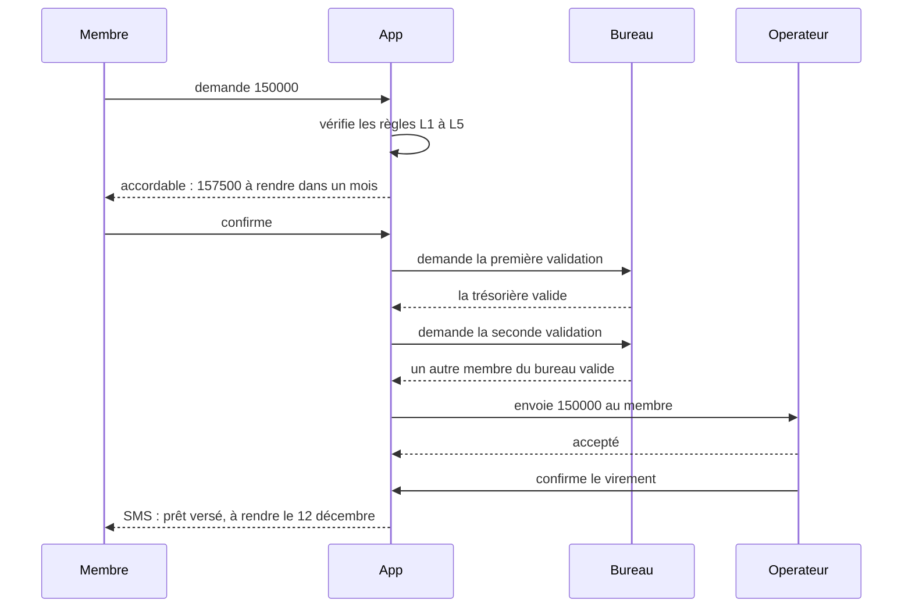
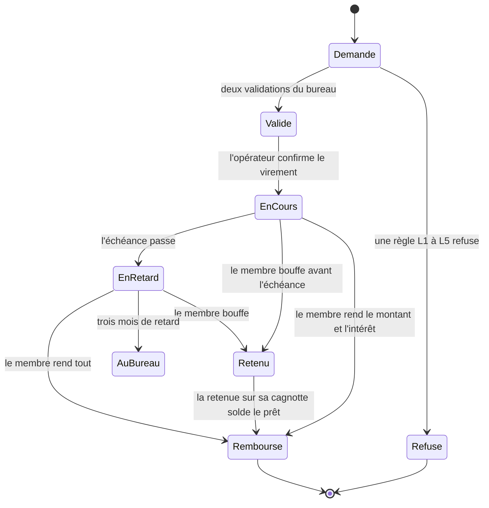
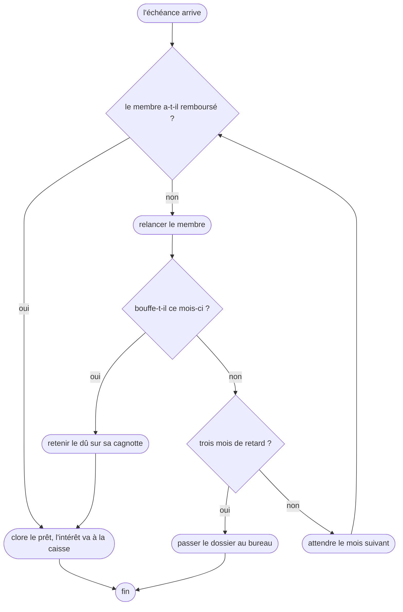

# Correction 4.4 — Exercice 4 : les diagrammes du prêt

> Rappel de l'énoncé : les diagrammes de séquence, d'états et d'activité
> de la caisse de prêts ; dire lesquels sont des esquisses ; compter les
> réponses de décision et leurs tests.

Cette correction est une conception, sans code nouveau. Les trois
diagrammes sont des **esquisses** de l'analyse ; la section 4 dit comment
chacun deviendrait un document.

## En bref

- **Séquence** : la demande traverse quatre participants, et le point
  délicat est la **double validation** : deux membres du bureau, l'un après
  l'autre, avant tout envoi.
- **États** : un prêt a six états ; le plus important est celui qu'on
  oublie, `Retenu`, quand l'emprunteur bouffe avant d'avoir remboursé.
- **Activité** : le remboursement à l'échéance a trois décisions et six
  réponses. Chacune demande un test.

## 1. La séquence de la demande

Le diagramme dit **l'ordre** qui protège la caisse : rien ne part avant la
seconde validation, et le SMS ne part qu'après la confirmation de
l'opérateur, comme dans la leçon.

## 2. Les états d'un prêt

L'état **`Retenu`** est celui que l'on oublie : quand l'emprunteur reçoit
sa cagnotte, la caisse se rembourse **avant** de lui verser le reste (Q5
de la correction 4.1/4). Sans lui, le diagramme laisserait croire qu'un
prêt ne se solde que par un paiement du membre.

`AuBureau` n'a pas de sortie dessinée : c'est voulu. Ce qui s'y passe est
une décision humaine (relance, échéancier, exclusion), que le système
enregistre sans la modéliser.

## 3. L'activité du remboursement

## 4. Esquisse ou document ?

| Diagramme | Aujourd'hui | Pour en faire un document |
|---|---|---|
| séquence de la demande | esquisse, pour discuter avec le bureau | l'enregistreur de la leçon dans le service de prêt, et un test de référence sur `docs/pret.mmd` |
| états du prêt | esquisse | une table de transitions (leçon 3.5), et le diagramme généré depuis elle, avec ses gardes (exercice 3) |
| activité du remboursement | esquisse | les données de `activity.Graph`, vérifiées par `check.Problems` (exercice 2), dessinées et comptées par le code |

## 5. Les réponses de décision et leurs tests

Trois décisions, deux réponses chacune : **six réponses**.

| Réponse | Test |
|---|---|
| `d1=oui` | `TestARepaidLoanIsClosedAndItsInterestGoesToTheFund` |
| `d1=non` | `TestAnUnpaidLoanIsReminded` |
| `d2=oui` | `TestTheDueIsKeptOnThePotOfTheBorrower` |
| `d2=non` | `TestABorrowerWhoDoesNotTakeThePotWaits` |
| `d3=oui` | `TestThreeMonthsLateGoesToTheBureau` |
| `d3=non` | `TestTwoMonthsLateWaitsAnotherMonth` |

Le test de `d2=oui` est celui qui protège le plus d'argent : il vérifie que
la cagnotte de l'emprunteur est **diminuée** de son dû, et que la caisse
est créditée du même montant.

## Ce qu'il faut retenir

1. Un même processus se dessine trois fois, pour trois questions : l'ordre
   des échanges, la vie d'une chose, les étapes et décisions.
2. L'état qu'on oublie est souvent celui où une **autre** partie du
   système agit sur la chose (ici, la cagnotte qui rembourse le prêt).
3. Chaque esquisse a un chemin vers un document généré et vérifié ; on ne
   le prend que pour les diagrammes qu'on veut garder.
