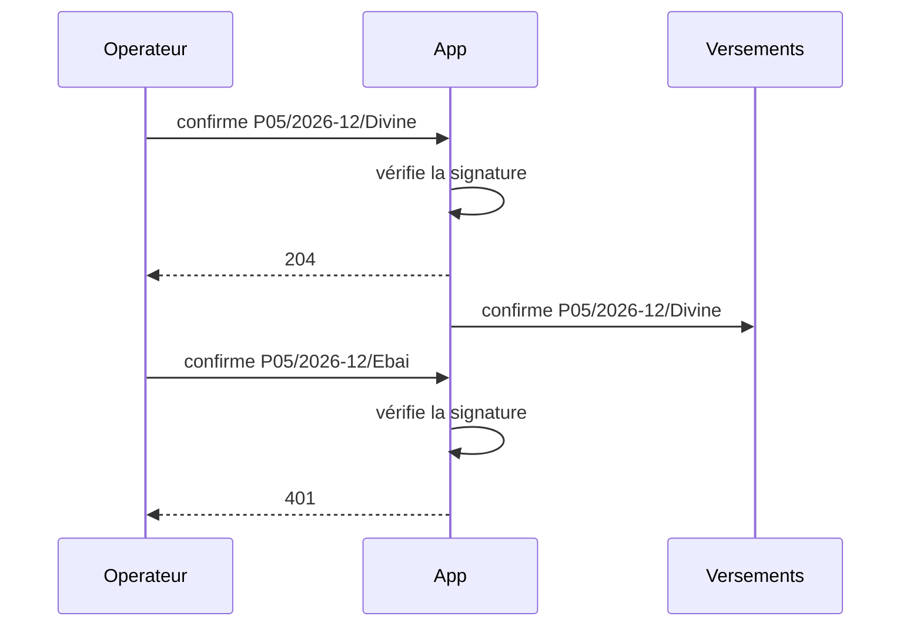

# Correction 4.4 — Exercice 5 : le runbook du 14 janvier

> Rappel de l'énoncé : après une rotation de clé de l'opérateur, 37
> versements restent bloqués ; le runbook promet un 401 et de nouvelles
> tentatives, qui ne viennent jamais. Expliquer, générer le vrai
> diagramme, corriger sans perdre la raison de la version 2.3, écrire le
> test, débloquer, et rédiger le compte rendu.

La correction est dans `ex5/callback2` du module de correction, verte
sous `go vet ./...` et `go test -race -count=1 ./...`.

## En bref

- **La version 2.3 répond 204 avant de vérifier.** L'opérateur a donc
  reçu « bien reçu » pour les 37 réponses, et n'avait aucune raison de
  réessayer. La vérification échouait ensuite en arrière-plan, dans un
  journal de débogage éteint.
- **Le runbook décrivait la version 2.2.** Personne ne l'a mis à jour, et
  aucun test ne le liait au code.
- **La correction vérifie avant de répondre** (une vérification HMAC prend
  des microsecondes), et ne laisse en arrière-plan que l'écriture du
  versement, qui était la vraie cause des délais. Chaque refus est
  compté, et une alerte sonne au premier.
- Rejouée : avec la correction, les 37 versements passent dès la mise à
  jour de la clé ; avec l'alerte, dès 19 h, au lieu du lendemain midi.

## 1. Pourquoi l'opérateur n'a jamais réessayé

```go
// Receive answers the operator, then checks and applies the answer. The
// operator retries an answer until it gets a 204.
func (h *Handler) Receive(ctx context.Context, ref string, body []byte, sig string) int {
    h.Trace.Call("Operateur", "App", "confirme "+ref)
    h.Trace.Back("App", "Operateur", "204")
    h.wg.Go(func() {
        h.Trace.Call("App", "App", "vérifie la signature")
        if err := h.Sig.Verify(body, sig); err != nil {
            if h.Debug != nil {
                h.Debug.Printf("callback %s: %v", ref, err)
            }
            return
        }
        h.Trace.Call("App", "Versements", "confirme "+ref)
        h.Payouts.Confirm(context.Background(), ref)
    })
    return 204
}
```

L'opérateur réessaie une réponse **tant qu'il n'a pas reçu de 204**. La
version 2.3 renvoie 204 **avant** de vérifier la signature : pour
l'opérateur, chacune des 37 réponses a été reçue. Il les a rayées de sa
liste, et la sortie de la nuit le montre : « *0 retries* ».

Personne n'a rien vu parce que l'échec de la vérification n'allait
**nulle part** : un `Printf` sur un journal de débogage, `nil` en
production. Ni compteur, ni alerte, ni erreur rendue à qui que ce soit.
Les versements sont restés en attente, ce qui ressemble exactement à un
opérateur lent.

## 2. Le diagramme du code, contre celui du runbook

Ce que fait la version 2.3 pour une réponse à la signature fausse
(`go run ./ex5/cmd/seq23`, avec l'enregistreur) :

```text
sequenceDiagram
    participant Operateur
    participant App
    participant Versements
    Operateur->>App: confirme P05/2027-01/Divine
    App-->>Operateur: 204
    App->>App: vérifie la signature
```

Le runbook disait : vérifier, confirmer, **puis** répondre 204, et 401 si
la signature est fausse. Le code répond 204 **d'abord**, et il n'existe
plus de 401. L'astreinte a pris sa décision (attendre les nouvelles
tentatives) sur un diagramme vrai pour la version précédente.

## 3. La raison de la version 2.3, et la correction

La version 2.3 avait une raison réelle, écrite dans son commentaire : que
l'opérateur reçoive son 204 tout de suite, et ne coupe jamais la
connexion faute de réponse. Mais la solution choisie a déplacé dans
l'arrière-plan **tout** le travail, y compris la vérification. Or ce qui
peut être lent, c'est l'écriture du versement en base, pas la
vérification : un HMAC se calcule en microsecondes.

La correction sépare les deux : vérifier tout de suite et répondre selon
le résultat ; écrire le versement en arrière-plan.

```go
// Receive checks the answer, then answers the operator: 401 makes it try
// again later, 204 tells it the bank has the answer.
func (h *Handler) Receive(ctx context.Context, ref string, body []byte, sig string) int {
    h.Trace.Call("Operateur", "App", "confirme "+ref)
    h.Trace.Call("App", "App", "vérifie la signature")
    if err := h.Sig.Verify(body, sig); err != nil {
        h.BadSignatures.Add(1)
        h.Trace.Back("App", "Operateur", "401")
        return 401
    }
    h.Trace.Back("App", "Operateur", "204")
    h.wg.Go(func() {
        h.Trace.Call("App", "Versements", "confirme "+ref)
        h.Payouts.Confirm(context.Background(), ref)
    })
    return 204
}
```

Le compteur `BadSignatures` est une alerte : en temps normal, il ne bouge
jamais. Une augmentation veut dire que quelqu'un forge des réponses, ou
qu'une clé a changé d'un côté seulement. Dans les deux cas, quelqu'un doit
être prévenu tout de suite.

Une remarque : écrire le versement en arrière-plan garde un risque, celui
d'un arrêt du processus entre le 204 et l'écriture. Pour l'éliminer, il
faut écrire la réponse dans une file **durable** avant de répondre, ce qui
est rapide, puis l'appliquer. C'est la boîte d'envoi transactionnelle du
niveau 8 ; la correction présente s'arrête à la vérification.

## 4. Le test qui aurait fait échouer la version 2.3

Le diagramme du runbook est désormais celui que le code dessine, pour une
bonne et une mauvaise réponse :

```go
// The runbook's diagram is drawn by the code: one good answer, one bad.
func TestTheRunbookDiagramIsWhatTheCodeDoes(t *testing.T) {
    const path = "../../docs/callback.mmd"
    rec := &trace.Recorder{}
    h := &callback2.Handler{Sig: key{"k"}, Payouts: &payouts{}, Trace: rec}
    h.Receive(context.Background(), "P05/2026-12/Divine", nil, "k")
    h.Wait()
    h.Receive(context.Background(), "P05/2026-12/Ebai", nil, "forged")
    got := rec.Mermaid("Operateur", "App", "Versements")
    if *update {
        if err := os.WriteFile(path, []byte(got), 0o644); err != nil {
            t.Fatal(err)
        }
    }
    want, err := os.ReadFile(path)
    if err != nil || got != string(want) {
        t.Fatalf("docs/callback.mmd is not what the code does (%v); run go test -update.\n%s", err, got)
    }
}
```



Avec ce test, la version 2.3 aurait changé `docs/callback.mmd` dans la même
revue de code : le 204 serait passé avant la vérification, et le 401 aurait
disparu du diagramme. Quelqu'un aurait vu, sous ses yeux, que la réponse
n'attendait plus la vérification.

## 5. Le 15 au matin

Mettre à jour la clé ne suffit **pas** : l'opérateur ne renverra jamais
les 37 réponses, puisqu'il les croit reçues. Il fallait :

1. mettre à jour la clé de la banque ;
2. lancer le **rapprochement** de la leçon 3.5 : demander à l'opérateur le
   statut des 37 virements, et appliquer ses réponses ;
3. vérifier que les 37 versements passent en `Paid`, et prévenir les
   membres.

Avec la correction, la nuit se rejoue autrement
(`go run ./ex5/cmd/rotation2`, puis `go run ./ex5/cmd/rotation2 alert`) :

```text
all 37 confirmed at Jan 15 09:00, after 592 answers; 555 refused signatures counted
all 37 confirmed at Jan 14 19:00, after 74 answers; 37 refused signatures counted
```

Sans alerte, l'opérateur réessaie toutes les heures, chaque tentative est
refusée et comptée (555 refus), et tout passe à 9 h, dès la mise à jour de
la clé. Avec l'alerte au premier refus, l'astreinte met la clé à jour à
19 h : 37 refus, puis 37 confirmations.

## Le compte rendu, en cinq lignes

1. **Quoi** : du 14 janvier 18 h au 15 janvier midi, 37 versements sont
   restés « en cours » alors que l'opérateur les avait confirmés.
2. **Pourquoi** : après sa rotation de clé, toutes ses réponses avaient
   une signature que la banque refusait ; la version 2.3 répondait 204
   avant de vérifier, donc l'opérateur n'a jamais réessayé, et l'échec
   n'était écrit que dans un journal éteint.
3. **Pourquoi personne ne l'a vu** : aucune alerte sur les signatures
   refusées, et un runbook qui décrivait la version précédente,
   l'astreinte a donc attendu des tentatives qui ne pouvaient pas venir.
4. **Correction** : vérifier avant de répondre (401 en cas d'échec),
   écrire le versement après ; compter et alerter au premier refus ;
   diagramme du runbook généré par le code et vérifié par un test.
5. **Ce qui reste ouvert** : une file durable entre le 204 et l'écriture ;
   une procédure de rotation de clé coordonnée avec l'opérateur, avec une
   période où les deux clés sont acceptées.

## Ce qu'il faut retenir

1. Un 204 est une promesse : « j'ai ta réponse ». Ne la fais qu'après
   avoir vérifié ce que tu promets.
2. Quand on déplace du travail en arrière-plan, on déplace aussi ses
   échecs : chacun doit aller vers une alerte, pas vers un journal éteint.
3. Un runbook est un document d'astreinte : il se génère et se vérifie
   comme le reste, sinon il décrit une version que plus personne
   n'exécute.
4. Dans une rotation de clé, il faut une période où **les deux** clés sont
   acceptées.
