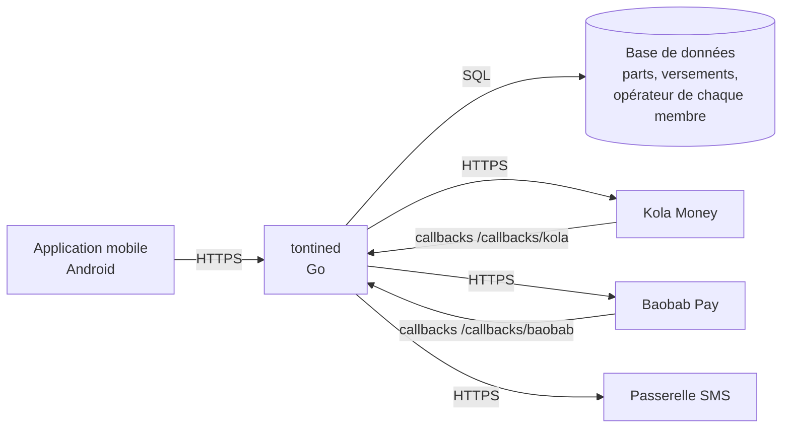

# Correction 4.5 — Exercice 4 : les ADR du cours

> Rappel de l'énoncé : écrire trois ADR pour des décisions des leçons 3.5,
> 4.1 et 3.6, puis redessiner le diagramme de conteneurs après
> l'ADR-0004.

Cette correction est un texte. Les tests nommés dans les ADR existent
dans les modules des leçons citées.

## En bref

- Chaque ADR dit **les forces** qui ont mené à la décision, souvent un
  incident ou une mesure des leçons, et **ce que la décision coûte**.
- Les deux premiers ont un test qui les vérifie ; le troisième en a un
  aussi, à la leçon 3.6, sous une forme indirecte.
- Après l'ADR-0004, le diagramme de conteneurs gagne un système extérieur
  et une donnée : **l'opérateur de chaque membre**.

## 1. Trois ADR

```text
# ADR-0009 — Un délai dépassé chez l'opérateur est un statut Unknown

- Statut : Acceptée
- Date : 2026-11-08
- Vérifiée par : TestALateConfirmAfterExpiryIsPaid

## Contexte

L'opérateur répond parfois après notre délai de 30 secondes. Traiter le
délai comme un refus rembourse le client alors que l'opérateur a peut-être
payé : la simulation de la leçon 3.5 a chiffré ce cas à 6 132 000 FCFA
payés deux fois en une soirée.

## Décision

Nous traitons un délai dépassé comme une ignorance : le paiement passe en
Unknown, d'où seule une réponse de l'opérateur, ou le rapprochement, le
fait sortir. Nous ne rendons l'argent que sur un refus explicite.

## Conséquences

L'argent d'un client peut rester bloqué jusqu'au rapprochement. Une tâche
de rapprochement et une alerte sur l'âge des paiements Unknown sont
obligatoires.
```

```text
# ADR-0010 — Les heures reçues de l'extérieur sont converties à l'entrée

- Statut : Acceptée
- Date : 2026-12-08
- Vérifiée par : TestAC14AnOperatorTimeInUTCIsReadInDouala

## Contexte

L'opérateur envoie ses heures en UTC ; les règles de la tontine (« payer le
5 à n'importe quelle heure ») parlent de l'heure de Douala. Un calcul qui
lisait le jour dans le fuseau reçu a compté à l'heure 15 paiements faits
entre minuit et une heure (leçon 4.1, exercice 5).

## Décision

Nous convertissons toute heure qui entre dans le système dans le fuseau de
la tontine, à l'endroit où elle entre, une seule fois. Le reste du code ne
voit que des heures de Douala.

## Conséquences

Chaque adaptateur qui reçoit une heure la convertit ; chaque critère
d'acceptation qui parle d'heures a au moins un exemple écrit comme
l'extérieur l'envoie.
```

```text
# ADR-0011 — Chaque service crée son propre client HTTP

- Statut : Acceptée
- Date : 2026-11-09
- Vérifiée par : TestTheServerDoesNotDependOnTheSingleton

## Contexte

Un paquet a changé le délai de http.DefaultClient pour un besoin à lui, et
l'export au régulateur, qui utilisait le même client, a cessé de
fonctionner sans qu'aucun de ses fichiers ne change (leçon 3.6).

## Décision

Aucun code ne modifie ni n'utilise http.DefaultClient. Chaque service
reçoit un http.Client créé par la racine de composition, avec le délai que
son scénario de qualité demande.

## Conséquences

Un client de plus à construire par service. Les délais apparaissent dans
la racine de composition, où ils se relisent ensemble.
```

Le troisième « Vérifiée par » est le test de la leçon 3.6 qui interdit au
serveur de dépendre du singleton de configuration, un cousin de cette
décision. La vérification exacte (« aucun paquet n'utilise
`http.DefaultClient` ») serait une règle de plus dans `tools/arch` : une
recherche de l'identifiant dans les fichiers du produit. Un ADR peut
nommer un test qui n'existe pas encore, à condition que le contrôle du
dossier le signale jusqu'à ce qu'il soit écrit : c'est une dette visible.

## 2. Les conteneurs après l'ADR-0004



Ce qui change par rapport au diagramme de la leçon :

- **deux** systèmes extérieurs au lieu d'un « Opérateurs Mobile Money »
  générique : chacun a son contrat, sa disponibilité (leçon 4.2) et sa
  clé de signature (leçon 4.4) ;
- **une adresse de rappel par opérateur**, qui choisit le vérificateur
  (correction 3.6/4) ;
- **une donnée de plus** dans la base : l'opérateur de chaque portefeuille,
  que l'ADR-0004 annonçait dans ses conséquences.

## Ce qu'il faut retenir

1. Le contexte d'un bon ADR cite souvent un incident ou une mesure : c'est
   ce qui rend la décision difficile à défaire à la légère.
2. Les conséquences disent le coût de la décision, pas seulement ses
   bienfaits.
3. Un ADR peut nommer un test à écrire, si le contrôle du dossier le
   signale : la dette est alors visible.
4. Un ADR qui ajoute un système ou une donnée change le diagramme de
   conteneurs dans la même revue.
