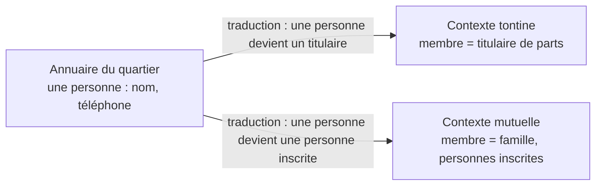

# Correction 4.6 — Exercice 4 : le plan d'analyse de la mutuelle

> Rappel de l'énoncé : classer la mutuelle dans la grille ; écrire son
> plan d'analyse ; trouver les mots à deux sens avec la tontine ; écrire
> trois scénarios de qualité.

Cette correction est un plan, sans code.

## En bref

- **Risque moyen à élevé** : de l'argent (remboursements) et des données
  de santé, qui sont les plus sensibles de toutes.
- **Le plan tient en deux semaines** de travail d'analyse, réparties sur
  les outils qui répondent aux risques présents.
- **« Membre » et « cotisation » ont deux sens** avec la tontine : deux
  contextes, et une traduction pour les personnes communes.

## 1. Qui perd quoi

Une famille qui n'est pas remboursée d'une facture de 40 000 FCFA ; une
famille dont la maladie d'un enfant est connue du quartier. Le second
risque est le plus grave, et il n'existe pas dans la tontine. Dans la
grille de la leçon : **moyen à élevé**, la ligne de la mutuelle.

## 2. Le plan

| Outil | Sur quoi | Effort |
|---|---|---|
| cas d'utilisation (4.1) | « se faire rembourser une facture », « inscrire une famille », « régulariser un retard » : les extensions surtout (facture illisible, plafond atteint en cours d'année, famille en retard de deux mois) | 2 jours |
| critères chiffrés (4.1) | 70 %, plafond de 50 000 par personne et par an, seuil de 20 000 pour le comité, retard de deux mois | 1 jour, avec le trésorier |
| scénarios de qualité (4.2) | confidentialité d'abord ; disponibilité modeste (un remboursement peut attendre une heure) | 1 jour |
| modèle conceptuel (4.3) | famille, personne inscrite, facture, remboursement ; contrôlé sur le registre papier du trésorier | 2 jours |
| diagrammes (4.4) | les états d'une facture ; l'activité du remboursement avec ses décisions | 1 jour |
| C4 et ADR (4.5) | contexte et conteneurs ; ADR sur la confidentialité et sur le partage des personnes avec la tontine | 1 jour |
| DDD stratégique (4.6) | la carte des contextes avec la tontine | une demi-journée |

Environ neuf jours sur deux semaines. Ce qui est volontairement léger :
la performance (quelques dizaines de factures par mois) et les diagrammes
de séquence (peu d'échanges extérieurs).

## 3. Les mots à deux sens

| Mot | Tontine | Mutuelle |
|---|---|---|
| membre | une personne qui tient une part | une **famille** adhérente, ou une personne inscrite |
| cotisation | 50 000 par part et par mois | 3 000 par personne inscrite et par mois |
| retard | une pénalité de 5 % par semaine | plus de remboursement jusqu'à régularisation |

Les mêmes mots, des règles opposées : deux contextes. La carte :

Ce qui est partagé, c'est **la personne** (un nom, un téléphone), et rien
d'autre. Les données de santé ne sortent jamais du contexte de la
mutuelle.

## 4. Trois scénarios

**Confidentialité**

| Partie | |
|---|---|
| source | un membre du bureau de la tontine, qui a accès à l'application de la tontine |
| stimulus | il cherche les factures d'une famille du quartier |
| artefact | les données de la mutuelle |
| réponse | aucun accès : les comptes de la tontine ne voient rien de la mutuelle ; chaque consultation d'une facture est journalisée |
| mesure | zéro donnée de santé lisible depuis le contexte de la tontine ; 100 % des consultations journalisées avec leur auteur |

**Exactitude**

| Partie | |
|---|---|
| stimulus | une facture de 80 000 FCFA arrive pour une personne déjà remboursée de 30 000 cette année |
| réponse | rembourser 20 000 (le reste du plafond de 50 000), pas 56 000 (70 %) |
| mesure | zéro remboursement au-delà du plafond, vérifié chaque mois par un contrôle des données |

**Disponibilité**

| Partie | |
|---|---|
| stimulus | le trésorier enregistre une facture |
| environnement | n'importe quel jour ouvrable |
| mesure | 99 % des enregistrements réussis sur 30 jours ; un remboursement peut attendre jusqu'à une heure |

Le dernier est volontairement modeste : le noter (H, B) dans l'arbre
d'utilité évite de dépenser pour une disponibilité dont personne n'a
besoin.

## Ce qu'il faut retenir

1. Le plan d'analyse découle de « qui perd quoi » : ici, les données de
   santé avant l'argent.
2. Chaque outil a un sujet précis et un temps borné.
3. Quand deux domaines partagent des personnes, on partage la personne,
   et rien de ce que chaque domaine sait d'elle.
