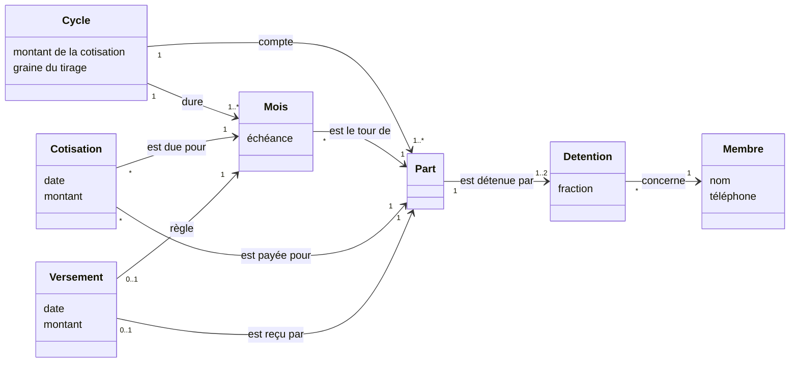

# Leçon 4.3 — Modéliser le domaine sans code : le modèle conceptuel

## L'essentiel en deux minutes

**Le problème, en une phrase.** Le code range le monde dans des types :
un membre, un nombre de parts, une date. Si ces types ne correspondent pas
aux **choses** du métier, le code devient faux le jour où une situation
réelle ne rentre pas dans ses cases, et ce jour-là il faut tout reprendre.
Le **modèle conceptuel** dessine ces choses avant le code : quels
concepts, quels liens entre eux, et **combien** de chaque côté.

**Trois images.**

- **Le plan d'une maison avant les briques** : on y voit les pièces et
  les portes, pas la marque du ciment. Le modèle conceptuel montre les
  concepts et leurs liens, pas les tables ni les types Go.
- **L'état civil** : une personne a **un** père et **une** mère
  biologiques, et peut avoir **zéro, un ou plusieurs** enfants. Ces
  chiffres de chaque côté d'un lien s'appellent des **multiplicités**.
  Elles disent ce qui est possible, et donc ce qui est une erreur.
- **Le lexique d'un contrat** : « dans le présent contrat, *le
  Bénéficiaire* désigne… ». Avant de discuter, on s'accorde sur le sens
  des mots. C'est le **glossaire**.

**Le code, en dix lignes.** Une multiplicité du modèle (« une part a un
ou deux titulaires, dont les fractions font 1 ») devient une règle qu'on
vérifie sur des données réelles :

```go
        // A share has one or two holders, whose parts add up to 1.
        num, den := 0, 1
        for _, h := range s.Holders {
            num, den = num*h.Den+h.Num*den, den*h.Den
        }
        if len(s.Holders) < 1 || len(s.Holders) > 2 || num != den {
            out = append(out, Violation{0, "holders", fmt.Sprintf("%s: %d holders, parts %d/%d", s.ID, len(s.Holders), num, den)})
        }
```

**Les règles à retenir.**

1. **Cherche les noms du métier** dans ce que disent les gens (cas
   d'utilisation, comptes rendus) : ils sont les concepts candidats.
2. **Écris un glossaire** : une définition par mot, un seul mot par
   concept, et le nom qu'il aura dans le code.
3. **Dessine les concepts, leurs liens et leurs multiplicités**, sans
   identifiants, sans types techniques, sans base de données.
4. **Chaque multiplicité est une règle vérifiable.** Confronte-les aux
   données réelles avant d'écrire le logiciel : elles y trouvent des
   erreurs, et des concepts oubliés.
5. **Un concept manquant coûte plus cher qu'un champ manquant** : un champ
   s'ajoute ; un concept absent oblige à tordre tout ce qui en dépend.

La suite mesure tout cela sur un vrai module.

---

La leçon 4.1 a trouvé **ce que** la tontine doit faire, la leçon 4.2 **à
quel point**. Celle-ci s'intéresse à ce dont on parle : les choses du
métier, et leurs liens. Le problème qui revient est

> **Avant d'écrire les types du programme, comment savoir quelles
> « choses » existent dans le métier, comment elles se tiennent, et
> combien de chacune peuvent se rattacher aux autres ? Et comment le
> vérifier sans attendre que le logiciel soit écrit ?**

La tontine de la leçon 4.1 avait une règle R3 : « on peut avoir deux
parts : on cotise deux fois, on bouffe deux fois ». Le code l'a écrite
comme un **nombre** : un membre a `Shares int`. La trésorière arrive avec
son cahier de l'année passée, pour qu'on le reprenne dans l'application.
Dedans, une ligne que personne n'avait prévue : la part P05 est tenue
**à moitié** par Divine, et à moitié par Ebai.

Tout ce qui suit est mesuré sur un module vert sous `gofmt -l`,
`go vet ./...` et `go test -race -count=1 ./...`. Le cahier, la tontine et
ses membres sont fictifs.

## 1. Les mots du métier

Un modèle conceptuel commence par les **mots**. La technique la plus
simple, popularisée par Craig Larman (*Applying UML and Patterns*) :
relire ce que disent les gens du métier, et souligner les **noms**. Dans
le cas d'utilisation et le compte rendu de la leçon 4.1 :

```text
Le 5, la trésorière ouvre le mois en cours. Le système montre les
cotisations reçues : toutes les parts sont là. Le système indique le
bénéficiaire du mois et le montant. [...] Si le 10 il manque encore des
parts, la caisse de secours avance ce qui manque, et le retardataire
rembourse la caisse. [...] On peut avoir deux parts (deux « noms ») : on
cotise deux fois, on bouffe deux fois.
```

Les noms soulignés : trésorière, mois, cotisation, part, bénéficiaire,
montant, caisse de secours, retardataire, nom. Ce sont des **concepts
candidats**. Certains sont des concepts (part, cotisation, mois), d'autres
des **rôles** d'un concept (bénéficiaire et retardataire sont des membres
dans une situation), d'autres des **attributs** (montant). Et deux mots,
« part » et « nom », désignent la même chose.

Le tri se fait avec une question : « **est-ce que j'ai besoin de me
souvenir de chacun, séparément ?** ». Une part, oui : on suit chacune,
mois après mois. Un montant, non : c'est une propriété d'autre chose.

## 2. Le glossaire

Le glossaire fixe le sens de chaque mot, un seul mot par concept, et le
nom que le concept portera dans le code. Le code de ce cours est en
anglais, le métier parle français : le glossaire est aussi le
**dictionnaire** entre les deux.

| Terme | Définition | Synonymes à éviter | Dans le code |
|---|---|---|---|
| tontine | un groupe de personnes qui cotisent ensemble selon des règles communes | association, njangi | — |
| cycle | une période où chaque part reçoit la cagnotte une fois, dans l'ordre tiré | tour (c'est autre chose) | `Cycle` |
| **part** | ce qui cotise chaque mois et reçoit la cagnotte une fois par cycle | **nom**, main | `Share` |
| titulaire | une personne qui détient tout ou partie d'une part | propriétaire | `Holding.Person` |
| membre | une personne qui est titulaire d'au moins une part | adhérent | — |
| cotisation | un paiement fait pour une part, pour un mois | versement (c'est autre chose) | `Contribution` |
| cagnotte | ce qui revient à une part le mois de son tour : le nombre de parts × le montant de la cotisation | pot, caisse | le montant d'un `Payout` |
| versement | le paiement de la cagnotte à la part dont c'est le tour ; « bouffer », c'est recevoir un versement | — | `Payout` |
| tour | le mois où une part reçoit la cagnotte | rang | `Cycle.Order` |

Trois choses que le glossaire a fixées, et qui n'allaient pas de soi :

- **« Nom » et « part » sont un seul concept.** Si le code avait gardé
  les deux mots, quelqu'un aurait fini par écrire un type `Name` et un type
  `Share`.
- **Membre n'est pas part.** Un membre peut tenir deux parts (Ama), ou une
  demi-part (Divine). C'est exactement ce que la leçon 4.1 avait confondu.
- **« Cotisation » et « versement » vont dans des sens opposés** : la
  cotisation va de la part à la tontine, le versement de la tontine à la
  part. Dans la conversation, les deux s'appelaient parfois « paiement ».

Martin Fowler résume l'idée d'Eric Evans derrière ce travail : le
*langage omniprésent* (*ubiquitous language*), « *a common, rigorous
language between developers and users* ». Le glossaire en est la première
version écrite.

## 3. Le modèle conceptuel

Le modèle dessine les concepts du glossaire, leurs **attributs** et leurs
**associations**, avec des **multiplicités** à chaque bout. En UML, c'est
un diagramme de classes ; GitHub l'affiche à partir d'un texte Mermaid :



Comment le lire : « une **part** est détenue par **une ou deux**
détentions ; chaque détention concerne **un** membre, avec une
**fraction** ». La demi-part de Divine et Ebai, c'est une part et deux
détentions de ½.

Ce que les multiplicités disent, en français :

| Multiplicité | Ce qu'elle dit | Ce qui serait une erreur |
|---|---|---|
| Part `1` → `1..2` Détention, fractions = 1 | une part a un ou deux titulaires, dont les fractions font une part entière | une part sans titulaire, trois titulaires, deux moitiés et un tiers |
| Mois `*` → `1` Part (le tour) | chaque mois est le tour d'**une** part | deux bénéficiaires le même mois |
| Versement `0..1` → `1` Mois | un mois a au plus un versement ; à la fin du cycle, exactement un | deux versements le même mois, un mois sans versement |
| Versement `0..1` → `1` Part | une part reçoit au plus une cagnotte par cycle | une part qui bouffe deux fois |

Ce que le modèle **ne contient pas**, exprès : pas d'identifiant, pas de
statut (`Sent`, `Unknown` appartiennent au logiciel, leçon 3.5), pas de
type `int64`, pas de table. Il ne dit rien du *comment*. Fowler appelle ce
genre de diagramme une **esquisse** (*UML as sketch*), dont l'objectif est
« *selective communication rather than complete specification* ». Il
ajoute : « *comprehensiveness is the enemy of comprehensibility* ». Un
modèle conceptuel utile tient sur une page.

## 4. Mesure : le cahier dans le modèle de la leçon 4.1

Le modèle de la leçon 4.1 n'avait pas de concept **part** : un membre
avait un **nombre** de parts.

```go
type Member struct {
    Name   string
    Shares int
}
```

La seule façon d'y écrire le cahier est de donner une part à chaque
titulaire :

```go
// FromShares writes the shares of the notebook in the flat model: each
// holder of a share gets one more share. It is the only translation the
// flat model allows.
func FromShares(shares []model.Share) []Member {
    var out []Member
    index := map[string]int{}
    for _, s := range shares {
        for _, h := range s.Holders {
            i, ok := index[h.Person]
            if !ok {
                i = len(out)
                index[h.Person] = i
                out = append(out, Member{Name: h.Person})
            }
            out[i].Shares++
        }
    }
    return out
}
```

Le cahier de la trésorière, chargé dans ce modèle
(`go run ./cmd/flat`) :

```text
the tontine: 12 shares, a pot of 600000, 12 months
flat model:  13 shares, a pot of 650000, 13 months
Divine  flat model: 1 share, owes 600000 a year, paid 300000: 300000 "late"; takes a pot of 650000
Ebai    flat model: 1 share, owes 600000 a year, paid 325000: 275000 "late"; takes a pot of 650000
```

Une seule demi-part, et tout est faux : treize parts au lieu de douze, un
cycle de treize mois, une cagnotte de 650 000 au lieu de 600 000. Divine et
Ebai apparaissent **en retard** de 300 000 et 275 000 FCFA, alors qu'elles
ont payé ce qu'elles devaient, et chacune recevrait une cagnotte entière :
1 300 000 FCFA pour une part qui en vaut 600 000.

Corriger ce modèle sans changer ses concepts demanderait des cas
particuliers partout : un booléen « demi-part », une règle « si demi-part,
diviser par deux », un tour partagé. Le problème n'est pas un champ qui
manque, c'est un **concept** : la part, qui existe indépendamment des
personnes qui la tiennent.

## 5. Les multiplicités deviennent des règles

Le modèle conceptuel se dessine sans code. Mais on peut le **vérifier**
avec du code, avant d'écrire le logiciel : chaque multiplicité devient une
règle, et l'on confronte les règles aux données réelles. Les concepts,
écrits en Go uniquement pour cette vérification :

```go
// Holding is a person's part of a share: Num/Den of it.
type Holding struct {
    Person   string
    Num, Den int
}
```

```go
// Share ("part", "nom") is what pays every month and takes the pot once a
// cycle. One or two people hold it.
type Share struct {
    ID      string
    Holders []Holding
}
```

Et les règles, une par multiplicité :

```go
// Check returns every violation, in the order of the rules, then of the
// lines.
func Check(c Cycle, cs []Contribution, ps []Payout) []Violation {
    var out []Violation
    shares := map[string]Share{}
    for _, s := range c.Shares {
        shares[s.ID] = s
        // A share has one or two holders, whose parts add up to 1.
        num, den := 0, 1
        for _, h := range s.Holders {
            num, den = num*h.Den+h.Num*den, den*h.Den
        }
        if len(s.Holders) < 1 || len(s.Holders) > 2 || num != den {
            out = append(out, Violation{0, "holders", fmt.Sprintf("%s: %d holders, parts %d/%d", s.ID, len(s.Holders), num, den)})
        }
    }

    // A contribution comes from a holder of the share, for their part.
    for _, ct := range cs {
        h, ok := holding(shares[ct.Share], ct.Person)
        if !ok {
            out = append(out, Violation{ct.Line, "holder", fmt.Sprintf("%s is not a holder of %s", ct.Person, ct.Share)})
            continue
        }
        if want := c.Amount * int64(h.Num) / int64(h.Den); ct.Amount != want {
            out = append(out, Violation{ct.Line, "part", fmt.Sprintf("%s paid %d for %s, owes %d", ct.Person, ct.Amount, ct.Share, want)})
        }
    }

    // A month has exactly one payout, to the share whose turn it is, of the
    // whole pot. A share takes the pot exactly once a cycle.
    pot := int64(len(c.Shares)) * c.Amount
    byMonth, byShare := map[string]int{}, map[string]int{}
    for _, p := range ps {
        byMonth[p.Month]++
        byShare[p.Share]++
        if byMonth[p.Month] > 1 {
            out = append(out, Violation{p.Line, "one a month", fmt.Sprintf("second payout in %s", p.Month)})
        }
        if byShare[p.Share] > 1 {
            out = append(out, Violation{p.Line, "once", fmt.Sprintf("%s takes the pot a second time", p.Share)})
        }
        if turn := c.Order[p.Month]; turn != p.Share {
            out = append(out, Violation{p.Line, "turn", fmt.Sprintf("%s paid in %s, the turn of %s", p.Share, p.Month, turn)})
        }
        if p.Amount != pot {
            out = append(out, Violation{p.Line, "pot", fmt.Sprintf("%d paid, the pot is %d", p.Amount, pot)})
        }
    }
    for _, m := range slices.Sorted(maps.Keys(c.Order)) {
        if byMonth[m] == 0 {
            out = append(out, Violation{0, "one a month", fmt.Sprintf("no payout in %s", m)})
        }
    }
    for _, s := range c.Shares {
        if byShare[s.ID] == 0 {
            out = append(out, Violation{0, "once", fmt.Sprintf("%s never took the pot", s.ID)})
        }
    }
    return out
}
```

## 6. Mesure : le cahier contrôlé

Le cahier de l'année, contrôlé par les règles du modèle
(`go run ./cmd/check`) :

```text
12 shares, 156 contributions, 12 payouts read; 8 problems:
line  21  part        Ebai paid 50000 for P05, owes 25000
line  65  holder      Mme Fon is not a holder of P06
line  58  one a month second payout in 2026-02
line  58  turn        P08 paid in 2026-02, the turn of P07
line  86  pot         550000 paid, the pot is 600000
line 169  once        P08 takes the pot a second time
cycle     one a month no payout in 2026-09
cycle     once        P06 never took the pot
```

Huit problèmes, sur 168 lignes que la trésorière tenait avec soin. Ils ne
sont pas tous de la même nature :

| Ligne | Problème | Nature |
|---|---|---|
| 21 | Ebai a payé une part entière sur une demi-part | **donnée** : 25 000 de trop, à rendre ou à reporter |
| 58 | un second versement en février, à P08, dont ce n'était pas le tour | **donnée** : une erreur de la trésorière, ou une avance non notée |
| 169 | P08 reçoit une seconde cagnotte en octobre | **conséquence** de la ligne 58 : P08 a bouffé deux fois |
| cycle | P06 n'a jamais bouffé, aucun versement en septembre | **donnée** : soit P06 n'a pas été payée, soit le versement n'a pas été noté |
| 86 | 550 000 versés en avril au lieu de 600 000 | **donnée**, ou une règle oubliée : la caisse de secours (R4) aurait dû avancer 50 000 |
| 65 | « Mme Fon n'est pas titulaire de P06 » | **modèle** : la femme de Fon a payé pour lui. Ce n'est pas une erreur |

La dernière ligne est la plus précieuse. Les données ne sont pas fausses :
c'est le **modèle** qui l'est. Il confondait **celui qui paie** et
**celui qui doit**. Une cotisation est due par le titulaire d'une part ;
elle peut être payée par n'importe qui, pour lui. Le modèle doit gagner un
concept, ou au moins une association (« payée par », « pour le compte
de ») : c'est l'exercice 3.

Le contrôle a donc servi deux fois : il a trouvé quatre erreurs de
données (et une conséquence) qu'il faudra régler avec la trésorière
**avant** la reprise, et un
concept oublié qu'il fallait trouver **avant** d'écrire le logiciel. La
même découverte, faite en production, aurait coûté une migration de
données.

## 7. Du modèle conceptuel au logiciel

Le passage au code change beaucoup de choses, et doit en garder une :

| Ce qui change | Exemple |
|---|---|
| les noms, d'après le glossaire | part → `Share`, cotisation → `Contribution` |
| des identifiants apparaissent | `P05`, une clé en base |
| des statuts apparaissent | un versement `Sent`, `Unknown`, `Paid` (leçon 3.5) |
| des types techniques apparaissent | un montant en `int64` de FCFA, une date avec son fuseau (leçon 4.1, exercice 5) |
| **ce qui ne change pas** | **les multiplicités** : une part, une ou deux détentions ; un mois, un versement |

Les multiplicités deviennent des contraintes du code (une validation dans
le constructeur, une contrainte d'unicité en base) et des tests. Si le
code permet ce que le modèle interdit, le code est faux ; si le code
interdit ce que le métier fait (une demi-part), le modèle était faux.

## 8. La campagne

Une erreur à la fois dans les règles et dans la lecture du cahier :

```text
trois titulaires acceptés                    tuee
fractions non vérifiées                      tuee
fractions mal additionnées                   tuee
payeur étranger ignoré                       tuee
montant de la part ignoré                    tuee
deux versements par mois                     tuee
deux cagnottes par part                      tuee
tour ignoré                                  tuee
cagnotte d'une part de moins                 tuee
mois sans versement ignoré                   tuee
part jamais payée ignorée                    tuee
numéro de ligne décalé                       tuee
12/12 tuees
```

Douze erreurs, toutes vues. Une précision d'honnêteté : au premier
passage, « fractions mal additionnées » ne compilait pas (`go vet`
refusait une affectation de `den` à lui-même) ; elle a été réécrite, puis
rejouée.

## 9. La grille

| | Modèle de la leçon 4.1 (un membre, un nombre de parts) | Modèle conceptuel (part, détention, membre) |
|---|---|---|
| la demi-part de Divine et Ebai | impossible à écrire : deux parts entières | une part, deux détentions de ½ |
| cycle | 13 mois | 12 mois |
| cagnotte | 650 000 | 600 000 |
| Divine et Ebai | « en retard » de 575 000 FCFA à elles deux | à jour |
| problèmes trouvés dans le cahier | — | 8 : 4 erreurs de données, leurs conséquences, et un concept manquant |
| coût d'une nouvelle règle sur les parts | des cas particuliers partout | une règle sur la part |

## 10. Les trois erreurs qui restent

### « Le modèle, c'est le schéma de la base »

Le schéma de la base est **une** traduction du modèle, avec des clés, des
index, des colonnes techniques. Partir de la base, c'est discuter avec le
métier de clés étrangères au lieu de parts et de détentions. Et c'est
souvent figer les erreurs du premier modèle : une colonne `shares INTEGER`
dans la table des membres est exactement le modèle de la leçon 4.1.

### « Le modèle doit être complet avant de coder »

Le modèle de cette leçon n'a ni la caisse de secours, ni le tirage, ni
les pénalités. Il a les concepts dont la **reprise du cahier** avait
besoin. Un modèle complet n'est jamais fini, et personne ne le lit. On
modélise ce que la prochaine décision demande, et on le confronte aux
données.

### « Les noms du code suffisent »

`Share`, `Holding`, `Payout` : un membre du bureau ne lit pas ces mots, et
le développeur suivant ne sait pas que `Share` est ce que la trésorière
appelle « un nom ». Le glossaire est le seul endroit où les deux langues
se rencontrent. Sans lui, la conversation suivante recrée la confusion.

## 11. Le lien avec la production

- « La migration des données a échoué sur 3 % des lignes » : des données
  réelles que le modèle ne prévoyait pas. Contrôler les données avec les
  multiplicités **avant** de concevoir les tables les aurait trouvées.
- « On a ajouté un booléen, puis un deuxième, puis un cas particulier » :
  un concept manquant, compensé par des champs. Le signe : un `if` sur le
  même booléen dans dix fichiers.
- « Le support et les développeurs ne parlent pas de la même chose » : pas
  de glossaire, ou un glossaire qui n'a pas suivi le code.

## 12. Ce qu'il faut retenir

1. Les concepts candidats sont les noms de ce que dit le métier ; trie-les
   en concepts, rôles et attributs.
2. Le glossaire donne un mot par concept, sa définition, et son nom dans
   le code.
3. Le modèle conceptuel montre concepts, associations et multiplicités,
   sans rien de technique, et tient sur une page.
4. Chaque multiplicité est une règle : confronte-les aux données réelles,
   pour trouver des erreurs de données et des concepts oubliés.
5. Un concept manquant ne se corrige pas par des champs : il se corrige
   dans le modèle.

## 13. Approfondissement

### Event Storming

Une autre façon de trouver les concepts part des **événements** plutôt
que des noms : « cotisation reçue », « cagnotte versée », « membre
parti ». L'*Event Storming* d'Alberto Brandolini les fait écrire sur des
post-it, au mur, par le métier et les développeurs ensemble, puis
regroupe ce qui va ensemble. Son site le décrit comme « *a flexible
workshop format for collaborative exploration of complex business
domains* ». Les deux approches se complètent : les noms donnent les
concepts, les événements donnent ce qui leur arrive.

### Le langage omniprésent, et le niveau 7

Le glossaire de cette leçon est la première étape du *langage omniprésent*
d'Eric Evans (*Domain-Driven Design*, 2003). Le DDD va plus loin : il
découpe le domaine en **contextes** où un même mot peut avoir deux sens
(« membre » pour la tontine et pour la banque), et donne au modèle du code
la forme exacte du modèle du métier. La leçon 4.6 dit quand ce prix vaut
la peine, et le niveau 7 l'applique.

## 14. Le réflexe à installer

Avant de déclarer le premier `type` d'un nouveau domaine :

1. Souligne les noms dans ce que dit le métier ; trie concepts, rôles,
   attributs.
2. Écris le glossaire, avec les synonymes à éviter et le nom dans le
   code.
3. Dessine les concepts et leurs multiplicités sur une page.
4. Écris les multiplicités comme des règles, et passe les données réelles
   dedans. Chaque violation est une erreur de données, ou une erreur du
   modèle : trie-les avec le métier.

## Sources

- Craig Larman, *Applying UML and Patterns*, 3ᵉ édition, Prentice Hall,
  2004 — le modèle du domaine, les classes conceptuelles, la recherche des
  noms.
- Martin Fowler, *UML Distilled*, 3ᵉ édition, Addison-Wesley, 2003, et
  [UmlAsSketch](https://martinfowler.com/bliki/UmlAsSketch.html).
- Martin Fowler, [UbiquitousLanguage](https://martinfowler.com/bliki/UbiquitousLanguage.html).
- Eric Evans, *Domain-Driven Design*, Addison-Wesley, 2003.
- Mermaid, [Class diagrams](https://mermaid.js.org/syntax/classDiagram.html),
  la section *Cardinality / Multiplicity on relations*.
- Alberto Brandolini, [EventStorming](https://www.eventstorming.com/).
- OMG, [Unified Modeling Language 2.5.1](https://www.omg.org/spec/UML/2.5.1),
  la spécification d'UML, diagrammes de classes et multiplicités compris.

---

➡️ Exercices : [4.3-exercices.md](../exercices/4.3-exercices.md)
