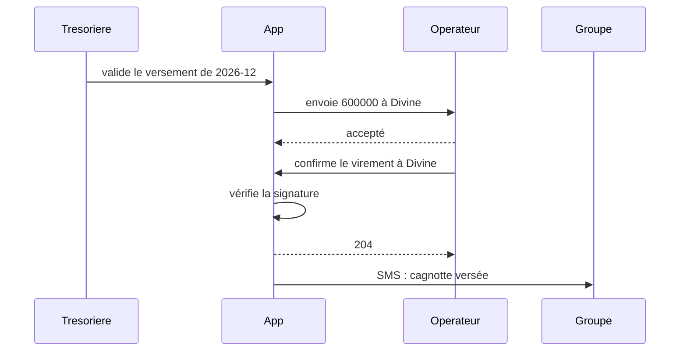
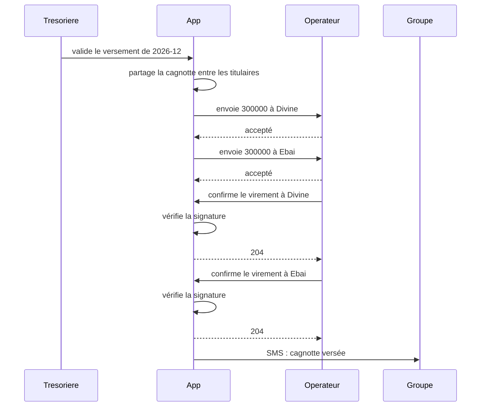
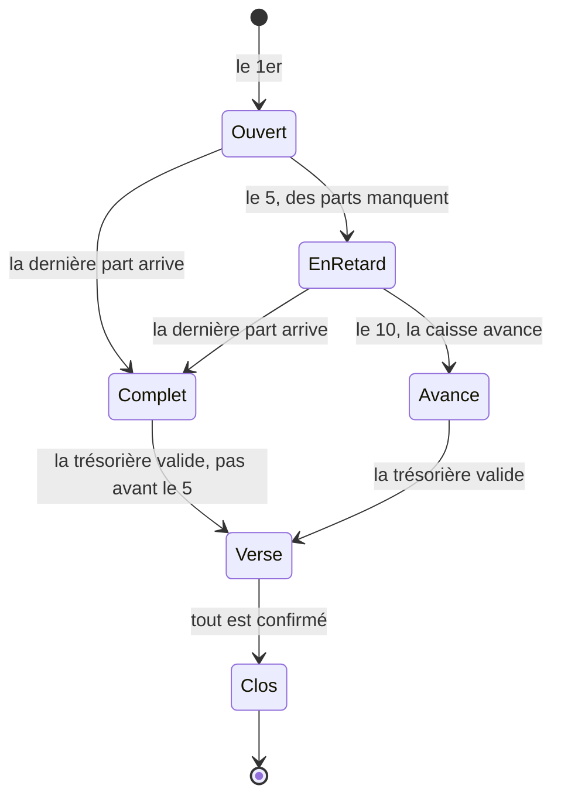

# Leçon 4.4 — Les diagrammes qui servent : séquence, états, activité

## L'essentiel en deux minutes

**Le problème, en une phrase.** Un diagramme aide à penser à plusieurs :
on voit d'un coup qui parle à qui, dans quel ordre, et ce qui se passe
quand ça tourne mal. Mais un diagramme dessiné à la main **dérive** : le
code change, le dessin reste. Le jour d'un incident, quelqu'un le croit,
et prend la mauvaise décision.

**Trois images.**

- **Le plan du métro** : il ne respecte pas les distances, seulement
  l'ordre des stations et les correspondances. Un diagramme de
  **séquence** fait pareil : il ne dit rien de la durée, seulement de
  l'ordre des messages entre les participants.
- **Le feu tricolore** : vert, puis orange, puis rouge, puis vert ; jamais
  de l'orange au vert. Un diagramme d'**états** dit dans quels états une
  chose peut être, et par où elle passe.
- **La recette avec ses « si »** : « si la pâte colle, rajoutez de la
  farine ». Un diagramme d'**activité** suit un processus, ses décisions
  et ses boucles. Chaque chemin de la recette est un cas à essayer.

**Le code, en quinze lignes.** Le diagramme du dépôt est celui que le code
dessine, et un test le vérifie :

```go
// The diagram in docs/ is the one the code draws. When the code changes,
// this test fails and shows the new diagram; go test -update writes it,
// and the change of the diagram is reviewed with the change of the code.
func TestTheSequenceDiagramIsUpToDate(t *testing.T) {
    const path = "../docs/versement.mmd"
    got := payflow.December()
    if *update {
        if err := os.WriteFile(path, []byte(got), 0o644); err != nil {
            t.Fatal(err)
        }
    }
    want, err := os.ReadFile(path)
    if err != nil {
        t.Fatal(err)
    }
    if got != string(want) {
        t.Fatalf("docs/versement.mmd is not what the code does; run go test -update and review the diff.\nthe code draws:\n%s", got)
    }
}
```

**Les règles à retenir.**

1. **Un diagramme par question** : « qui parle à qui, dans quel ordre ? »
   (séquence), « par où passe cette chose ? » (états), « quelles étapes,
   quelles décisions ? » (activité).
2. **Pendant l'analyse, on esquisse** : au tableau, avec le métier, vite,
   incomplet. L'esquisse sert à décider, puis on la jette.
3. **Une fois le code écrit, le diagramme vient du code** : généré par une
   exécution ou par les données, jamais recopié à la main.
4. **Un diagramme qui compte est vérifié par un test.** Quand le code
   change, le test échoue, et le nouveau diagramme se relit en revue avec
   le code.
5. **Les chemins d'un diagramme d'activité sont un plan de test** : une
   réponse de décision qu'aucun test ne parcourt est un trou, et souvent
   un défaut.

La suite mesure tout cela sur un vrai module.

---

Les leçons 4.1 à 4.3 ont écrit ce que la tontine doit faire, à quel point,
et de quoi elle parle. Elles ont déjà utilisé deux diagrammes : la table
des transitions de la leçon 3.5, et le modèle conceptuel de la leçon 4.3.
Celle-ci se concentre sur les trois diagrammes de **comportement** qui
servent le plus, et sur la façon de les garder justes. Le problème qui
revient est

> **Un diagramme aide à comprendre et à décider. Comment choisir celui qui
> répond à la question posée, et comment éviter qu'il ne mente quelques
> mois plus tard ?**

Tout ce qui suit est mesuré sur un module vert sous `gofmt -l`,
`go vet ./...` et `go test -race -count=1 ./...`. Les diagrammes sont
écrits en Mermaid, que GitHub affiche dans les fichiers Markdown.

## 1. Trois questions, trois diagrammes

| Question | Diagramme | Ce qu'il montre | Ce qu'il cache |
|---|---|---|---|
| qui parle à qui, dans quel ordre ? | **séquence** | les participants, les messages, leur ordre, les réponses | les durées, les données détaillées, les autres scénarios |
| par où passe cette chose, et qu'est-ce qui la fait changer ? | **états** | les états d'**une** chose, les transitions, les événements | qui provoque l'événement, ce qui se passe ailleurs |
| quelles étapes, quelles décisions, dans quel processus ? | **activité** | les étapes, les décisions, les boucles, éventuellement les acteurs | l'état des choses, l'ordre exact des messages |

Le piège le plus courant est de forcer une question dans le mauvais
diagramme : un diagramme de séquence avec des `alt` et des `loop` partout
pour raconter un processus (c'est une activité), ou un diagramme
d'activité pour décrire la vie d'un paiement (ce sont des états).

## 2. Le diagramme de séquence du versement

À la réunion de conception du versement de la cagnotte, l'équipe a dessiné
ce diagramme, puis l'a mis dans le wiki :



Il dit l'essentiel : la trésorière valide, l'application envoie le
virement, l'opérateur l'accepte, puis confirme plus tard par un appel ;
l'application vérifie la signature, et **seulement alors** prévient le
groupe. Six mois plus tard, quelqu'un prépare une astreinte avec ce
diagramme. Est-il encore juste ?

## 3. Mesure : le code contre le diagramme

Pour le savoir, il faut le dessin de ce que **fait** le code. Chaque étape
du versement le dit à un enregistreur :

```go
// Recorder keeps the messages in the order they happen.
type Recorder struct {
    mu   sync.Mutex
    msgs []Message
}
```

```go
func (r *Recorder) Call(from, to, text string) { r.add(Message{from, to, text, false}) }
```

Le code de production lui passe `nil`, et l'enregistreur ne fait rien.
Une démonstration rejoue le versement de décembre pour la demi-part P05,
avec l'enregistreur, et en tire le diagramme. Comparé à celui du wiki
(`diff docs/versement-wiki.mmd`, contre la sortie de
`go run ./cmd/sequence first`) :

```text
7c7,8
<     App->>Operateur: envoie 600000 à Divine
---
>     App->>App: partage la cagnotte entre les titulaires
>     App->>Operateur: envoie 300000 à Divine
8a10,12
>     App->>Operateur: envoie 300000 à Ebai
>     Operateur-->>App: accepté
>     App->>Groupe: SMS : cagnotte versée
12c16,18
<     App->>Groupe: SMS : cagnotte versée
---
>     Operateur->>App: confirme le virement à Ebai
>     App->>App: vérifie la signature
>     App-->>Operateur: 204
```

Deux différences, et elles ne vont **pas dans le même sens** :

- **Les virements.** Le wiki montre un virement de 600 000 ; le code en
  fait deux de 300 000, depuis la correction de l'exercice 5 de la leçon
  4.3. Ici, **le diagramme est périmé**, le code a raison.
- **Le SMS.** Le wiki prévient le groupe **après** les confirmations ; le
  code le prévient dès que les virements **partent**, avant que
  l'opérateur n'ait rien confirmé. Ici, **le code a tort** : un membre lit
  « cagnotte versée » alors que l'argent peut encore être refusé ou rester
  en `Unknown`.

Le diagramme généré ne dit pas qui a raison. Il dit **où** le code et
l'intention se sont séparés. La décision reste humaine : on met à jour le
dessin pour les virements, et l'on corrige le code pour le SMS.

```go
// Callback is the operator's answer for the transfer of month m to to.
func (f *Flow) Callback(ctx context.Context, m, to string, body []byte, sig string) error {
    f.Trace.Call("Operateur", "App", "confirme le virement à "+to)
    f.Trace.Call("App", "App", "vérifie la signature")
    if err := f.Sig.Verify(body, sig); err != nil {
        f.Trace.Back("App", "Operateur", "401")
        return err
    }
    f.mu.Lock()
    defer f.mu.Unlock()
    if !f.waits[m][to] {
        f.Trace.Back("App", "Operateur", "404")
        return fmt.Errorf("%w: %s %s", ErrUnknown, m, to)
    }
    delete(f.waits[m], to)
    f.Trace.Back("App", "Operateur", "204")
    if len(f.waits[m]) > 0 {
        return nil
    }
    f.Trace.Call("App", "Groupe", "SMS : cagnotte versée")
    return f.SMS.Group(ctx, fmt.Sprintf("La cagnotte de %s (%s) est versée.", m, f.shares[m].ID))
}
```

## 4. Un diagramme qui ne peut plus mentir

Le diagramme du dépôt (`docs/versement.mmd`) est désormais celui que le
code dessine, et le test de l'essentiel le vérifie. Avant sa mise à jour,
il échouait ainsi :

```text
--- FAIL: TestTheSequenceDiagramIsUpToDate (0.00s)
    payflow_test.go:32: docs/versement.mmd is not what the code does; run go test -update and review the diff.
        the code draws:
```

`go test -update` réécrit le fichier depuis le code, et la revue de code
montre le changement du **diagramme** à côté du changement du code. On
appelle cette technique un fichier de référence (*golden file*) : le
résultat attendu est un fichier versionné, que le test compare et qu'une
option régénère. Le diagramme du versement, tel que le code le dessine
maintenant :



Le SMS est à la fin, après les deux confirmations. Si quelqu'un remet le
SMS au moment de l'envoi, le test échoue et montre le nouveau diagramme :
le changement de comportement ne peut plus passer inaperçu.

## 5. Le diagramme d'états : esquisser avec le métier

La leçon 3.5 générait le diagramme d'états d'un paiement depuis sa table
de transitions. C'est la bonne façon de le **documenter**. Pendant
l'**analyse**, avant qu'il n'y ait de table, le diagramme d'états sert à
autre chose : discuter avec le métier de la vie d'une chose. Voici
l'esquisse du **mois**, faite au tableau avec la trésorière :



Dessinée en dix minutes, elle a fait poser deux questions : « un mois
`Complet` le 3 peut-il être versé le 3 ? » (non, pas avant le 5 : AC6 de
la leçon 4.1) et « que devient un mois `Verse` dont un virement passe en
`Unknown` ? » (il reste `Verse` jusqu'au rapprochement). Les réponses vont
dans les critères d'acceptation ; l'esquisse, elle, a fait son travail. Si
le mois devient un jour une machine à états dans le code, son diagramme
sera généré depuis la table, comme à la leçon 3.5.

## 6. Le diagramme d'activité, et ses chemins

La clôture du mois est un **processus** : des étapes, des décisions, une
boucle. Il est dessiné avec la trésorière, et écrit comme des **données**,
pour que le dessin et l'analyse viennent de la même source :

```go
// Closing is the activity "close the month", drawn with the treasurer from
// the use case of lesson 4.1 and the statuses of lesson 3.5.
var Closing = Graph{
    Start: "start", End: "end",
    Nodes: []Node{
        {"start", "le 5 du mois", false},
        {"d1", "toutes les parts sont reçues ?", true},
        {"remind", "relancer les retardataires", false},
        {"d2", "le 10 : toutes les parts sont reçues ?", true},
        {"advance", "la caisse avance ce qui manque", false},
        {"send", "envoyer un virement par titulaire", false},
        {"d3", "l'opérateur accepte ?", true},
        {"fix", "corriger le numéro avec le titulaire", false},
        {"wait", "attendre les confirmations", false},
        {"d4", "tout est confirmé dans les 30 min ?", true},
        {"unknown", "statut Unknown : rapprochement", false},
        {"sms", "prévenir le groupe", false},
        {"end", "mois clôturé", false},
    },
    Edges: []Edge{
        {"start", "d1", ""},
        {"d1", "send", "oui"},
        {"d1", "remind", "non"},
        {"remind", "d2", ""},
        {"d2", "send", "oui"},
        {"d2", "advance", "non"},
        {"advance", "send", ""},
        {"send", "d3", ""},
        {"d3", "wait", "oui"},
        {"d3", "fix", "non"},
        {"fix", "send", ""},
        {"wait", "d4", ""},
        {"d4", "sms", "oui"},
        {"d4", "unknown", "non"},
        {"unknown", "sms", ""},
        {"sms", "end", ""},
    },
}
```

Le diagramme, généré depuis ces données (et vérifié par un test, comme le
précédent) :

```mermaid
flowchart TD
    start(["le 5 du mois"])
    d1{"toutes les parts sont reçues ?"}
    remind(["relancer les retardataires"])
    d2{"le 10 : toutes les parts sont reçues ?"}
    advance(["la caisse avance ce qui manque"])
    send(["envoyer un virement par titulaire"])
    d3{"l'opérateur accepte ?"}
    fix(["corriger le numéro avec le titulaire"])
    wait(["attendre les confirmations"])
    d4{"tout est confirmé dans les 30 min ?"}
    unknown(["statut Unknown : rapprochement"])
    sms(["prévenir le groupe"])
    end(["mois clôturé"])
    start --> d1
    d1 -->|oui| send
    d1 -->|non| remind
    remind --> d2
    d2 -->|oui| send
    d2 -->|non| advance
    advance --> send
    send --> d3
    d3 -->|oui| wait
    d3 -->|non| fix
    fix --> send
    wait --> d4
    d4 -->|oui| sms
    d4 -->|non| unknown
    unknown --> sms
    sms --> end
```

Un diagramme d'activité a une propriété utile : ses **chemins** sont un
plan de test. Chaque chemin du début à la fin est un scénario. Les
énumérer, en passant au plus une fois dans chaque boucle :

```go
// Paths lists every way from Start to End that goes through each loop at
// most once: a node is visited at most twice.
func (g Graph) Paths() []Path {
    var out []Path
    visits := map[string]int{}
    var walk func(id string, answers Path)
    walk = func(id string, answers Path) {
        if visits[id] == 2 {
            return
        }
        visits[id]++
        defer func() { visits[id]-- }()
        if id == g.End {
            out = append(out, slices.Clone(answers))
            return
        }
        for _, e := range g.Edges {
            if e.From != id {
                continue
            }
            next := answers
            if g.node(id).Decision {
                next = append(slices.Clone(answers), id+"="+e.Guard)
            }
            walk(e.To, next)
        }
    }
    walk(g.Start, nil)
    return out
}
```

Puis comparer avec les tests qui existent déjà, dans les leçons
précédentes (`go run ./cmd/paths`) :

```text
12 paths through the diagram:
   d1=oui d3=oui d4=oui
   d1=oui d3=oui d4=non
   d1=oui d3=non d3=oui d4=oui
   d1=oui d3=non d3=oui d4=non
   d1=non d2=oui d3=oui d4=oui
   d1=non d2=oui d3=oui d4=non
   d1=non d2=oui d3=non d3=oui d4=oui
   d1=non d2=oui d3=non d3=oui d4=non
   d1=non d2=non d3=oui d4=oui
   d1=non d2=non d3=oui d4=non
   d1=non d2=non d3=non d3=oui d4=oui
   d1=non d2=non d3=non d3=oui d4=non
5 tests; answers no test goes through: [d3=non]
```

Douze chemins, et cinq tests. On ne va pas écrire douze tests : les
chemins sont des combinaisons de quatre décisions, et la plupart des
combinaisons ne cachent rien de plus que leurs parties. Mais **chaque
réponse de chaque décision** doit être parcourue par au moins un test. Il
en manque une : `d3=non`, « l'opérateur refuse le virement », puis on
corrige le numéro et l'on renvoie.

Le test de ce chemin, écrit avant de toucher au code :

```go
// The path d3=non of the activity diagram: the operator refuses Ebai's
// transfer, the treasurer fixes the number with Ebai, and validates again.
// Divine's transfer, already accepted, must not leave twice.
func TestARefusedTransferIsSentAgainAlone(t *testing.T) {
    var sent []string
    refuse := map[string]bool{"Ebai": true}
    op := scriptOp{&sent, refuse}
    sms := &payflow.FakeSMS{}
    f := &payflow.Flow{Op: op, SMS: sms, Sig: payflow.FakeVerifier{}}
    ctx := context.Background()
    if err := f.Validate(ctx, "2026-12", half, 600_000); err == nil {
        t.Fatal("no error when the operator refuses")
    }
    delete(refuse, "Ebai") // the number is fixed
    if err := f.Validate(ctx, "2026-12", half, 600_000); err != nil {
        t.Fatal(err)
    }
    if got := strings.Join(sent, ","); got != "Divine 300000,Ebai 300000,Ebai 300000" {
        t.Fatalf("sent %s", got)
    }
    f.Callback(ctx, "2026-12", "Divine", nil, "ok")
    f.Callback(ctx, "2026-12", "Ebai", nil, "ok")
    if len(sms.Sent) != 1 {
        t.Fatalf("SMS %v", sms.Sent)
    }
}
```

```text
--- FAIL: TestARefusedTransferIsSentAgainAlone (0.00s)
    payflow_test.go:112: sent Divine 300000,Ebai 300000,Divine 300000,Ebai 300000
FAIL
FAIL    example/diagrams44/payflow      0.002s
FAIL
```

Le chemin que personne n'avait testé cachait un défaut : après le refus du
virement d'Ebai, valider à nouveau **renvoie aussi celui de Divine**, déjà
accepté. Divine aurait reçu 600 000 FCFA. Le code garde désormais les
virements acceptés, et ne les renvoie jamais :

```go
// Validate is called once the treasurer and a second member of the bureau
// have validated the payout of month m.
func (f *Flow) Validate(ctx context.Context, m string, s Share, pot int64) error {
    f.Trace.Call("Tresoriere", "App", "valide le versement de "+m)
    f.Trace.Call("App", "App", "partage la cagnotte entre les titulaires")
    f.mu.Lock()
    if f.waits == nil {
        f.waits, f.accepted, f.shares = map[string]map[string]bool{}, map[string]map[string]bool{}, map[string]Share{}
    }
    if f.waits[m] == nil { // validating again after a refusal keeps what was accepted
        f.waits[m], f.accepted[m], f.shares[m] = map[string]bool{}, map[string]bool{}, s
    }
    f.mu.Unlock()
    given := int64(0)
    for i, h := range s.Holders {
        amount := pot * int64(h.Num) / int64(h.Den)
        if i == len(s.Holders)-1 {
            amount = pot - given
        }
        given += amount
        f.mu.Lock()
        done := f.accepted[m][h.Person]
        f.mu.Unlock()
        if done {
            continue // accepted the first time: never twice
        }
        f.Trace.Call("App", "Operateur", fmt.Sprintf("envoie %d à %s", amount, h.Person))
        if err := f.Op.Send(ctx, m+"/"+h.Person, h.Person, amount); err != nil {
            f.Trace.Back("Operateur", "App", "refusé")
            return err
        }
        f.Trace.Back("Operateur", "App", "accepté")
        f.mu.Lock()
        f.waits[m][h.Person], f.accepted[m][h.Person] = true, true
        f.mu.Unlock()
    }
    return nil // the group hears of it when the operator has confirmed everything
}
```

Et un test empêche que le trou se reforme : si quelqu'un ajoute une
décision au diagramme, ce test demande les tests de ses réponses.

```go
// Every answer of every decision is gone through by at least one test.
// Add a decision to the diagram, and this test asks for its tests.
func TestEveryAnswerHasATest(t *testing.T) {
    seen := map[string]bool{}
    for _, answers := range activity.Tested {
        for _, a := range answers {
            seen[a] = true
        }
    }
    for _, o := range activity.Closing.Outcomes() {
        if !seen[o] {
            t.Errorf("no test goes through %s", o)
        }
    }
}
```

## 7. Esquisse ou document ?

Martin Fowler distingue l'UML comme **esquisse** (*sketch*) et l'UML comme
plan détaillé. L'esquisse vise « *selective communication rather than
complete specification* ». Les deux usages de cette leçon :

| | Esquisse | Document |
|---|---|---|
| quand | pendant l'analyse, avant le code | une fois le code écrit |
| où | au tableau, dans un message, une photo | dans le dépôt, à côté du code |
| qui l'écrit | l'équipe et le métier, à la main | le code : une exécution, ou des données |
| combien de temps il vit | le temps de décider | aussi longtemps que le code |
| comment il reste juste | il ne reste pas : on le jette | un test le compare au code |

Le diagramme du wiki de la section 2 était une esquisse devenue document
sans changer de nature : écrite à la main, jamais vérifiée. C'est le cas
qui ment.

## 8. La campagne

Une erreur à la fois dans l'enregistreur, le versement et l'activité :

```text
réponse dessinée comme un appel              tuee
ordre des participants ignoré                tuee
enregistreur nul qui panique                 tuee
SMS dès l'envoi                              tuee
SMS dès la première confirmation             tuee
virement accepté renvoyé                     tuee
nouvelle validation qui oublie tout          tuee
signature non vérifiée                       tuee
réponse inconnue acceptée                    tuee
franc d'arrondi perdu                        tuee
texte du diagramme changé                    tuee
boucles parcourues deux fois                 tuee
réponses des étapes ordinaires               tuee
décision dessinée en rectangle               tuee
14/14 tuees
```

Quatorze erreurs, toutes vues. Au premier passage, « franc d'arrondi
perdu » ne compilait pas (une variable devenait inutilisée) ; elle a été
réécrite, puis rejouée. Remarque « texte du diagramme changé » : une seule
lettre dans un message de l'enregistreur (« à » devient « a »), et le test
du diagramme échoue. C'est voulu : le diagramme fait partie de ce qu'on
livre.

## 9. La grille

| | Diagramme du wiki, dessiné à la main | Diagramme généré, vérifié par un test |
|---|---|---|
| virements de la demi-part | un de 600 000 (périmé) | deux de 300 000 |
| moment du SMS | après les confirmations (l'intention) | d'abord au départ (le défaut), puis après, une fois corrigé |
| un changement de comportement | passe inaperçu | fait échouer un test, et se relit en revue |
| coût | une réunion | un enregistreur, un test, `go test -update` |

| | Avant l'analyse des chemins | Après |
|---|---|---|
| réponses de décision sans test | 1 (`d3=non`) | 0 |
| défaut trouvé | — | un virement accepté renvoyé : 300 000 de trop |

## 10. Les trois erreurs qui restent

### « Un grand diagramme de tout le système »

Un diagramme de séquence de toute l'application, avec quarante
participants, ne répond à aucune question : personne ne le lit, et
personne ne le tient à jour. Un diagramme répond à **une** question, pour
**un** scénario.

### « Le diagramme est dans le wiki, il est à jour »

Un diagramme est à jour s'il a été produit par le code, ou vérifié
contre lui, depuis le dernier changement. Sinon, il dit ce que quelqu'un
pensait à une date inconnue. La section 3 a trouvé deux dérives en six
mois, dans un diagramme de douze lignes.

### « Un diagramme de séquence pour chaque fonction »

Le diagramme de séquence montre les échanges entre **participants** : la
trésorière, l'application, l'opérateur, le groupe. À l'intérieur d'une
fonction, le code se lit mieux que son dessin. On dessine aux frontières,
là où les questions « qui ? » et « dans quel ordre ? » ont un sens.

## 11. Le lien avec la production

- « Le runbook dit que l'opérateur est appelé après la base ; c'est
  l'inverse depuis la v3 » : un diagramme recopié, que personne n'a
  vérifié. En astreinte, on suit le dessin, et l'on cherche au mauvais
  endroit.
- « Les membres ont reçu "versé" alors que l'argent n'était pas parti » :
  un message envoyé au mauvais moment de la séquence. Le diagramme généré
  le montre en une ligne.
- « Ce cas-là n'avait jamais été testé » : une branche d'un processus
  qu'aucun scénario ne parcourait. L'énumération des chemins la trouve
  avant la production.

Le traçage distribué (OpenTelemetry, niveau 9) fait en production ce que
l'enregistreur fait ici : il reconstruit la séquence réelle d'une requête
à travers les services. C'est le même réflexe à plus grande échelle :
**le dessin vient de ce qui s'est passé**.

## 12. Ce qu'il faut retenir

1. Choisis le diagramme d'après la question : séquence pour l'ordre des
   échanges, états pour la vie d'une chose, activité pour un processus.
2. Esquisse pendant l'analyse, avec le métier, et jette l'esquisse une
   fois la décision prise.
3. Une fois le code écrit, génère le diagramme depuis une exécution ou des
   données, et vérifie-le par un test de référence.
4. Un diagramme généré qui diffère de l'intention ne dit pas qui a raison :
   il montre où décider.
5. Les réponses des décisions d'un diagramme d'activité sont un plan de
   test minimal : chacune doit être parcourue par un test.

## 13. Approfondissement

### Les fragments des diagrammes de séquence

UML et Mermaid permettent des fragments dans un diagramme de séquence :
`alt` (une alternative), `loop` (une répétition), `par` (en parallèle).
Utiles pour **un** « sinon » ou **une** boucle ; au-delà, le diagramme
raconte un processus, et un diagramme d'activité le dira mieux.

### Les couloirs

Un diagramme d'activité peut ranger ses étapes dans des **couloirs**
(*swimlanes*), un par acteur : la trésorière, l'application, l'opérateur.
Ils montrent qui fait quoi, et surtout **où une étape change de mains** :
c'est là que les choses se perdent.

### Couverture des chemins

Énumérer tous les chemins devient vite impossible (chaque décision double
leur nombre). La couverture des **réponses** de chaque décision, utilisée
ici, est le minimum utile. Entre les deux, la couverture par **paires** de
décisions trouve la plupart des défauts dus à des combinaisons, pour une
fraction des tests.

## 14. Le réflexe à installer

Devant un diagramme, demande :

1. À quelle question répond-il ? Est-ce le bon type de diagramme pour
   elle ?
2. Est-ce une esquisse (pour décider, à jeter) ou un document (à garder
   juste) ?
3. Si c'est un document : qui le produit, le code ou une main ? Quel test
   échoue s'il devient faux ?
4. Si c'est une activité : chaque réponse de chaque décision a-t-elle un
   test ?

## Sources

- Martin Fowler, *UML Distilled*, 3ᵉ édition, Addison-Wesley, 2003 — les
  chapitres sur les diagrammes de séquence, d'états et d'activité ; et
  [UmlAsSketch](https://martinfowler.com/bliki/UmlAsSketch.html).
- OMG, [Unified Modeling Language 2.5.1](https://www.omg.org/spec/UML/2.5.1),
  les chapitres *Interactions*, *StateMachines* et *Activities*.
- Mermaid, [Sequence diagrams](https://mermaid.js.org/syntax/sequenceDiagram.html),
  [State diagrams](https://mermaid.js.org/syntax/stateDiagram.html) et
  [Flowcharts](https://mermaid.js.org/syntax/flowchart.html), dont la
  section sur les caractères à mettre entre guillemets.
- GitHub Docs, [Creating diagrams](https://docs.github.com/en/get-started/writing-on-github/working-with-advanced-formatting/creating-diagrams).

---

➡️ Exercices : [4.4-exercices.md](../exercices/4.4-exercices.md)
