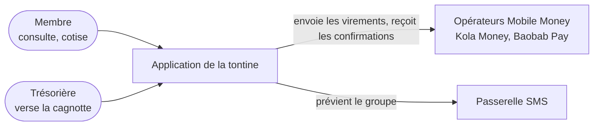
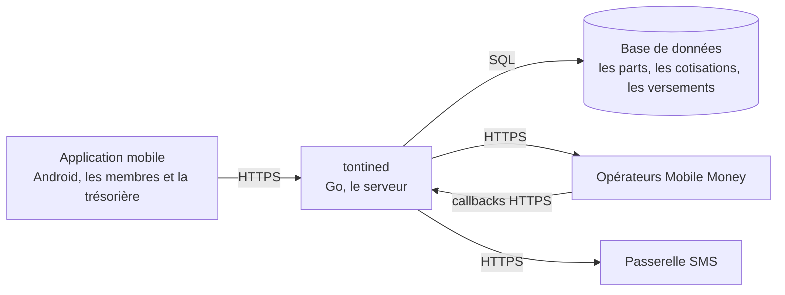
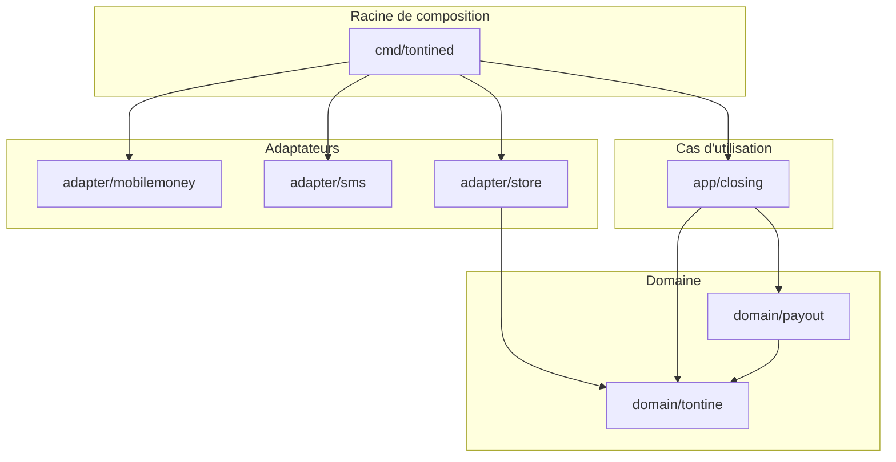

# Leçon 4.5 — Décrire une architecture : le modèle C4 et les ADR

## L'essentiel en deux minutes

**Le problème, en une phrase.** Six mois après la mise en production, un
nouveau développeur demande « de quoi c'est fait ? » et « pourquoi
c'est fait comme ça ? ». Les réponses sont dans la tête de deux
personnes, ou dans un document que personne n'a mis à jour. Il devine,
et il « simplifie » une décision dont il ne connaît pas la raison.

**Trois images.**

- **Les cartes routières** : le pays, la région, la ville, le quartier.
  Chaque carte a son niveau de détail, et l'on ne met pas les rues sur la
  carte du pays. Le **modèle C4** fait pareil pour un logiciel : le
  contexte, les conteneurs, les composants, le code.
- **Le procès-verbal de réunion** : on y note ce qui a été décidé, pourquoi,
  et par qui, et l'on ne le réécrit pas après coup. Un **ADR**
  (*Architecture Decision Record*) est le procès-verbal d'une décision
  d'architecture.
- **Le compteur électrique plombé** : la règle (« on ne touche pas au
  compteur ») est vérifiée par un scellé, pas par la bonne volonté. Une
  décision d'architecture importante se vérifie par un **test**.

**Le code, en dix lignes.** Une décision d'architecture, vérifiée à chaque
`go test` à partir des imports réels :

```go
// ADR-0002: the domain depends on no adapter, no use case, no root. The
// imports are read from the code itself, at every go test.
func TestTheDomainDependsOnNoAdapter(t *testing.T) {
    edges, err := arch.Tontine.Imports("../..")
    if err != nil {
        t.Fatal(err)
    }
    if vs := arch.Tontine.Violations(edges); len(vs) != 0 {
        t.Fatalf("ADR-0002 is broken:\n%v", vs)
    }
}
```

**Les règles à retenir.**

1. **Deux questions, deux outils** : « de quoi c'est fait ? » se répond
   par des diagrammes à plusieurs niveaux (C4) ; « pourquoi ? » par des
   décisions écrites (ADR).
2. **Un diagramme par niveau de zoom**, et pas plus de détails que son
   niveau n'en demande.
3. **Ce qui change souvent se tire du code** : le diagramme des composants
   se génère depuis les imports. Ce qui change rarement (le contexte, les
   conteneurs) se dessine à la main.
4. **Un ADR par décision**, court, numéroté, jamais réécrit : une décision
   nouvelle remplace l'ancienne, et chacune pointe vers l'autre.
5. **Une décision qui compte est vérifiée par un test**, et l'ADR nomme ce
   test. Un dossier d'ADR se contrôle comme du code.

La suite mesure tout cela sur un vrai module.

---

Les leçons précédentes ont analysé le problème : ce que la tontine doit
faire, à quel point, de quoi elle parle, comment elle se comporte. Il reste
à décrire la **solution** : de quoi l'application est faite, et pourquoi
elle est faite ainsi. Le problème qui revient est

> **Comment décrire une architecture pour qu'un nouveau venu la comprenne
> en une heure, sans que la description ne devienne fausse au premier
> changement, et comment garder la trace des raisons des choix ?**

Tout ce qui suit est mesuré sur un module vert sous `gofmt -l`,
`go vet ./...` et `go test -race -count=1 ./...`. L'application, sa
structure et ses décisions sont celles de la tontine des leçons
précédentes, simplifiées.

## 1. Le modèle C4 : quatre niveaux de zoom

Simon Brown a proposé le modèle C4 comme « *a set of hierarchical
abstractions - software systems, containers, components, and code* », avec
un diagramme par niveau :

| Niveau | Question | Pour qui | Change |
|---|---|---|---|
| 1. contexte | qui utilise le système, et avec quels autres systèmes parle-t-il ? | tout le monde, le métier compris | rarement |
| 2. conteneurs | de quels programmes et de quels stockages est-il fait ? | les développeurs, l'exploitation | parfois |
| 3. composants | de quels morceaux est fait chaque conteneur, et qui dépend de qui ? | les développeurs | souvent |
| 4. code | les types et fonctions | personne : le code se lit | tout le temps |

« Conteneur » ne veut pas dire conteneur Docker : c'est tout ce qui
**s'exécute** ou **stocke** à part (une application mobile, un serveur,
une base de données).

## 2. Le contexte



Le diagramme de contexte tient sur une demi-page, et le bureau de la
tontine le comprend. Il dit surtout **ce qui n'est pas** dans le
système : l'opérateur et la passerelle SMS sont des systèmes extérieurs,
dont la tontine dépend sans les contrôler. Chaque flèche vers l'extérieur
est un endroit où la leçon 4.2 a demandé un scénario de qualité.

## 3. Les conteneurs



Ces deux diagrammes sont dessinés **à la main**, et c'est juste : ils
changent rarement (un nouveau conteneur est un événement), et une partie
de ce qu'ils montrent n'est pas dans ce dépôt (l'application mobile, les
opérateurs). Un changement de ces diagrammes accompagne une décision, et
donc un ADR (section 6).

## 4. Les composants, tirés du code

À l'intérieur de `tontined`, les composants sont des paquets Go, rangés en
couches par une décision (l'ADR-0002, plus bas) :

```go
// Tontine is the architecture of ADR-0002 and ADR-0003.
var Tontine = Architecture{
    Module: "example/arch45",
    Layers: []Layer{
        {"Domaine", "domain/"},
        {"Cas d'utilisation", "app/"},
        {"Adaptateurs", "adapter/"},
        {"Racine de composition", "cmd/"},
    },
    Allow: map[[2]string]bool{
        {"Domaine", "Domaine"}:                         true,
        {"Cas d'utilisation", "Domaine"}:               true,
        {"Cas d'utilisation", "Cas d'utilisation"}:     true,
        {"Adaptateurs", "Domaine"}:                     true,
        {"Racine de composition", "Domaine"}:           true,
        {"Racine de composition", "Cas d'utilisation"}: true,
        {"Racine de composition", "Adaptateurs"}:       true,
    },
    Ignore: []string{"tools/"},
}
```

Ce niveau change à chaque fonctionnalité : un paquet de plus, un import de
plus. Dessiné à la main, il serait faux dans un mois. Il se **lit** donc
dans le code : on parcourt les fichiers Go, et l'on relève les imports
entre paquets du module.

```go
// Imports reads the Go files under root (tests and testdata excluded) and
// returns the imports between packages of the architecture, sorted.
func (a Architecture) Imports(root string) ([]Edge, error) {
    module := a.Module
    seen := map[Edge]bool{}
    err := filepath.WalkDir(root, func(path string, d fs.DirEntry, err error) error {
        if err != nil {
            return err
        }
        if d.IsDir() && d.Name() == "testdata" && path != root {
            return filepath.SkipDir
        }
        if d.IsDir() || !strings.HasSuffix(path, ".go") || strings.HasSuffix(path, "_test.go") {
            return nil
        }
        f, err := parser.ParseFile(token.NewFileSet(), path, nil, parser.ImportsOnly)
        if err != nil {
            return err
        }
        rel, _ := filepath.Rel(root, filepath.Dir(path))
        from := module + "/" + filepath.ToSlash(rel)
        for _, imp := range f.Imports {
            to, _ := strconv.Unquote(imp.Path.Value)
            if strings.HasPrefix(to, module+"/") && !a.ignored(from) && !a.ignored(to) {
                seen[Edge{from, to}] = true
            }
        }
        return nil
    })
    edges := make([]Edge, 0, len(seen))
    for e := range seen {
        edges = append(edges, e)
    }
    slices.SortFunc(edges, func(a, b Edge) int { return strings.Compare(a.From+" "+a.To, b.From+" "+b.To) })
    return edges, err
}
```

Le diagramme des composants, généré depuis ces imports et vérifié par un
test de référence comme à la leçon 4.4 :



L'outillage (`tools/`, qui contient ce programme) est exclu : il ne fait
pas partie du produit qu'il décrit. Sans cette exclusion, le premier essai
s'était signalé lui-même : `cmd/c4` importait `arch`, un paquet d'aucune
couche.

## 5. Mesure : le raccourci

Un soir de livraison, quelqu'un a besoin des frais de l'opérateur dans le
partage de la cagnotte, et écrit, dans `domain/payout` :

```text
import (
    "example/arch45/adapter/mobilemoney"
    "example/arch45/domain/tontine"
)

// Fee is what the operator takes: "just one call, it was quicker".
var Fee = mobilemoney.FeeOf
```

(Un extrait : la copie de `testdata` n'est que lue par le contrôle, pas
compilée.) Dans la vraie vie, l'adaptateur aurait sa fonction `FeeOf`, le
code compilerait, et les tests du partage passeraient. Le contrôle des
imports,
sur le code du dépôt puis sur la copie avec le raccourci
(`go run ./tools/c4 .`, puis `go run ./tools/c4 tools/arch/testdata/shortcut`) :

```text
8 imports between packages, 0 forbidden
9 imports between packages, 1 forbidden
   domain/payout (Domaine) imports adapter/mobilemoney (Adaptateurs)
```

Une flèche interdite, que le diagramme dessine en gras avec la mention
« interdit » (`domain_payout ==>|interdit| adapter_mobilemoney`). Le
raccourci semblait anodin ; il fait dépendre **la règle de partage** de la
tontine **du client HTTP** d'un opérateur. Le jour où l'opérateur change,
ou où l'on veut tester le partage sans réseau, il faut défaire ce
raccourci. Le test `TestTheDomainDependsOnNoAdapter` refuse la livraison,
et son message cite l'ADR que le raccourci casse.

## 6. Les ADR : le procès-verbal des décisions

Michael Nygard a proposé en 2011 le format qui s'est imposé : un ADR est
« *a short text file* », numéroté, avec un titre, un **statut**, un
**contexte** (les forces en présence), une **décision** (« *We will …* »)
et des **conséquences**. Les numéros sont « *numbered sequentially and
monotonically. Numbers will not be reused* ». Et une décision qui change
n'est pas réécrite : « *If a decision is reversed, we will keep the old one
around, but mark it as superseded* ».

Les quatre ADR de la tontine, dans `docs/adr` :

| ADR | Titre | Statut |
|---|---|---|
| 0001 | Noter les décisions d'architecture | Acceptée |
| 0002 | Le domaine ne dépend d'aucun fournisseur | Acceptée |
| 0003 | Un seul opérateur, Kola Money | Remplacée par ADR-0004 |
| 0004 | Une famille par opérateur | Acceptée, remplace ADR-0003 |

L'ADR-0002 en entier :

```text
# ADR-0002 — Le domaine ne dépend d'aucun fournisseur

- Statut : Acceptée
- Date : 2026-10-22
- Vérifiée par : TestTheDomainDependsOnNoAdapter

## Contexte

Les règles de la tontine (parts, cagnotte, partage) changent avec le
bureau, l'opérateur Mobile Money change avec les prix. Les deux ne doivent
pas changer ensemble.

## Décision

Nous rangeons les règles dans `domain/`, qui n'importe que lui-même. Les
cas d'utilisation (`app/`) déclarent les interfaces dont ils ont besoin ;
les adaptateurs (`adapter/`) les réalisent ; seule la racine de
composition (`cmd/`) connaît tout le monde.

## Conséquences

Changer d'opérateur ne touche pas `domain/`. Un développeur pressé ne
peut plus appeler l'opérateur depuis une règle : le test qui vérifie cette
décision échoue.
```

Trois choses le rendent utile :

- **Le contexte dit les forces**, pas la solution : « les règles changent
  avec le bureau, l'opérateur avec les prix ». C'est ce qu'il faut savoir
  pour juger, plus tard, si la décision tient encore.
- **Les conséquences disent aussi le coût** : un développeur pressé ne peut
  plus appeler l'opérateur depuis une règle. C'est voulu, et c'est écrit.
- **« Vérifiée par »** nomme le test qui empêche de casser la décision sans
  le savoir.

L'ADR-0003 montre la vie d'une décision : « un seul opérateur » était
juste en octobre. En février, six membres arrivent avec Baobab Pay ;
l'ADR-0004 la **remplace**. L'ancien reste, marqué « Remplacée par
ADR-0004 » : un nouveau venu qui voit encore du code « à la Kola » sait
pourquoi il existe, et que ce n'est plus la règle. Martin Fowler le
résume : « *Once an ADR is accepted, it should never be reopened or
changed - instead it should be superseded* ».

## 7. Un dossier d'ADR se contrôle

Un dossier d'ADR a ses propres erreurs : deux ADR avec le même numéro, un
« remplacée par » qui pointe vers un ADR qui n'existe pas, un remplaçant
qui ne dit pas ce qu'il remplace, un test cité qui a été renommé. Le
contrôleur lit chaque fichier :

```go
// Check reads every ADR of dir, and looks for the tests they name in the Go
// files under code. It returns the problems, sorted.
func Check(dir, code string) ([]string, error) {
    entries, err := os.ReadDir(dir)
    if err != nil {
        return nil, err
    }
    var out []string
    byNumber := map[int]ADR{}
    var numbers []int
    for _, e := range entries {
        m := fileRE.FindStringSubmatch(e.Name())
        if m == nil {
            out = append(out, fmt.Sprintf("%s: the name is not NNNN-title.md", e.Name()))
            continue
        }
        raw, err := os.ReadFile(filepath.Join(dir, e.Name()))
        if err != nil {
            return nil, err
        }
        a := ADR{File: e.Name(), Text: string(raw)}
        a.Number, _ = strconv.Atoi(m[1])
        if t := titleRE.FindStringSubmatch(a.Text); t == nil || t[1] != m[1] {
            out = append(out, fmt.Sprintf("%s: the title is not \"# ADR-%s — ...\"", a.File, m[1]))
        }
        if _, dup := byNumber[a.Number]; dup {
            out = append(out, fmt.Sprintf("%s: number %04d is used twice", a.File, a.Number))
        }
        if s := statusRE.FindStringSubmatch(a.Text); s != nil {
            a.Status = s[1]
        }
        switch {
        case a.Status == "Proposée" || a.Status == "Acceptée" || a.Status == "Abandonnée":
        case byRE.MatchString(a.Status):
            a.ReplacedBy, _ = strconv.Atoi(byRE.FindStringSubmatch(a.Status)[1])
        default:
            out = append(out, fmt.Sprintf("%s: status %q is not Proposée, Acceptée, Abandonnée or Remplacée par ADR-NNNN", a.File, a.Status))
        }
        if !dateRE.MatchString(a.Text) {
            out = append(out, fmt.Sprintf("%s: no date", a.File))
        }
        for _, section := range []string{"## Contexte", "## Décision", "## Conséquences"} {
            if !strings.Contains(a.Text, "\n"+section+"\n") {
                out = append(out, fmt.Sprintf("%s: no section %q", a.File, section))
            }
        }
        if r := replacesRE.FindStringSubmatch(a.Text); r != nil {
            a.Replaces, _ = strconv.Atoi(r[1])
        }
        if v := verifiedRE.FindStringSubmatch(a.Text); v != nil {
            a.VerifiedBy = v[1]
        }
        byNumber[a.Number] = a
        numbers = append(numbers, a.Number)
    }
    slices.Sort(numbers)
    for i, n := range slices.Compact(numbers) {
        if n != i+1 {
            out = append(out, fmt.Sprintf("ADR-%04d: the numbers are not 1, 2, 3... (ADR-%04d is missing)", n, i+1))
            break
        }
    }
    tests, err := testNames(code)
    if err != nil {
        return nil, err
    }
    for _, n := range slices.Compact(numbers) {
        a := byNumber[n]
        if a.ReplacedBy != 0 {
            b, ok := byNumber[a.ReplacedBy]
            switch {
            case !ok:
                out = append(out, fmt.Sprintf("%s: replaced by ADR-%04d, which does not exist", a.File, a.ReplacedBy))
            case b.Replaces != a.Number:
                out = append(out, fmt.Sprintf("%s: replaced by ADR-%04d, which does not say \"Remplace : ADR-%04d\"", a.File, a.ReplacedBy, a.Number))
            }
        }
        if a.Replaces != 0 {
            if b, ok := byNumber[a.Replaces]; !ok || b.ReplacedBy != a.Number {
                out = append(out, fmt.Sprintf("%s: replaces ADR-%04d, which is not marked \"Remplacée par ADR-%04d\"", a.File, a.Replaces, a.Number))
            }
        }
        if a.VerifiedBy != "" && !tests[a.VerifiedBy] {
            out = append(out, fmt.Sprintf("%s: verified by %s, which is not a test of the code", a.File, a.VerifiedBy))
        }
    }
    slices.Sort(out)
    return out, nil
}
```

Sur le dossier du projet, puis sur un dossier où cinq erreurs ont été
glissées (`go run ./tools/adr`, puis
`go run ./tools/adr tools/adrcheck/testdata/bad`) :

```text
docs/adr: 0 problems
tools/adrcheck/testdata/bad: 6 problems
   0002-le-domaine-ne-depend-de-rien.md: verified by TestTheDomainIsPure, which is not a test of the code
   0003-payer-en-especes.md: status "acceptée" is not Proposée, Acceptée, Abandonnée or Remplacée par ADR-NNNN
   0003-un-seul-operateur.md: number 0003 is used twice
   0003-un-seul-operateur.md: replaced by ADR-0005, which does not exist
   0004-familles-d-operateurs.md: no section "## Conséquences"
   0004-familles-d-operateurs.md: replaces ADR-0003, which is not marked "Remplacée par ADR-0004"
```

La plus importante est la première : « *verified by TestTheDomainIsPure,
which is not a test of the code* ». Le test a été renommé, l'ADR non.
L'ADR **affirme** une vérification qui n'existe plus. Sans contrôle, cette
phrase serait crue pendant des années.

## 8. Ce qu'on dessine, ce qu'on génère, ce qu'on écrit

| Description | Change | Comment la garder juste |
|---|---|---|
| contexte (C4, niveau 1) | rarement | dessinée à la main ; changée avec un ADR |
| conteneurs (niveau 2) | parfois | dessinée à la main ; changée avec un ADR |
| composants (niveau 3) | souvent | **générée** depuis les imports ; vérifiée par un test de référence |
| code (niveau 4) | tout le temps | pas de diagramme : le code, et les diagrammes de la leçon 4.4 aux frontières |
| décisions (ADR) | une par décision | jamais réécrites ; dossier contrôlé ; les règles importantes vérifiées par un test |

## 9. La campagne

Une erreur à la fois dans les deux outils :

```text
testdata lu                                  SURVIT
fichiers de test lus                         SURVIT
outillage compté                             tuee
tout est permis                              tuee
préfixe sans la barre                        tuee
import interdit dessiné normalement          SURVIT
numéro en double accepté                     tuee
statut en minuscules accepté                 tuee
remplaçante absente acceptée                 tuee
lien retour non vérifié                      SURVIT
test cité non vérifié                        tuee
section Conséquences facultative             tuee
numéro manquant accepté                      SURVIT
date facultative                             SURVIT
8/14 tuees
```

Six survivantes, et toutes disent la même chose : **chaque règle demande
son cas de test**. Le seul dossier `testdata` du module était sous
`tools/`, déjà ignoré : il ne pouvait pas montrer qu'un `testdata` à
l'intérieur du produit est bien sauté. Aucun dossier d'ADR n'avait de
trou dans les numéros, ni d'ADR sans date, ni de remplaçant sans lien
retour. Cinq petits dossiers de test, un par cas, et deux tests de
plus :

```go
// Added after the campaign: the replacement exists, but does not point
// back.
func TestAReplacementMustPointBack(t *testing.T) {
    got, err := adrcheck.Check("testdata/oneway", "../..")
    if err != nil {
        t.Fatal(err)
    }
    want := []string{"0001-noter-les-decisions.md: replaced by ADR-0002, which does not say \"Remplace : ADR-0001\""}
    if !slices.Equal(got, want) {
        t.Fatalf("%q", got)
    }
}
```

Rejouée :

```text
testdata lu                                  tuee
fichiers de test lus                         tuee
outillage compté                             tuee
tout est permis                              tuee
préfixe sans la barre                        tuee
import interdit dessiné normalement          tuee
numéro en double accepté                     tuee
statut en minuscules accepté                 tuee
remplaçante absente acceptée                 tuee
lien retour non vérifié                      tuee
test cité non vérifié                        tuee
section Conséquences facultative             tuee
numéro manquant accepté                      tuee
date facultative                             tuee
14/14 tuees
```

## 10. La grille

| | Architecture dans les têtes | C4 et ADR, contrôlés |
|---|---|---|
| « de quoi c'est fait ? » | demander aux deux anciens | trois diagrammes, le troisième tiré du code |
| « pourquoi ? » | demander, si quelqu'un se souvient | un ADR par décision, avec son contexte |
| le raccourci du domaine vers l'opérateur | découvert au changement d'opérateur | refusé à la livraison, avec le numéro de l'ADR |
| une décision remplacée | le vieux code reste un mystère | l'ancien ADR dit « remplacée par ADR-0004 » |
| un test renommé | l'ADR ment en silence | le contrôle du dossier le signale |

## 11. Les trois erreurs qui restent

### « Un ADR pour chaque choix »

Choisir une bibliothèque de journalisation n'est pas une décision
d'architecture : elle se change en une heure. Un ADR est pour une décision
**coûteuse à défaire**, qui touche la structure, les qualités de la leçon
4.2, ou les dépendances. Le site adr.github.io parle d'une décision qui
répond à une exigence « *architecturally significant* ». Une dizaine d'ADR
par an pour une application comme la tontine, c'est beaucoup.

### « On corrige l'ADR quand la décision change »

C'est perdre la raison de l'ancienne décision, et la date du changement.
Le code de l'époque, qui suit l'ancienne règle, devient incompréhensible.
On écrit un nouvel ADR, qui remplace l'ancien, et l'on relie les deux.

### « La documentation d'architecture, c'est un outil à part »

Un wiki, un outil de dessin, un document partagé : tout ce qui vit loin du
code dérive loin de lui. Les ADR et les diagrammes vivent **dans le
dépôt**, se relisent dans les revues de code, et les règles importantes
sont des tests. Un outil externe peut s'ajouter pour la présentation ; la
source reste à côté du code.

## 12. Le lien avec la production

- « Pourquoi n'utilise-t-on pas la base X ? Personne ne sait » : une
  décision sans ADR. Quelqu'un la défera, et retrouvera la raison à ses
  dépens.
- « Le service de paiement appelle directement la base du service de
  comptes » : une règle de dépendance sans test. Elle a tenu jusqu'au
  premier soir pressé.
- « Le schéma d'architecture de la revue de sécurité montre trois
  conteneurs ; il y en a cinq » : un diagramme de conteneurs qui n'a pas
  suivi les ADR qui en ajoutaient.

## 13. Ce qu'il faut retenir

1. C4 : un diagramme par niveau de zoom ; contexte et conteneurs à la
   main, composants tirés du code.
2. Un ADR par décision coûteuse à défaire : contexte, décision,
   conséquences, statut ; jamais réécrit, remplacé.
3. Les règles d'architecture importantes sont des tests, que l'ADR nomme.
4. Un dossier d'ADR se contrôle : numéros, statuts, liens, tests cités.
5. Tout vit dans le dépôt, et se relit avec le code.

## 14. Approfondissement

### ISO/IEC/IEEE 42010 et les vues

La norme ISO/IEC/IEEE 42010 décrit ce qu'est une description
d'architecture : des **parties prenantes**, leurs **préoccupations**, et
des **vues** qui y répondent. Les diagrammes C4 sont des vues ; les
scénarios de qualité de la leçon 4.2 sont des préoccupations. Le modèle
arc42 propose un plan de document complet sur cette base, pour les projets
qui doivent remettre une documentation formelle.

### Des diagrammes C4 comme code

Des outils écrivent les diagrammes C4 dans un langage textuel (Structurizr
DSL, C4-PlantUML, et une syntaxe C4 expérimentale de Mermaid), et
produisent les quatre niveaux à partir d'un seul modèle. Ils valent la
peine quand il y a beaucoup de systèmes et de conteneurs. Pour une
application, des diagrammes Mermaid et un test sur les imports suffisent.

### Les règles d'architecture comme tests

Le test de l'ADR-0002 est une *fitness function* de la leçon 4.2,
appliquée à la structure. On peut en écrire d'autres : « aucun paquet
n'importe `net/http` hors des adaptateurs », « pas de cycle entre
paquets », « le domaine n'utilise pas `time.Now` » (leçon 3.6). Chacune
tient en quelques lignes, et chacune remplace une phrase du wiki que
personne ne vérifiait.

## 15. Le réflexe à installer

Devant une décision qui coûterait cher à défaire :

1. Écris l'ADR **avant** le code : le contexte, la décision, ce qu'elle
   coûte.
2. Demande-toi quel test cassera si quelqu'un la défait sans le savoir, et
   écris-le ; nomme-le dans l'ADR.
3. Si la décision change un conteneur ou le contexte, mets à jour le
   diagramme dans la même revue.
4. Si elle remplace une décision ancienne, marque l'ancienne, et relie
   les deux.

## Sources

- Simon Brown, [The C4 model for visualising software architecture](https://c4model.com/),
  et [Abstractions](https://c4model.com/abstractions).
- Michael Nygard, [Documenting Architecture Decisions](https://www.cognitect.com/blog/2011/11/15/documenting-architecture-decisions),
  2011.
- Martin Fowler, [Architecture Decision Record](https://martinfowler.com/bliki/ArchitectureDecisionRecord.html).
- [Architectural Decision Records](https://adr.github.io/), le site de
  l'organisation ADR sur GitHub.
- ISO/IEC/IEEE 42010, *Software, systems and enterprise — Architecture
  description*.
- Neal Ford, Rebecca Parsons, Patrick Kua, *Building Evolutionary
  Architectures*, O'Reilly, 2017 — les *fitness functions* de structure.

---

➡️ Exercices : [4.5-exercices.md](../exercices/4.5-exercices.md)
