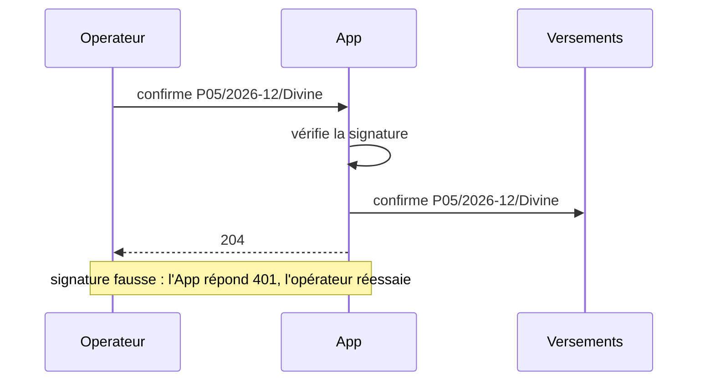

# Exercices 4.4 — Les diagrammes qui servent

Cinq exercices, du plus simple au plus ouvert. Traite-les **dans l'ordre** et
écris tes réponses dans `mes-reponses/` avant d'ouvrir les corrections.

Les exercices s'appuient sur les paquets `trace`, `payflow` et `activity`,
et sur les diagrammes de `docs/`, de la
[leçon 4.4](../cours/4.4-diagrammes.md), recopiés tels quels dans le
module des exercices. Tout le code ci-dessous compile et passe
`go vet` ; la tontine, l'opérateur et l'incident sont **fictifs**.

---

## Exercice 1 — Compréhension : le bon diagramme, et ce qu'il dit

*Niveau 1. Aucune ligne de code à écrire.*

### 1.a — Quel diagramme ?

Pour chaque question, dis quel diagramme (séquence, états, activité) y
répond le mieux, et pourquoi en une phrase :

1. « Qu'est-ce qui se passe, et dans quel ordre, quand un membre paie par
   Mobile Money ? »
2. « Un prêt peut-il être remboursé avant d'avoir été accordé ? »
3. « Quelles sont les étapes d'une réunion mensuelle, de l'appel à la
   clôture ? »
4. « Quand l'application envoie-t-elle le SMS au groupe : avant ou après la
   réponse de l'opérateur ? »
5. « Quels sont tous les cas possibles d'un départ de membre ? »
6. « Un mois clos peut-il redevenir ouvert ? »

### 1.b — Lire la séquence

Avec le diagramme généré de la section 4 de la leçon :

1. Combien de messages l'application envoie-t-elle à l'opérateur pour la
   demi-part ? Et pour une part entière ?
2. Que montre le diagramme si l'opérateur ne confirme **jamais** le
   virement d'Ebai ? Qu'est-ce que le diagramme ne peut pas montrer, par
   nature ?
3. Pourquoi « vérifie la signature » est-il une flèche de l'application
   vers elle-même ?

### 1.c — Lire l'activité

Avec le diagramme de la clôture du mois, écris le chemin (sous la forme
`d1=… d2=…`) de chacun de ces mois :

1. Tout le monde a payé le 4 ; l'opérateur accepte ; il confirme en
   2 minutes.
2. Fon paie le 12 ; l'opérateur refuse le numéro d'Ebai ; Ebai donne le
   bon ; tout est confirmé en 5 minutes.
3. Il manque Kum le 5 et le 10 ; l'opérateur accepte ; la confirmation
   d'un virement n'arrive qu'au rapprochement du lendemain.

Lequel de ces mois le diagramme ne sait-il pas représenter fidèlement, et
pourquoi ?

---

## Exercice 2 — Code : un diagramme bien formé

*Niveau 2. Écrire une fonction ; les tests sont fournis.*

Un diagramme d'activité écrit comme des données peut être **faux** : une
flèche vers une étape qui n'existe pas, une décision sans « sinon », une
étape d'où l'on ne sort jamais. Avant de dessiner, ou d'en tirer un plan
de test, on le vérifie :

```go
// Problems returns what is wrong with g, one sentence per problem, sorted:
//
//   - an edge from or to a node that does not exist;
//   - a decision with fewer than two edges out, or two edges with the same
//     guard, or an edge without a guard;
//   - a step (not a decision) with a guard on an edge out, or with other
//     than exactly one edge out (End has none);
//   - a node from which End cannot be reached;
//   - a node that cannot be reached from Start.
//
// To write: exercise 2.
func Problems(g activity.Graph) []string {
    return nil
}
```

Les tests sont dans `ex2/check/check_test.go`. Sur le squelette, six des
sept échouent. Deux d'entre eux :

```go
func TestEveryNodeLeadsToTheEnd(t *testing.T) {
    g := small()
    g.Edges[3].To = "b" // b loops on itself forever
    has(t, check.Problems(g), "b", "end")
}
```

```go
func TestEveryNodeCanBeReached(t *testing.T) {
    g := small()
    g.Nodes = append(g.Nodes, activity.Node{ID: "lost"})
    g.Edges = append(g.Edges, activity.Edge{From: "lost", To: "z"})
    has(t, check.Problems(g), "lost", "reach")
}
```

1. Écris `Problems` pour que les sept tests passent sous
   `go test -race -count=1 ./ex2/...`.
2. Le diagramme de la leçon a une boucle (`fix → send`). Ta règle « End
   est atteignable depuis chaque étape » l'accepte-t-elle ? Et une boucle
   sans sortie ?
3. Quel test de la leçon aurait dû s'appuyer sur `Problems` avant
   d'énumérer les chemins, et pourquoi ?

---

## Exercice 3 — Refactoring : le diagramme d'états du mois

*Niveau 3. Remplacer un dessin par un diagramme généré.*

Trois mois après l'esquisse de la leçon (section 5), le mois est devenu
une machine à états dans le code :

```go
var transitions = map[step]Status{
    {Open, LastShare}:     Complete,
    {Open, FifthDay}:      Late,
    {Late, LastShare}:     Complete,
    {Late, TenthDay}:      Advanced,
    {Advanced, LastShare}: Advanced, // the late share repays the fund
    {Complete, Validate}:  Paid,
    {Advanced, Validate}:  Paid,
    {Paid, Confirmed}:     Closed,
    {Paid, LastShare}:     Paid, // a share after the payout repays the fund
}
```

L'esquisse, elle, a été recopiée dans `docs/mois.mmd`, telle quelle :

```text
stateDiagram-v2
    [*] --> Ouvert : le 1er
    Ouvert --> Complet : la dernière part arrive
    Ouvert --> EnRetard : le 5, des parts manquent
    EnRetard --> Complet : la dernière part arrive
    EnRetard --> Avance : le 10, la caisse avance
    Complet --> Verse : la trésorière valide, pas avant le 5
    Avance --> Verse : la trésorière valide
    Verse --> Clos : tout est confirmé
    Clos --> [*]
```

1. Écris `Mermaid()` pour le paquet `month`, qui génère le diagramme
   depuis la table, comme à la leçon 3.5.
2. Ajoute le test de référence qui compare `docs/mois.mmd` au diagramme
   généré, avec l'option `-update`.
3. Avant de lancer `-update`, **liste les différences** entre l'esquisse
   et la table. Pour chacune, dis qui a raison, l'esquisse ou le code, et
   ce que tu fais.
4. L'esquisse dit « pas avant le 5 » sur une flèche ; la table ne peut pas
   le dire. Où cette règle doit-elle vivre, et comment le diagramme
   généré peut-il la montrer quand même ?

---

## Exercice 4 — Conception : les diagrammes du prêt

*Niveau 4. Trois diagrammes, sans code imposé.*

Reprends la caisse de prêts (leçon 4.1, exercice 4 ; leçon 4.3,
exercice 4).

1. Le **diagramme de séquence** de la demande de prêt, de la demande du
   membre à l'argent reçu, avec les deux validations du bureau.
2. Le **diagramme d'états** d'un prêt, de la demande à la clôture, avec
   les cas de retard et de départ du membre.
3. Le **diagramme d'activité** du remboursement à l'échéance, avec ses
   décisions.
4. Pour chacun : est-ce une esquisse ou un document ? S'il doit devenir un
   document, d'où sera-t-il généré, et quel test le gardera juste ?
5. Combien de réponses de décision ton diagramme d'activité a-t-il ?
   Écris le titre du test qui parcourt chacune.

---

## Exercice 5 — Incident : le runbook du 14 janvier

*Niveau 7. Un incident réel, à expliquer et à corriger.*

**Les faits.** Le 14 janvier à 18 h, l'opérateur change la clé qui signe
ses réponses ; la banque met la sienne à jour le lendemain à 9 h. Entre
les deux, 37 virements de cagnottes et d'avances sont confirmés par
l'opérateur. Le 15 au matin, les membres concernés voient encore
« versement en cours ». L'astreinte ouvre le runbook, dont le diagramme
dit :



Elle conclut : « une signature fausse donne un 401, et l'opérateur
réessaie ; on attend ses nouvelles tentatives ». Elle attend jusqu'à midi.
Rien n'arrive.

Le code de la réception, version 2.3 :

```go
// Receive answers the operator, then checks and applies the answer. The
// operator retries an answer until it gets a 204.
func (h *Handler) Receive(ctx context.Context, ref string, body []byte, sig string) int {
    h.Trace.Call("Operateur", "App", "confirme "+ref)
    h.Trace.Back("App", "Operateur", "204")
    h.wg.Go(func() {
        h.Trace.Call("App", "App", "vérifie la signature")
        if err := h.Sig.Verify(body, sig); err != nil {
            if h.Debug != nil {
                h.Debug.Printf("callback %s: %v", ref, err)
            }
            return
        }
        h.Trace.Call("App", "Versements", "confirme "+ref)
        h.Payouts.Confirm(context.Background(), ref)
    })
    return 204
}
```

La nuit, rejouée (`go run ./ex5/cmd/rotation`) :

```text
37 answers from the operator, 0 retries, 0 transfers confirmed at the bank, 37 still waiting
```

1. **Explique** pourquoi l'opérateur n'a jamais réessayé, et pourquoi
   personne n'a rien vu de la nuit.
2. **Génère** le diagramme de séquence de ce que fait le code, avec
   l'enregistreur, pour une réponse à la signature fausse. Compare-le au
   runbook.
3. Le choix de la version 2.3 (répondre tout de suite, vérifier ensuite)
   avait une raison. Laquelle ? Propose une correction qui la respecte
   **et** qui ne perd plus de réponse.
4. Écris le test de référence qui aurait fait échouer la version 2.3 au
   moment où elle changeait la séquence.
5. Que fallait-il faire, le 15 au matin, pour débloquer les 37
   versements ?
6. Écris le **compte rendu** de l'incident en cinq lignes.

---

Corrections : [exercice 1](../corrections/4.4-exercice-1.md) ·
[exercice 2](../corrections/4.4-exercice-2.md) ·
[exercice 3](../corrections/4.4-exercice-3.md) ·
[exercice 4](../corrections/4.4-exercice-4.md) ·
[exercice 5](../corrections/4.4-exercice-5.md)
